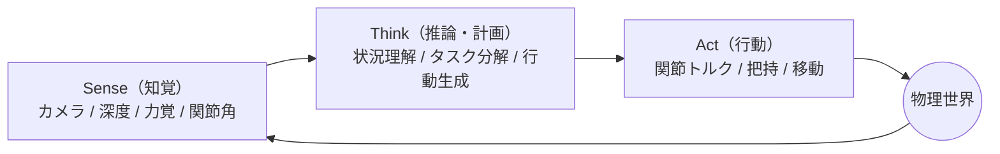
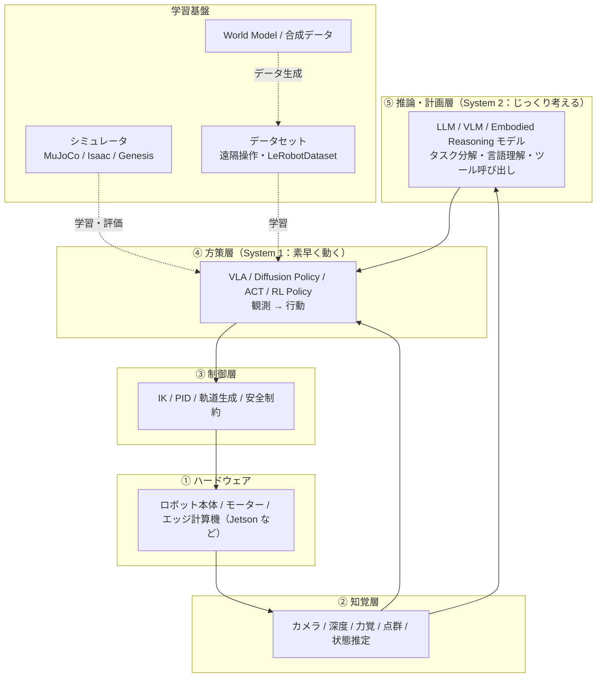
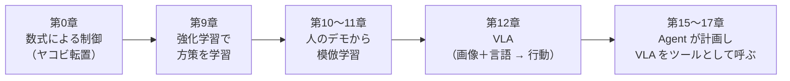

# はじめに

LLM、RAG、AI エージェントの普及で、ソフトウェアエンジニアの仕事は大きく変わりました。そして2026年、次の大きな波として急速に存在感を増しているのが **フィジカルAI（Physical AI）** です。

NVIDIA の Jensen Huang 氏は CES 2026 の発表で「ロボティクスの ChatGPT モーメントが来た」と表現しました[^nvidia-ces]。Google DeepMind は 2026年7月に全身制御まで扱う **Gemini Robotics 2** を発表しています[^gr2]。また Hugging Face の **LeRobot** を使えば、数万円のロボットアームで模倣学習まで試せるようになりました[^so101]。

本連載は、**クラウド、AI、Web・業務システムなどを開発しているソフトウェアエンジニアが、フィジカルAIを「理論＋実践」で体系的に学ぶ** ためのシリーズです。第0章では、連載全体の地図を示したうえで、次の3点を押さえます。

- フィジカルAIとは何か（生成AI・従来のロボットとの違い）
- なぜ「今」なのか、2026年時点の技術スタックと主要プレイヤー
- 最初の一歩として、MuJoCo で **Sense → Think → Act ループ** を動かす

:::note info
**想定読者**
- Python が読み書きできるソフトウェアエンジニア（クラウド、AI、Java / Web 開発など、分野は問いません）
- 機械学習や LLM アプリ開発の経験があると理解が早いですが、必須ではありません
- ロボット工学・制御工学の知識は不要です。数式は必要最小限にとどめ、記号の意味はその都度説明します
:::

:::note warn
本記事の業界動向は **2026年9月時点** の各社公式発表・報道をもとにしています。この分野の変化は非常に速いため、最新情報は参考文献のリンク先で確認してください。
:::

---

# 連載目次

| # | タイトル | 主なテーマ |
|---|---|---|
| **00** | **フィジカルAIとは何か（本記事）** | 全体像・技術スタック・環境構築 |
| **Part 1：Agent から Embodied Agent へ** | | |
| 01 | Tool Calling から Action へ | SayCan / RT-1 / RT-2 の系譜 |
| 02 | LLM でロボットを動かす | Code as Policies・階層型プランニング |
| **Part 2：ロボット工学の基礎（エンジニア版）** | | |
| 03 | 座標変換と運動学 | 同次変換・クォータニオン・順運動学 |
| 04 | 逆運動学（IK） | ヤコビアン・数値IK |
| 05 | 制御と軌道生成 | PID・軌道計画 |
| **Part 3：シミュレーション** | | |
| 06 | MuJoCo 入門 | 物体把持環境の構築 |
| 07 | Isaac Sim / Isaac Lab | GPU 並列シミュレーション |
| 08 | Genesis | 次世代 GPU ネイティブシミュレータ |
| **Part 4：ロボット学習** | | |
| 09 | 強化学習（RL） | PPO / SAC・報酬設計 |
| 10 | 模倣学習（IL） | BC / ACT / Diffusion Policy |
| 11 | LeRobot 実践 | データセット・学習・評価 |
| **Part 5：基盤モデルの時代** | | |
| 12 | Vision-Language-Action（VLA） | RT-2 / OpenVLA / π0 系 / SmolVLA / GR00T |
| 13 | World Model | Dreamer / Cosmos・「想像」で学ぶ |
| 14 | 合成データ | 動画生成 → 行動データ |
| **Part 6：Agent × フィジカルAI** | | |
| 15 | RAG for Robots | 手順書・安全規程を参照するロボット |
| 16 | マルチエージェント・ロボティクス | Planner / Executor / Safety Agent |
| 17 | MCP とロボット | Robot MCP Server の設計 |
| **Part 7：実世界へ** | | |
| 18 | Sim2Real | Domain Randomization・ギャップの正体 |
| 19 | エッジ推論と Jetson | 量子化・リアルタイム推論 |
| 20 | 実機実践 | SO-101 などの低価格アーム |

各章は原則として **「理論 → 最小実装 → まとめ」** の構成です。Part 6 では、LLM アプリや Agent 開発の知識をロボットにどう活かせるかを扱います。

---

# 1. フィジカルAIとは何か

## 1.1 一言でいうと

> **フィジカルAI ＝ センサーで世界を知覚し、推論し、身体（アクチュエータ）を通じて物理世界に働きかける AI**

あえて単純化すると、次のように整理できます。

```text
LLM          = 頭脳
AI Agent     = 頭脳 + ツール（API）
Physical AI  = 頭脳 + ツール + 身体（センサー / モーター）
```

Agent がツールを呼び出す先が、API ではなく **モーター** になったもの、と捉えると理解しやすいでしょう。ただし後述するように、「出力先が物理世界になる」というこの一点が、設計を根本から変えます。

## 1.2 基本ループ：Sense → Think → Act

フィジカルAIの本質は、次のループを **現実世界の時間の中で回し続けること** です。



LLM とのチャットは「1回の入力に1回の出力」で完結します。一方フィジカルAIでは、**行動の結果が次の観測を変える** 閉ループになります。

クラウドエンジニアであれば、Kubernetes の **Reconciliation Loop**（現在の状態を監視し、あるべき状態との差を埋める操作を繰り返す仕組み）を思い浮かべるとわかりやすいかもしれません。ロボットは、これを 1秒間に数百回という速さで、物理世界を相手に回しています。

## 1.3 用語の整理

似た言葉が多いので、本連載での使い分けを決めておきます。

| 用語 | 意味 | 位置づけ |
|---|---|---|
| ロボティクス | 機械（身体）の設計・制御を扱う工学 | 身体はあるが、動作はあらかじめ決められたものが中心 |
| 生成AI | テキスト・画像・音声などを生成する AI | 知能は高いが、出力はデジタル |
| Embodied AI | 身体を持つ AI の研究分野 | 主に学術的な概念 |
| **フィジカルAI** | 知覚 → 推論 → 計画 → 行動を実世界で統合する AI | ロボティクスと生成AIが重なる領域。産業実装寄りの呼び方 |

ロボットアームや人型ロボットだけでなく、**自動運転車、ドローン、AMR（自律移動ロボット）、工場設備** もフィジカルAIの対象です。

---

# 2. 生成AIとの本質的な違い ― 5つの壁

「LLM がこれだけ賢いなら、ロボットもすぐに動かせるのでは？」と思うかもしれません。しかし、物理世界には生成AIにはない壁があります。

| 観点 | 生成AI（LLM） | フィジカルAI |
|---|---|---|
| ① 可逆性 | やり直せる（再生成すればよい） | **不可逆**。落としたコップは元に戻らない |
| ② 時間制約 | 数秒の応答でも許容される | 制御は **数十〜数百 Hz**（1秒間に数十〜数百回）で判断し続ける必要がある |
| ③ 出力空間 | 離散的なトークン（語彙の中から1つ選ぶ） | **連続値**（関節の角度や速度を実数で指定する） |
| ④ データ | Web 上に大量のテキストがある | ロボットの行動データは **少なく、収集コストが高い** |
| ⑤ 身体の差 | モデルはどの環境でも同じように動く | ロボットごとに関節の数や形状が違う（**Embodiment Gap**） |

さらに **安全性** の重みが別格です。LLM のハルシネーションは誤情報で済む場合もありますが、ロボットの誤判断は **物理的な事故** に直結します。

## 2.1 数式で見る違い

LLM は、それまでのトークン列から次のトークンを予測します。

$$
p_\theta(x_{t+1} \mid x_{1}, \dots, x_{t})
$$

一方、ロボットの **方策（Policy）**、つまり「状況に応じてどう動くかを決める関数」は、観測と言語指示から **行動** を出力します。近年の主流は、1ステップ分ではなく **未来 $H$ ステップ分の行動をまとめて出力する（Action Chunking）** 方式です。

$$
\pi_\theta(a_{t}, a_{t+1}, \dots, a_{t+H-1} \mid o_t, \ell)
$$

- $\pi_\theta$：パラメータ $\theta$（ニューラルネットワークの重み）を持つ方策
- $o_t$：時刻 $t$ の観測（カメラ画像、関節角など）
- $\ell$：「赤いコップを取って」のような言語指示
- $a_t, \dots, a_{t+H-1}$：これから $H$ ステップ分の行動（関節角の目標値など）

この $\pi_\theta$ を大規模なデータで事前学習したものが、第12章で扱う **VLA（Vision-Language-Action）モデル** です。「GPT は次のトークンを予測し、VLA は次の一連の行動を予測する」と覚えておけば十分です。

---

# 3. なぜ「今」なのか

ロボット研究には数十年の歴史がありますが、2024〜2026年に注目度が一気に高まりました。背景には、技術と産業の両面の変化があります。

## 3.1 技術的なブレイクスルー

| 要因 | 内容 | 解説する章 |
|---|---|---|
| **VLA モデル** | Web 規模のデータで学習した VLM（画像と言語を扱うモデル）の知識を、ロボットの行動生成に転用できるようになった（RT-2 以降） | 12 |
| **拡散モデル / Flow Matching による行動生成** | 「右から掴んでも左から掴んでもよい」のように **正解が複数ある動作** を、安定して学習できるようになった | 10, 12 |
| **World Model** | 未来の映像や状態を予測する「世界のモデル」を作り、学習や評価に使えるようになった | 13 |
| **GPU シミュレーション** | 数千の環境を並列に動かし、仮想空間で大量の試行錯誤ができるようになった | 07, 08 |
| **オープンソース化と低価格ハード** | LeRobot や SO-101 などで、個人でもデータ収集から学習まで一通り試せるようになった | 11, 20 |
| **エッジ推論** | Jetson などを使い、ロボット本体の上で大型モデルを動かせるようになった | 19 |

## 3.2 産業側のニーズ

- **人手不足**：少子高齢化により、製造・物流・建設・介護の担い手が不足している
- **危険作業の代替**：災害現場、高所、有害環境など、人が入りにくい場所での作業
- **多品種少量生産**：ティーチング（ロボットに動作を1つずつ教え込む作業）では変化に追いつかない

従来の産業用ロボットは、**決められた動作を正確に繰り返す** ことは得意ですが、未知の物体や環境の変化への対応は苦手でした。フィジカルAIは、センシングと学習によって **状況に合わせて柔軟に動く** ことを目指します。

---

# 4. フィジカルAIの技術スタック全体像

フィジカルAIは単一のモデルではなく、**多層のシステム** です。本連載で学ぶ内容をこの地図に当てはめると、次のようになります。



ポイントは **「遅い頭脳」と「速い身体制御」の分離** です。人間も、「今日の献立を考える」ようなゆっくりした思考（System 2）と、「熱いものに触れて瞬時に手を引っ込める」ような速い反応（System 1）を使い分けています。

NVIDIA の GR00T は、ゆっくり考える VLM 側（System 2）と、高頻度で動作を生成する側（System 1）を組み合わせた構成です[^groot-jp]。Google DeepMind も、推論を担う **Gemini Robotics ER 2** と、行動を生成する VLA の **Gemini Robotics 2** を組み合わせています[^gr2]。

:::note info
**ソフトウェアエンジニアが注目すべき点**
Gemini Robotics ER 2 では、VLA やナビゲーション API などの低レベル制御を **「ツール」として宣言し、推論モデルがそれを呼び出す** 構成が紹介されています[^er2]。つまり、LLM アプリ開発でおなじみの **Function Calling 型の Agent アーキテクチャが、そのままロボットの上位層になりつつある** ということです。第1・2章と Part 6 でこの構造を掘り下げます。
:::

---

# 5. 主要プレイヤーと2026年の動向

2026年9月時点の主な動きを整理します（いずれも各社の発表ベースです。性能に関する主張は各社自身の評価である点に注意してください）。

| プレイヤー | 主なモデル / ツール | 2026年の主な動き |
|---|---|---|
| **NVIDIA** | Cosmos（World Model）、Isaac GR00T（人型ロボット向け VLA）、Isaac Sim / Lab、Jetson | CES 2026 で Cosmos Transfer / Predict 2.5、Cosmos Reason 2、GR00T N1.6、評価基盤 Isaac Lab-Arena、Jetson T4000 を発表し、LeRobot との統合も発表[^nvidia-ces]。その後、推論・世界生成・行動生成を1つにまとめた「オムニモデル」**Cosmos 3** を公開[^cosmos] |
| **Google DeepMind** | Gemini Robotics 2 / ER 2 / On-Device 2 | 2026年7月に発表。人型ロボットの全身制御、器用な操作、複数ロボットの協調を打ち出した。ER 2 は Gemini API から利用できる[^gr2][^er2] |
| **Physical Intelligence** | π0 / π0.5 / FAST トークナイザ | 汎用ロボット基盤モデルの代表格。行動系列を離散コサイン変換（DCT）で圧縮してトークン化する FAST などを提案。2026年には後継モデルも発表している[^odsc] |
| **Hugging Face** | LeRobot、SmolVLA、SO-101 | オープンソースのロボット学習ライブラリ。低価格アーム SO-101 と組み合わせると、データ収集から模倣学習・推論まで一通り体験できる[^so101] |
| **ヒューマノイド各社** | Tesla、Figure、Unitree、Apptronik、Boston Dynamics など | 工場などでの実証導入が進んでいる。Gemini Robotics 2 のデモでは Apptronik の Apollo 2 が使われた[^gr2-news] |

全体として、2026年は **「オープンモデル＋シミュレーション＋合成データ＋エッジ推論」をまとめて提供するプラットフォーム競争** の段階に入っています。LLM の世界で起きた「基盤モデル → ファインチューニング → エコシステム」という流れが、ロボティクスでも再現されつつあると言えます。

---

# 6. ソフトウェアエンジニアのための対応表

ソフトウェア開発や AI 開発でなじみのある概念を、フィジカルAIの概念に対応づけておきます。今後の章を読むときの「辞書」として使ってください。

| なじみのある概念 | フィジカルAIでの対応 | 解説する章 |
|---|---|---|
| トークン | 行動トークン（離散化した関節角、FAST など） | 12 |
| 次トークン予測 | 行動予測 / Action Chunking | 10, 12 |
| 事前学習 + ファインチューニング | ロボット基盤モデル + 自分のロボットでの追加学習 | 11, 12 |
| API / Function Calling | スキル（Pick、Place、Move）、VLA をツールとして呼び出す | 01, 02, 17 |
| Agent のプランニング | タスク分解・階層型制御（System 2 → System 1） | 02, 16 |
| RAG | 手順書・安全規程・設備マニュアルの参照 | 15 |
| テスト環境 / ステージング | シミュレーション（本番＝実機の前に仮想環境で検証） | 06〜08, 18 |
| 評価データセット / LLM-as-a-Judge | シミュレーション評価・World Model による評価・実機評価 | 13, 18 |
| 合成データ | シミュレーションデータ・生成動画 | 14 |
| ガードレール / サーキットブレーカー | 安全制約・緊急停止・フェイルセーフ | 05, 16 |
| ハルシネーション / 本番障害 | 誤った把持や衝突などの **物理事故** | 全体 |

---

# 7. 実践：Sense → Think → Act を MuJoCo で動かす

理論はここまでにして、手を動かしましょう。第0章のゴールは、**環境構築** と、フィジカルAIの最小単位である **制御ループを自分で書いて動かすこと** です。

## 7.1 シミュレータの選び方

本連載では次の3つのシミュレータを使います。実機がなくても、これらのソフトウェア上で物理法則に従うロボットを動かし、学習させることができます。

| シミュレータ | 特徴 | 必要環境 | 本連載での役割 |
|---|---|---|---|
| **MuJoCo** | Google DeepMind が保守する、軽量で高精度な物理エンジン。研究で広く使われている | CPU のみで動作。Windows / macOS / Linux | **メイン**（第3〜6章、第10〜12章） |
| **Genesis** | GPU ネイティブで高速な新しいシミュレータ | GPU があると高速 | 第8章 |
| **Isaac Sim / Isaac Lab** | NVIDIA の写実的なシミュレータ。大規模な並列強化学習の定番 | **RT コアを持つ RTX GPU が必須**（公式の最小要件は RTX 4080 / VRAM 16GB） | 第7章（クラウド GPU で実施） |

## 7.2 GPU についての注意（GTX 10xx 世代を使う場合）

GTX 1080 など **Pascal 世代の GPU** を使う場合は、次の2点に注意してください。

1. **Isaac Sim は動きません。** RT コアを持たない GPU はサポート対象外です[^isaac-req]。第7章はクラウド GPU（Azure / AWS / GCP の RTX 系インスタンスなど）で実施します。
2. **PyTorch はビルドを選ぶ必要があります。** PyTorch 2.8 以降の CUDA 12.8 ビルドでは Maxwell / Pascal 世代のサポートが外れ、CUDA 13 系でも Pascal はサポートされません[^pytorch-pascal]。GTX 1080 を使う場合は **CUDA 12.6 ビルド** を選び、インストール後に次のコマンドで確認してください。

```bash
pip install torch torchvision --index-url https://download.pytorch.org/whl/cu126
python -c "import torch; print(torch.cuda.is_available(), torch.cuda.get_arch_list())"
# get_arch_list() に sm_60 が含まれていれば GTX 10xx で動作します
```

:::note info
第6章までは **CPU だけ** で実行できます。GPU がなくても、まずは MuJoCo で基礎を固めましょう。VLA の学習（第11〜12章）では、ローカル GPU か Google Colab / クラウド GPU を使います。
:::

## 7.3 環境構築

Python 3.10 以上を想定しています。パッケージ管理には `uv` をおすすめしますが、`pip` でも問題ありません。

```bash
# uv を使う場合
uv init physical-ai-study && cd physical-ai-study
uv add mujoco numpy

# pip を使う場合
python -m venv .venv
# Windows: .venv\Scripts\activate / macOS・Linux: source .venv/bin/activate
pip install mujoco numpy
```

インストールできたか確認します。

```bash
python -c "import mujoco; print(mujoco.__version__)"
```

## 7.4 2関節アームで Sense → Think → Act

2つの関節を持つ平面アームを作り、**手先を緑色のターゲット位置まで動かします**。コードは `sense()` / `think()` / `act()` の3つの関数に分けてあり、1.2節のループをそのまま実装しています。

```python:sense_think_act.py
"""第0章: Sense → Think → Act ループの最小実装（MuJoCo）"""
import mujoco
import numpy as np

# ---- 1. 世界（ロボット＋環境）を MJCF で定義 ----
MJCF = """
<mujoco model="two_link_arm">
  <option timestep="0.002" gravity="0 0 0"/>
  <worldbody>
    <light pos="0 0 3"/>
    <geom type="plane" size="1 1 0.1" rgba="0.9 0.9 0.9 1"/>
    <body name="link1" pos="0 0 0.05">
      <joint name="shoulder" type="hinge" axis="0 0 1" damping="0.5"/>
      <geom type="capsule" fromto="0 0 0 0.3 0 0" size="0.02" rgba="0.2 0.4 0.8 1"/>
      <body name="link2" pos="0.3 0 0">
        <joint name="elbow" type="hinge" axis="0 0 1" damping="0.5"/>
        <geom type="capsule" fromto="0 0 0 0.25 0 0" size="0.02" rgba="0.8 0.4 0.2 1"/>
        <site name="hand" pos="0.25 0 0" size="0.02"/>
      </body>
    </body>
    <site name="target" pos="0.2 0.35 0.05" size="0.025" rgba="0 1 0 0.6"/>
  </worldbody>
  <actuator>
    <motor joint="shoulder" gear="1" ctrlrange="-5 5"/>
    <motor joint="elbow"    gear="1" ctrlrange="-5 5"/>
  </actuator>
</mujoco>
"""

model = mujoco.MjModel.from_xml_string(MJCF)
data = mujoco.MjData(model)
hand_id = mujoco.mj_name2id(model, mujoco.mjtObj.mjOBJ_SITE, "hand")
target_id = mujoco.mj_name2id(model, mujoco.mjtObj.mjOBJ_SITE, "target")

# 初期姿勢：腕が一直線（特異姿勢）だとヤコビ転置法ではうまく動かせないため、肘を少し曲げておく
data.qpos[:] = [0.0, 0.8]
mujoco.mj_forward(model, data)   # 位置・ヤコビアンなどを計算して状態を確定


def sense(model, data):
    """知覚: センサー値（ここではシミュレータの真値）を観測として取り出す"""
    return {
        "qpos": data.qpos.copy(),          # 関節角度 [rad]
        "qvel": data.qvel.copy(),          # 関節角速度 [rad/s]
        "hand": data.site_xpos[hand_id].copy(),
        "target": data.site_xpos[target_id].copy(),
    }


def think(model, data, obs, kp=300.0, kd=1.0):
    """判断: 手先を目標へ近づけるトルクを計算（ヤコビ転置法）"""
    error = obs["target"] - obs["hand"]            # 手先位置の誤差（ワールド座標）
    jacp = np.zeros((3, model.nv))
    mujoco.mj_jacSite(model, data, jacp, None, hand_id)  # 手先の並進ヤコビアン
    tau = kp * jacp.T @ error - kd * obs["qvel"]   # τ = Kp・Jᵀ・e − Kd・q̇
    return tau


def act(model, data, tau):
    """行動: アクチュエータに指令を送り、物理を1ステップ進める"""
    data.ctrl[:] = np.clip(tau, -5, 5)
    mujoco.mj_step(model, data)


if __name__ == "__main__":
    # ---- 2. 制御ループ ----
    for step in range(1500):                      # 0.002s × 1500 = 3秒
        obs = sense(model, data)
        tau = think(model, data, obs)
        act(model, data, tau)
        if step % 100 == 0 and step <= 600:
            dist = np.linalg.norm(obs["target"] - obs["hand"])
            print(f"t={data.time:4.2f}s  手先={obs['hand'][:2].round(3)}  目標までの距離={dist:.4f} m")

    final = np.linalg.norm(data.site_xpos[target_id] - data.site_xpos[hand_id])
    print(f"最終誤差: {final * 1000:.1f} mm")
```

制御ループを `if __name__ == "__main__":` の中に置いているのは、7.6 節のビューア版から `sense()` / `think()` / `act()` とモデルを `import` して再利用できるようにするためです（`import` しただけでは、制御ループは実行されません）。

実行結果（MuJoCo 3.x で確認）：

```text
t=0.00s  手先=[0.474 0.179]  目標までの距離=0.3230 m
t=0.20s  手先=[0.178 0.368]  目標までの距離=0.0289 m
t=0.40s  手先=[0.199 0.353]  目標までの距離=0.0032 m
t=0.60s  手先=[0.2   0.351]  目標までの距離=0.0008 m
t=0.80s  手先=[0.2  0.35]  目標までの距離=0.0002 m
t=1.00s  手先=[0.2  0.35]  目標までの距離=0.0001 m
t=1.20s  手先=[0.2  0.35]  目標までの距離=0.0000 m
最終誤差: 0.0 mm
```

約0.5秒で、手先が目標位置 (0.2, 0.35) に収束しています。

## 7.5 コードの解説

### ① 世界の定義（MJCF）

MuJoCo では、ロボットと環境を **MJCF** という XML 形式で記述します。HTML でページの構造を書くのと同じ感覚です。`body` が剛体（1つのかたまりとして動く部品）、`joint` が関節、`geom` が見た目と当たり判定の形状、`site` が座標を取得するための目印、`actuator` がモーターに対応します。書き方の詳細は第6章で扱うので、ここでは「XML でロボットの形と関節の構造を定義している」と理解できれば十分です。

### ② Think：ヤコビ転置法

`think()` では、次の式でトルク（関節を回す力）$\tau$ を計算しています。

$$
\tau = K_p \, J(q)^\top \left( x^{*} - x \right) - K_d \, \dot{q}
$$

- $\tau$：各関節に加えるトルクのベクトル
- $x^{*} - x$：目標位置と現在の手先位置の差（どちらへ、どれだけ動けばよいか）
- $q$：関節角度のベクトル（このロボットなら [肩の角度, 肘の角度]）。$\dot{q}$ はその角速度
- $J(q)$：**ヤコビアン**。関節を少し動かしたとき、手先がどちらへどれだけ動くかを表す行列（第4章で詳しく扱います）
- $K_p, K_d$：ゲイン（どのくらい強く補正するかを決める係数）

$J^\top$（ヤコビアンの転置）を掛けることで、「手先を目標へ引っ張る力」を「各関節が出すべきトルク」に変換しています。$-K_d \dot{q}$ は、動きすぎや振動を抑えるためのブレーキ（ダンピング項）です。

直感的には、**手先を目に見えないバネで目標へ引っ張っている** イメージです。バネの強さが $K_p$、動きにブレーキをかける粘性抵抗が $K_d$ に対応します。制御工学では、このように「誤差に比例する力」と「速度に比例するブレーキ」を組み合わせる方式を **PD制御** と呼びます（第5章で扱います）。

### ③ 特異姿勢の罠

コード中の `data.qpos[:] = [0.0, 0.8]` を削除し、腕がまっすぐ伸びた状態から始めてみてください。**手先が目標に届かず、途中で止まってしまいます。** 腕が一直線になると、ヤコビアン $J$ が特定の方向への動きを表現できなくなるためです。この状態を **特異姿勢** と呼びます。人間の腕も、肘を伸ばしきった状態からは、手先をそれ以上遠くへは動かせません。これと似た状況です。

「数式としては正しいのに、特定の姿勢では物理的に動けなくなる」という問題は、ロボティクス特有の難しさです。第4章の逆運動学（IK）で詳しく扱います。

### ④ この実装と「フィジカルAI」の関係

今回の `think()` は、人間が数式で書いた **ルールベースの制御器** です。本連載のゴールは、この `think()` の部分を段階的に置き換えていくことです。



`sense()` と `act()` の形は最後まで変わりません。**「Think をどう作るか」の進化こそが、フィジカルAIの歴史そのもの** だと言えます。

## 7.6 ビューアで動きを見る（任意）

ローカル PC であれば、MuJoCo のビューアで動きを確認できます。`sense_think_act.py` と同じディレクトリに `viewer_demo.py` を作り、次のコードを実行してください。`sense_think_act.py` のモデルと `sense()` / `think()` / `act()` をそのまま再利用し、制御ループだけをビューア付きに置き換えています。

```python:viewer_demo.py
"""第0章 7.6節: ビューアで Sense → Think → Act の動きを見る

ローカルPC専用（画面表示のない環境では実行できません）。
macOS では `python` の代わりに `mjpython` コマンドで実行してください。
"""
import time

import mujoco.viewer

from sense_think_act import act, data, model, sense, think

with mujoco.viewer.launch_passive(model, data) as viewer:
    while viewer.is_running() and data.time < 5.0:
        obs = sense(model, data)
        act(model, data, think(model, data, obs))
        viewer.sync()
        time.sleep(model.opt.timestep)   # 実時間に合わせる
```

:::note warn
macOS では `python` の代わりに `mjpython` コマンドで実行する必要があります。Google Colab など画面表示のない環境ではビューアを使えないため、第6章で画面を表示せずに描画する方法（オフスクリーンレンダリング）を紹介します。
:::

## 7.7 演習

1. `target` の `pos` を変えて、アームが届く範囲と届かない範囲を確かめてみましょう（アームの長さは 0.3 + 0.25 = 0.55 m です）。
2. `kp` と `kd` を変えると、収束の速さや振動はどう変わるでしょうか。第5章の PID 制御につながる体験です。
3. ループの途中（例：`step == 750`）でターゲットの位置を変え、アームが追従するか確かめてみましょう。ヒント：`model.site_pos[target_id] = [...]` で位置を変えたあと、`mujoco.mj_forward(model, data)` を呼びます。

---

# 8. まとめ

- **フィジカルAI** は、知覚 → 推論 → 行動のループを物理世界で回す AI。Agent の出力先が「身体」になったものと捉えると理解しやすい
- 生成AIとの違いは **不可逆性・リアルタイム性・連続的な行動空間・データ不足・Embodiment Gap**、そして **安全性**
- 2026年は、VLA・World Model・GPU シミュレーション・低価格ハードがそろい、**基盤モデルを中心としたプラットフォーム競争** の段階に入っている
- 最新のアーキテクチャは「推論する上位層」と「行動を生成する下位層」に分かれ、上位層は **Function Calling 型の Agent に近づいている**。ここにソフトウェアエンジニアの知識が活きる
- 実践では MuJoCo で **Sense → Think → Act** を実装した。今後の連載は、この `think()` を学習ベースの方策へ置き換えていく旅になる

## 次回予告

**第1章「Tool Calling から Action へ」** では、LLM Agent とロボットの接点を扱います。SayCan、RT-1、RT-2 の流れを追いながら、「LLM がロボットのスキルを呼び出す」最小構成の Agent を実装します。

---

# 参考文献

[^nvidia-ces]: NVIDIA Newsroom, "NVIDIA Releases New Physical AI Models as Global Partners Unveil Next-Generation Robots", 2026-01-05. https://nvidianews.nvidia.com/news/nvidia-releases-new-physical-ai-models-as-global-partners-unveil-next-generation-robots
[^cosmos]: NVIDIA, "Physical AI with World Foundation Models | NVIDIA Cosmos". https://www.nvidia.com/en-us/ai/cosmos/
[^groot-jp]: NVIDIA et al., "GR00T N1: An Open Foundation Model for Generalist Humanoid Robots", arXiv:2503.14734, 2025. https://arxiv.org/abs/2503.14734
[^gr2]: Google DeepMind, "Gemini Robotics 2 brings whole body intelligence to robots", 2026-07-30. https://deepmind.google/blog/gemini-robotics-2-brings-whole-body-intelligence-to-robots/
[^er2]: Google, "Introducing Gemini Robotics ER 2", 2026-07-30. https://blog.google/innovation-and-ai/models-and-research/google-deepmind/gemini-robotics-er-2/
[^gr2-news]: RobotToday, "Google DeepMind Unveils Gemini Robotics 2 AI Model for Humanoid Robots", 2026-07-31. https://robottoday.com/industry-briefing/google-deepmind-unveils-gemini-robotics-2-ai-model-for-humanoid-robots/9890
[^odsc]: ODSC, "Physical AI in 2026: What Robotics Foundation Models Actually Mean for Engineers", 2026-08-07. https://opendatascience.com/physical-ai-in-2026-what-robotics-foundation-models-actually-mean-for-engineers/
[^so101]: Hugging Face, "SO-101 – LeRobot Documentation". https://huggingface.co/docs/lerobot/so101
[^isaac-req]: NVIDIA, "Isaac Sim Requirements". https://docs.isaacsim.omniverse.nvidia.com/latest/installation/requirements.html
[^pytorch-pascal]: PyTorch Developer Mailing List, "CUDA toolkit version and architecture support update: Maxwell and Pascal architecture support removed in CUDA 12.8 and 12.9 builds", 2025-07. https://dev-discuss.pytorch.org/t/cuda-toolkit-version-and-architecture-support-update-maxwell-and-pascal-architecture-support-removed-in-cuda-12-8-and-12-9-builds/3128
