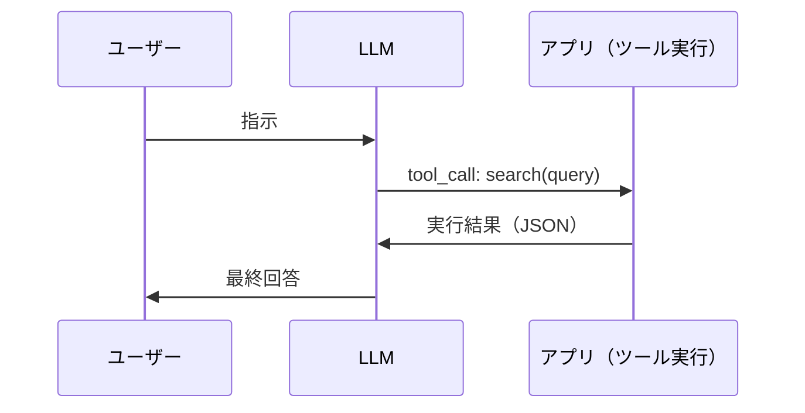
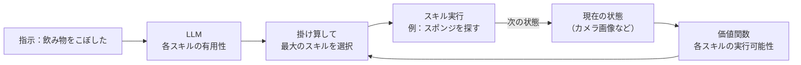
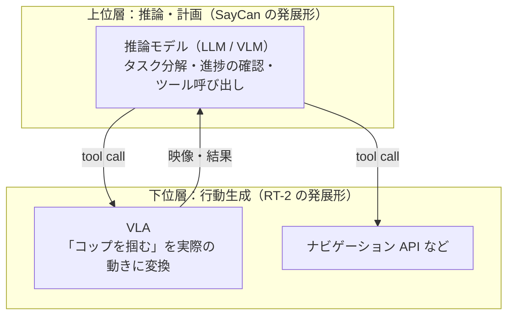
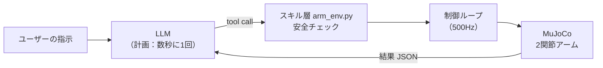

# はじめに

[第0章](./00_フィジカルAIとは何か.md)では、フィジカルAIを「Agent の出力先が API ではなく身体になったもの」と捉えました。第1章では、この捉え方を具体的に掘り下げます。

LLM アプリの開発でおなじみの **Function Calling（Tool Calling）** は、LLM が「どの関数を、どの引数で呼ぶか」を決め、アプリ側がそれを実行する仕組みです。では、呼び出す関数が `send_email()` ではなく `move_arm()` だったら、何が変わるのでしょうか。

本章のゴールは次の3つです。

- LLM をロボットにつなぐときの根本課題 **「グラウンディング（Grounding）」** を理解する
- その解決策の系譜である **SayCan → RT-1 → RT-2** を押さえる
- **LLM の Function Calling でシミュレーション上のロボットアームを動かす Agent** を実装する

:::note info
**前提**
- 第0章の MuJoCo 環境（`mujoco`, `numpy`）が入っていること
- 実践パートでは OpenAI API または Azure OpenAI の API キーを使います。キーがなくても、ロボット側（スキル層）の動作確認はできます
:::

---

# 1. Agent のループとロボットのループ

## 1.1 おなじみの Tool Calling ループ

LLM Agent の基本構造は次のとおりです。



ツールの実体は API やデータベースであり、実行結果はほぼ **決定的** です。同じクエリで検索すれば、ほぼ同じ結果が返ってきます。

## 1.2 ツールの呼び出し先が「物理世界」になると

ツールの呼び出し先がロボットになると、同じループでも性質が大きく変わります。

| 観点 | 一般的なツール（API） | ロボットのスキル |
|---|---|---|
| 実行結果 | 決定的。成功か失敗かが明確 | **確率的**。同じ指令でも、物体の位置や摩擦で結果が変わる |
| 実行時間 | ミリ秒〜秒 | 秒〜分。実行中も状況が変わる |
| 失敗の影響 | リトライすればよい | 物を落とす・倒すなど **やり直せない** ことがある |
| 前提条件 | API 仕様で決まる | **現在の状態** に依存する（届く位置か、手が空いているか） |

特に重要なのが最後の行です。「コップを取って」というツール呼び出しは、**コップがロボットの届く位置にあるときにしか意味がありません**。LLM は、この「今、この身体で、何ができるか」を知りません。

## 1.3 時間スケールの階層

もう1つの違いは **時間** です。第0章の制御ループは 500Hz（2ms ごと）で回っていました。一方、LLM の応答には通常、数百ミリ秒から数秒かかります。

```text
LLM（計画）        : 数秒に1回        「赤いコップに手を伸ばす」
学習した方策       : 数Hz〜数十Hz     「次はこの方向に少し動かす」
低レベル制御       : 数百Hz〜         「各モーターにこのトルクを出す」
```

LLM が直接モーターを動かすのは、速度の面で現実的ではありません。そのため、**LLM は「何をするか」を決め、「どう動くか」は下位の層に任せる** という階層構造が基本になります。本章の実装も、この構造に従います。

---

# 2. グラウンディング問題

## 2.1 LLM は「身体」を知らない

SayCan の論文では、この問題を次の例で説明しています[^saycan]。

「飲み物をこぼしちゃった。手伝ってくれる？」と LLM に尋ねると、「掃除機を使ってみては？」や「こぼしてしまってごめんなさい」のような答えが返ってくることがあります。どちらも文章としては自然ですが、**掃除機を持たず、それを扱うスキルもないロボットにとっては、実行できない答え** です。

このように、言語モデルの知識を **特定の身体・特定の環境で実行可能な行動** に結びつけることを **グラウンディング（Grounding）** と呼びます。

## 2.2 LLM アプリ開発の言葉でいうと

RAG に慣れた方なら、次のように対応づけると理解しやすいでしょう。

| RAG | ロボット |
|---|---|
| LLM は社内文書の内容を知らない | LLM はロボットの能力や周囲の状況を知らない |
| 検索結果をコンテキストに入れて回答を根拠づける | 現在の状態と実行可能性を入れて行動を根拠づける |
| 根拠のない回答 ＝ ハルシネーション | 実行できない計画 ＝ 行動のハルシネーション |

以降で紹介する3つの研究は、このグラウンディング問題への異なるアプローチです。

---

# 3. SayCan：LLM の知識 × ロボットの実行可能性

## 3.1 アイデア

**SayCan**（2022年、Google）は、「LLM が言うこと（Say）」と「ロボットができること（Can）」を掛け合わせる、というシンプルな発想に基づく手法です[^saycan]。

ロボットは「スポンジを取る」「流しに行く」のような **学習済みスキル** をあらかじめ持っています。指示を受けると、各スキルを次の2つの観点で採点します。

1. **Say（有用性）**：LLM から見て、そのスキルが指示の達成に役立つか
2. **Can（実行可能性）**：現在の状態から、そのスキルが成功しそうか

$$
\text{score}(s) = \underbrace{p_{\text{LLM}}(s \mid i)}_{\text{Say：役に立つか}} \times \underbrace{p(\text{成功} \mid \text{状態}, s)}_{\text{Can：できるか}}
$$

- $s$：スキル（例：「スポンジを取る」）
- $i$：ユーザーの指示（例：「飲み物をこぼした」）
- 前半：LLM が評価した「そのスキルが次の一手として適切な確率」
- 後半：強化学習で学習した **価値関数** が評価した「今の状態でそのスキルが成功する確率」。この実行可能性を **アフォーダンス（Affordance）** と呼びます

スコアが最大のスキルを実行し、その結果を踏まえて次のスキルを選ぶ、という処理を繰り返します。論文の言葉を借りれば、**ロボットが LLM の「手と目」になり、LLM がタスクの高レベルな知識を提供する** 関係です。



## 3.2 結果

SayCan は、キッチン環境で動く移動マニピュレータ（アーム付きの移動ロボット）で評価されました。

- 551 個のスキル（7種類のスキル × 17種類の物体）を使用[^saycan-data]
- 101 個の指示で評価。LLM に PaLM を使った場合、**正しいスキル列を選べた割合が 84%、実際に実行して成功した割合が 74%**[^saycan]
- より性能の高い LLM に替えると、ロボットの成功率も上がることが示された[^saycan]

最後の点は重要です。**LLM の進化が、そのままロボットの性能向上につながる** ことを示した、先駆的な例と言えます。

## 3.3 限界

一方で、SayCan には次のような制約があります。

- ロボットにできるのは、**事前に用意したスキルの組み合わせだけ**
- スキルごとに価値関数を学習する必要がある
- 「どう動くか」は各スキルの中に閉じており、LLM の知識は動作そのものには活かされない

「スキル自体を、もっと汎用的に学習できないか」。この問いから生まれたのが RT-1 です。

---

# 4. RT-1：行動を「トークン」として出力する Transformer

## 4.1 アイデア

**RT-1（Robotics Transformer 1）**（2022年、Google）は、カメラ画像と言語指示を入力として、**行動を直接出力する** Transformer モデルです[^rt1-blog]。スキルを個別に作るのではなく、1つのモデルで多くのタスクをこなすことを目指しました。

最大のポイントは、**連続値の行動を離散的なトークンとして扱った** ことです。

## 4.2 行動のトークン化

ロボットの行動（アームの移動量、グリッパーの開閉など）は、本来は連続値です。RT-1 は、各次元の値の範囲を **256 段階（ビン）に分割** し、どのビンに入るかを予測するという分類問題に置き換えました[^rt1-deep]。

$$
\text{token} = \text{round}\left( \frac{a - a_{\min}}{a_{\max} - a_{\min}} \times 255 \right)
$$

- $a$：ある次元の行動の値（例：手先の x 方向の移動量）
- $a_{\min}, a_{\max}$：その次元が取りうる最小値・最大値

たとえば値の範囲が −1〜1 なら、0.0 はトークン 128 前後、1.0 はトークン 255 になります。こうすると、**LLM と同じように「次のトークンを分類で予測する」問題として学習できます**。

RT-1 では、アームの7次元、移動台車の3次元、モード切り替えの1次元の計11次元を、それぞれ256ビンで出力します。モデルは約3,500万パラメータと小さく、**3Hz** で動作するように設計されています[^rt1-deep]。

## 4.3 データの規模

RT-1 のもう1つの特徴はデータです。

- **13台のロボット** で **17か月** かけて収集
- **約13万エピソード**、**700以上のタスク**[^rt1-blog]

その結果、学習時に見たことのない物体・環境・タスクの組み合わせに対しても、従来手法より高い汎化性能を示しました[^rt1-blog]。論文の分析では、**データの量よりもタスクの多様性のほうが汎化に寄与する** ことも報告されています[^rt1-deep]。

## 4.4 限界

RT-1 はロボットデータだけで学習しているため、**ロボットデータに出てこない概念は理解できません**。たとえば「絶滅した動物を取って」と言われても、恐竜のおもちゃを選ぶための知識がありません。

一方、Web 上の膨大な画像とテキストで学習した VLM（Vision-Language Model）は、恐竜が絶滅した動物であることを知っています。この2つを組み合わせたのが RT-2 です。

---

# 5. RT-2：VLM がそのまま行動を「話す」

## 5.1 アイデア

**RT-2**（2023年、Google DeepMind）は、Web 規模のデータで事前学習した VLM を、**ロボットの行動もテキストとして出力できるようにファインチューニング** したモデルです[^rt2]。

仕組みは驚くほどシンプルです。RT-1 と同じように行動を 256 ビンに離散化し、その番号を **数字の文字列** として VLM に出力させます[^rt2-blog]。

```text
入力：画像 + 「Q: What action should the robot take to pick up the bottle? A:」
出力：「1 128 91 241 5 101 127」   ← これが行動（各数字が1次元分のビン番号）
```

VLM にとって、これは「画像を見て質問に答える」のと同じ **テキスト生成タスク** です。そのため、モデルのアーキテクチャを変えずにロボットを制御できます。

学習時には、ロボットの行動データと、Web の画像質問応答（VQA）データを **混ぜて** 学習します（co-fine-tuning）。ロボットデータだけで学習すると、VLM が持っていた一般知識を忘れてしまうためです[^rt2]。ベースモデルには、PaLI-X（55B）と PaLM-E（12B）が使われました[^rt2-jp]。

## 5.2 何ができるようになったか

約6,000回の評価試行を通じて、RT-2 は次のような **創発的な能力** を示しました[^rt2]。

- **未知の物体への汎化**：ロボットデータにない物体も扱える
- **記号の理解**：「物体を数字の3の上に置いて」のように、ロボットデータにない指示を解釈できる
- **簡単な推論**：「一番小さい物を取って」「絶滅した動物を取って」
- **Chain-of-Thought**：「即席のハンマーとして使えるものは？」→ 石を選ぶ、「疲れている人に合う飲み物は？」→ エナジードリンクを選ぶ[^rt2]

つまり、**Web から学んだ知識が、ロボットの行動に直接転移した** のです。RT-2 の論文はこの種のモデルを **VLA（Vision-Language-Action）モデル** と名付けており、これが現在の VLA 研究の出発点になりました。VLA は第12章で詳しく扱います。

---

# 6. 3つのアプローチの整理と、現在の主流

| | SayCan | RT-1 | RT-2 |
|---|---|---|---|
| 年 | 2022 | 2022 | 2023 |
| LLM / VLM の役割 | スキルを **選ぶ** | 使わない（専用モデル） | 行動を **直接出力する** |
| 行動の生成 | 事前に用意したスキル | Transformer が行動トークンを出力 | VLM が行動トークンをテキストとして出力 |
| グラウンディングの方法 | 価値関数（実行可能性）を掛け合わせる | ロボットデータで学習 | ロボットデータ + Web データで同時に学習 |
| 強み | LLM の知識で長い手順を計画できる | 多数のタスクを1つのモデルで実行 | Web の知識を行動に活かせる |
| 弱み | スキルの範囲外のことはできない | ロボットデータにない概念は扱えない | 巨大で推論が遅く、長い手順の計画は苦手 |

では、2026年の最先端はどれに近いのでしょうか。答えは **「SayCan 型の階層構造 ＋ RT-2 型の VLA」の組み合わせ** です。

第0章で紹介したように、Google DeepMind の **Gemini Robotics ER 2** は、VLA やナビゲーション API を **ツールとして宣言** し、推論モデルがそれを呼び出して多段階のタスクをこなす構成を採っています[^er2]。



**上位層は、私たちが普段作っている Function Calling 型の Agent そのもの** です。次の実践では、この上位層を最小構成で作ってみます。

---

# 7. 実践：Function Calling でロボットアームを動かす

## 7.1 作るもの

第0章の2関節アームの周囲に、3つの物体（赤いカップ、青い箱、緑のボール）を置きます。ユーザーが「赤いカップ、青い箱、緑のボールの順に触って」と自然言語で指示すると、LLM が次の3つのツールを組み合わせてタスクを実行します。

| ツール | 役割 | 対応する概念 |
|---|---|---|
| `get_scene()` | 物体と手先の位置を取得する | Sense（観測） |
| `check_affordance(x, y)` | その位置に手が届くかを 0〜1 のスコアで返す | SayCan の Can（実行可能性） |
| `move_hand_to(x, y)` | 手先を指定位置へ動かす | Act（スキル実行） |

ただし、緑のボールはあえてアームの届く範囲の外に置いてあります。**LLM が「できないこと」をどう扱うか** も確認します。



## 7.2 環境構築

```bash
# uv の場合
uv add mujoco numpy openai python-dotenv
# pip の場合
pip install mujoco numpy openai python-dotenv
```

`python-dotenv` は、7.5 節で説明する `.env` ファイルから接続設定を読み込むために使います。

## 7.3 スキル層：`arm_env.py`

ロボット側のコードです。LLM からは、ここで定義した3つのメソッドだけが見えます。

```python:arm_env.py
"""第1章: LLM から呼び出す「ロボットのスキル」層（MuJoCo 2関節アーム）"""
import json
import mujoco
import numpy as np

MJCF = """
<mujoco model="tabletop_arm">
  <option timestep="0.002" gravity="0 0 0"/>
  <worldbody>
    <light pos="0 0 3"/>
    <geom type="plane" size="1 1 0.1" rgba="0.9 0.9 0.9 1"/>
    <body name="link1" pos="0 0 0.05">
      <joint name="shoulder" type="hinge" axis="0 0 1" damping="0.5"/>
      <geom type="capsule" fromto="0 0 0 0.3 0 0" size="0.02" rgba="0.2 0.4 0.8 1"/>
      <body name="link2" pos="0.3 0 0">
        <joint name="elbow" type="hinge" axis="0 0 1" damping="0.5"/>
        <geom type="capsule" fromto="0 0 0 0.25 0 0" size="0.02" rgba="0.8 0.4 0.2 1"/>
        <site name="hand" pos="0.25 0 0" size="0.02"/>
      </body>
    </body>
    <!-- 机の上の物体（見た目だけの目印。衝突判定なし） -->
    <site name="red_cup"    pos="0.20  0.35 0.05" size="0.03" rgba="1 0 0 1"/>
    <site name="blue_box"   pos="0.35 -0.20 0.05" size="0.03" type="box" rgba="0 0 1 1"/>
    <site name="green_ball" pos="0.60  0.30 0.05" size="0.03" rgba="0 1 0 1"/>
  </worldbody>
  <actuator>
    <motor joint="shoulder" gear="1" ctrlrange="-5 5"/>
    <motor joint="elbow"    gear="1" ctrlrange="-5 5"/>
  </actuator>
</mujoco>
"""

OBJECTS = ["red_cup", "blue_box", "green_ball"]
LINK1, LINK2 = 0.30, 0.25
R_MAX, R_MIN = LINK1 + LINK2, abs(LINK1 - LINK2)   # 届く範囲: 0.05 m 〜 0.55 m


class ArmEnv:
    def __init__(self):
        self.model = mujoco.MjModel.from_xml_string(MJCF)
        self.data = mujoco.MjData(self.model)
        self.hand_id = mujoco.mj_name2id(self.model, mujoco.mjtObj.mjOBJ_SITE, "hand")
        self.data.qpos[:] = [0.0, 0.8]          # 特異姿勢を避けた初期姿勢（第0章参照）
        mujoco.mj_forward(self.model, self.data)

    # ---------- 内部ユーティリティ ----------
    def _site_xy(self, name):
        sid = mujoco.mj_name2id(self.model, mujoco.mjtObj.mjOBJ_SITE, name)
        return self.data.site_xpos[sid][:2].copy()

    def _hand_xy(self):
        return self.data.site_xpos[self.hand_id][:2].copy()

    @staticmethod
    def _affordance(x, y):
        """実行可能性スコア（0〜1）。SayCan の価値関数を、幾何計算で簡易的に置き換えたもの"""
        r = float(np.hypot(x, y))
        outer = np.clip((R_MAX - r) / 0.05, 0.0, 1.0)   # 外側の限界に近いほど低い
        inner = np.clip((r - R_MIN) / 0.05, 0.0, 1.0)   # 根元に近すぎても低い
        return round(float(min(outer, inner)), 2), r

    # ---------- LLM に公開するスキル（ツール） ----------
    def get_scene(self):
        """シーン内の物体と手先の位置を返す"""
        return {
            "hand": [round(float(v), 3) for v in self._hand_xy()],
            "objects": {n: [round(float(v), 3) for v in self._site_xy(n)] for n in OBJECTS},
            "unit": "meter",
        }

    def check_affordance(self, x, y):
        """指定座標に手先を動かせるかを評価する"""
        score, r = self._affordance(x, y)
        return {"x": float(x), "y": float(y), "distance_from_base": round(r, 3), "affordance": score,
                "feasible": score >= 0.5}

    def move_hand_to(self, x, y, timeout=3.0):
        """手先を (x, y) へ動かす。内部で 500Hz の制御ループを回す"""
        # 安全層：LLM の出力をそのままモーターに送らず、必ず実行可能性を検証する
        check = self.check_affordance(x, y)
        if not check["feasible"]:
            return {"success": False,
                    "reason": f"到達不可能（基部からの距離 {check['distance_from_base']} m、"
                              f"届く範囲は {R_MIN:.2f}〜{R_MAX:.2f} m）"}

        m, d = self.model, self.data
        target = np.array([x, y])
        jacp = np.zeros((3, m.nv))
        t0, steps = d.time, 0
        while d.time - t0 < timeout:
            err = target - self._hand_xy()
            mujoco.mj_jacSite(m, d, jacp, None, self.hand_id)
            tau = 300.0 * jacp[:2].T @ err - 1.0 * d.qvel      # 第0章のヤコビ転置法
            d.ctrl[:] = np.clip(tau, -5, 5)
            mujoco.mj_step(m, d)
            steps += 1
            if np.linalg.norm(err) < 0.002 and np.linalg.norm(d.qvel) < 0.05:
                break
        final_err = float(np.linalg.norm(target - self._hand_xy()))
        return {"success": final_err < 0.005,
                "final_error_mm": round(final_err * 1000, 1),
                "sim_time_s": round(d.time - t0, 3),
                "control_steps": steps}

    # ---------- ツール呼び出しのディスパッチ ----------
    def call(self, name, args):
        fn = {"get_scene": self.get_scene,
              "check_affordance": self.check_affordance,
              "move_hand_to": self.move_hand_to}.get(name)
        if fn is None:
            return {"error": f"unknown tool: {name}"}
        try:
            return fn(**args)
        except TypeError as e:              # 引数の間違いも LLM に返して自己修正させる
            return {"error": str(e)}


if __name__ == "__main__":
    # LLM を使わずにスキル層だけを確認する（固定の計画を実行）
    env = ArmEnv()
    print("scene:", json.dumps(env.get_scene(), ensure_ascii=False))
    for name in OBJECTS:
        x, y = env.get_scene()["objects"][name]
        print(f"\n[{name}] check_affordance ->", env.check_affordance(x, y))
        print(f"[{name}] move_hand_to      ->", json.dumps(env.move_hand_to(x, y), ensure_ascii=False))
```

ポイントは次の3点です。

- **`check_affordance`**：SayCan では強化学習で学習した価値関数が実行可能性を評価しますが、ここでは「基部からの距離が届く範囲に入っているか」という幾何計算で代用しています。届く範囲の境界付近ではスコアを下げ、確実に届く位置ほど 1.0 に近づけています
- **`move_hand_to` 内の安全チェック**：LLM が `check_affordance` を呼ばずに直接移動を指示しても、**スキル層で必ず実行可能性を検証** します。LLM の出力をそのままモーターに送らないことが、ロボット Agent 設計の大原則です
- **内部の制御ループ**：1回のツール呼び出しの中で、第0章のヤコビ転置法による 500Hz の制御ループを、目標に到達するまで回します。LLM から見れば1回の関数呼び出しですが、その中では数百ステップの制御が行われています

まずは LLM を使わずに、スキル層だけを動かして確認します。

```bash
python arm_env.py
```

実行結果：

```text
scene: {"hand": [0.474, 0.179], "objects": {"red_cup": [0.2, 0.35], "blue_box": [0.35, -0.2], "green_ball": [0.6, 0.3]}, "unit": "meter"}

[red_cup] check_affordance -> {'x': 0.2, 'y': 0.35, 'distance_from_base': 0.403, 'affordance': 1.0, 'feasible': True}
[red_cup] move_hand_to      -> {"success": true, "final_error_mm": 1.2, "sim_time_s": 0.52, "control_steps": 260}

[blue_box] check_affordance -> {'x': 0.35, 'y': -0.2, 'distance_from_base': 0.403, 'affordance': 1.0, 'feasible': True}
[blue_box] move_hand_to      -> {"success": true, "final_error_mm": 1.4, "sim_time_s": 0.944, "control_steps": 472}

[green_ball] check_affordance -> {'x': 0.6, 'y': 0.3, 'distance_from_base': 0.671, 'affordance': 0.0, 'feasible': False}
[green_ball] move_hand_to      -> {"success": false, "reason": "到達不可能（基部からの距離 0.671 m、届く範囲は 0.05〜0.55 m）"}
```

赤いカップへの移動では、1回のツール呼び出しの中で **260 ステップ**（シミュレーション時間で 0.52 秒）の制御が行われています。緑のボールは基部から 0.671 m の位置にあり、アームの長さ 0.55 m を超えているため、スキル層が実行を拒否しています。

## 7.4 LLM Agent：`llm_agent.py`

次に、LLM がこれらのスキルを呼び出す Agent を作ります。構造は、一般的な Function Calling の Agent ループとまったく同じです。

```python:llm_agent.py
"""第1章: LLM の Function Calling でロボットのスキルを呼び出す Agent"""
import json
import os
import sys
import time

from dotenv import load_dotenv
from openai import OpenAI

from arm_env import ArmEnv

load_dotenv()   # このディレクトリの .env から OPENAI_API_KEY / OPENAI_BASE_URL / LLM_MODEL を読み込む

# ---- ツール定義（LLM に見せる「ロボットにできること」のカタログ） ----
TOOLS = [
    {"type": "function", "function": {
        "name": "get_scene",
        "description": "机の上の物体と、ロボットの手先の現在位置（x, y [m]）を取得する。",
        "parameters": {"type": "object", "properties": {}}}},
    {"type": "function", "function": {
        "name": "check_affordance",
        "description": "座標 (x, y) に手先を動かせるかを評価する。affordance は 0〜1 の実行可能性スコア。",
        "parameters": {"type": "object", "properties": {
            "x": {"type": "number"}, "y": {"type": "number"}},
            "required": ["x", "y"]}}},
    {"type": "function", "function": {
        "name": "move_hand_to",
        "description": "手先を座標 (x, y) [m] へ移動する。物体に「触れる」ときはその物体の座標を指定する。",
        "parameters": {"type": "object", "properties": {
            "x": {"type": "number"}, "y": {"type": "number"}},
            "required": ["x", "y"]}}},
]

SYSTEM_PROMPT = """あなたは机の上で作業する2関節ロボットアームの制御エージェントです。
- 物体の位置は推測せず、必ず get_scene で確認してください。
- 動かす前に check_affordance で実行可能性を確認し、実行できない指示は理由を説明してください。
- 作業が終わったら、何を実行し、何ができなかったかを日本語で簡潔に報告してください。"""


def run_agent(instruction: str, max_turns: int = 10):
    # OPENAI_API_KEY / OPENAI_BASE_URL は環境変数から自動で読み込まれる
    client = OpenAI()
    model = os.environ["LLM_MODEL"]           # OpenAI: モデル名 / Azure OpenAI: デプロイ名
    env = ArmEnv()

    messages = [{"role": "system", "content": SYSTEM_PROMPT},
                {"role": "user", "content": instruction}]

    for turn in range(max_turns):
        t0 = time.perf_counter()
        res = client.chat.completions.create(model=model, messages=messages, tools=TOOLS)
        llm_sec = time.perf_counter() - t0
        msg = res.choices[0].message
        messages.append(msg)

        if not msg.tool_calls:                     # ツール呼び出しがなければ最終回答
            print(f"\n[Agent] {msg.content}")
            return msg.content

        for tc in msg.tool_calls:                  # LLM が選んだスキルを実行（Act）
            args = json.loads(tc.function.arguments or "{}")
            result = env.call(tc.function.name, args)
            print(f"[turn {turn}] (LLM {llm_sec:.1f}s) {tc.function.name}({args}) -> "
                  f"{json.dumps(result, ensure_ascii=False)}")
            messages.append({"role": "tool", "tool_call_id": tc.id,
                             "content": json.dumps(result, ensure_ascii=False)})  # 結果を観測として返す（Sense）
    print("[Agent] 最大ターン数に達しました")


if __name__ == "__main__":
    text = sys.argv[1] if len(sys.argv) > 1 else "赤いカップ、青い箱、緑のボールの順に触ってください。"
    run_agent(text)
```

コードの対応関係を整理すると、第0章の Sense → Think → Act が、ここでは次のように置き換わっています。

| 第0章 | 第1章 |
|---|---|
| `sense()`：関節角や手先位置を読む | ツールの実行結果（`get_scene()` など）を `role: tool` のメッセージとして LLM に返す |
| `think()`：数式でトルクを計算 | **LLM** が次に呼ぶツールと引数を決める |
| `act()`：トルクを出力 | `move_hand_to()` がスキルを実行する（内部では第0章の制御が動く） |

## 7.5 LLM の接続設定

`OpenAI()` クライアントは、環境変数 `OPENAI_API_KEY` と `OPENAI_BASE_URL` を自動で読み込みます。Azure OpenAI も **v1 API** を使えば、同じ `OpenAI()` クライアントで呼び出せます[^aoai-v1]。

| 環境変数 | OpenAI | Azure OpenAI（v1 API） |
|---|---|---|
| `OPENAI_API_KEY` | OpenAI の API キー | Azure OpenAI リソースの API キー |
| `OPENAI_BASE_URL` | 設定不要 | `https://<リソース名>.openai.azure.com/openai/v1/` |
| `LLM_MODEL` | モデル名 | **デプロイ名** |

`LLM_MODEL` には、Function Calling に対応したモデル（または、そのモデルのデプロイ名）を指定してください。

これらの値は、シェルで環境変数を設定する代わりに、スクリプトと同じディレクトリに置いた **`.env` ファイル** に書いておきます。`llm_agent.py` は起動時に `load_dotenv()` で `.env` を読み込み、環境変数として設定します。OS やシェルによって書き方が違う `export`（bash）や `$env:`（PowerShell）を使い分ける必要がありません。

```env
# .env
OPENAI_API_KEY=...
LLM_MODEL=<モデル名 または デプロイ名>
# Azure OpenAI を使う場合だけ、次の行を追加する
OPENAI_BASE_URL=https://<リソース名>.openai.azure.com/openai/v1/
```

:::note warn
**OpenAI を使う場合、`OPENAI_BASE_URL` は「書かない」** でください。`OPENAI_BASE_URL=` のように値を空にして書くと、空の文字列が設定されたものとして扱われ、接続に失敗します。使わない行は、削除するか、先頭に `#` を付けてコメントアウトします。
:::

:::note warn
API キーをコードに直接書いたり、Git にコミットしたりしないでください。`.env` は `.gitignore` に追加して、Git の管理対象から外します。本番運用では、Azure の場合は Microsoft Entra ID によるキーレス認証を推奨します。
:::

## 7.6 実行

```bash
python llm_agent.py "赤いカップ、青い箱、緑のボールの順に触ってください。"
```

LLM の応答は実行のたびに変わりますが、システムプロンプトどおりに動いた場合、おおむね次の流れになります。

1. `get_scene()` で3つの物体の座標を取得する
2. 各物体について `check_affordance()` を呼び、赤いカップと青い箱は `feasible: true`、緑のボールは `feasible: false` であることを確認する
3. `move_hand_to()` で赤いカップ、青い箱の順に移動する
4. 最後に「赤いカップと青い箱には触れたが、緑のボールはアームの届く範囲外にあるため触れられなかった」と報告する

ログには、各ツール呼び出しを決めるまでにかかった LLM の応答時間（`LLM 1.2s` のような表示）も出力されます。**LLM の1回の判断に秒単位の時間がかかる一方で、その間にスキル層では数百ステップの制御が完了している** ことを確認してみてください。これが 1.3 節で説明した時間スケールの階層です。

:::note info
LLM が `check_affordance` を呼ばずに、いきなり緑のボールへ `move_hand_to` を呼ぶこともあります。その場合でも、スキル層の安全チェックが `success: false` と理由を返すため、ロボットが無理な動きをすることはありません。LLM はその結果を観測として受け取り、最終報告に反映します。
:::

## 7.7 設計のポイント：Web API の Agent との違い

この小さな実装にも、ロボット Agent 設計の重要な原則が詰まっています。

**① 安全はプロンプトではなく、コードで守る**
システムプロンプトの「動かす前に確認して」は、あくまでお願いです。LLM が従わなくても事故が起きないように、`move_hand_to` の中で実行可能性を必ず検証しています。Web API で入力値をサーバー側で検証するのと同じ考え方ですが、ロボットでは **検証漏れが物理的な事故につながる** ため、重要度がはるかに高くなります。

**② 数値をそのまま信用しない**
今回は LLM に座標 `(x, y)` を直接指定させています。LLM は数値の扱いが苦手で、座標を書き写す際にわずかに誤る可能性があります。対策としては、`touch(object_name="red_cup")` のように **物体名で指定するスキルにする** ことが考えられます。ツールの粒度（抽象度）をどう設計するかは、次章のテーマです。

**③ 実行結果を「観測」として必ず返す**
`move_hand_to` は成功・失敗だけでなく、最終誤差や失敗理由も返します。LLM はそれを見て次の行動を決めます。これは、SayCan の後継研究（Inner Monologue など）で提案された、実行結果を LLM にフィードバックして計画を修正させる考え方につながります。

**④ 時間スケールを分離する**
LLM は「どこへ行くか」だけを決め、「どう動くか」は 500Hz の制御ループに任せています。LLM に毎ステップのトルクを決めさせる設計は、速度・コスト・安全性のいずれの面でも成り立ちません。

## 7.8 演習

1. `OBJECTS` と MJCF に新しい物体（例：`yellow_block`）を追加し、「一番遠くにある、届く物体に触って」のような **推論が必要な指示** を試してみましょう。
2. `touch(object_name)` というツールを追加し、座標ではなく物体名で指定できるようにしてみましょう。LLM の振る舞いはどう変わるでしょうか。
3. システムプロンプトから「`check_affordance` で確認して」という一文を消して、LLM の振る舞いを比較してみましょう。スキル層の安全チェックが働くことを確認してください。
4. `move_hand_to` に、ランダムな失敗（例：10% の確率で `success: false`）を加えてみましょう。LLM はリトライするでしょうか。現実のロボットでは、このような確率的な失敗が日常的に起こります。

---

# 8. まとめ

- ツールの呼び出し先がロボットになると、実行結果が **確率的** になり、**やり直しがきかず**、**現在の状態に依存** するようになる
- LLM の知識を「この身体・この環境で実行できる行動」に結びつけることを **グラウンディング** と呼ぶ
- **SayCan** は LLM の有用性評価と価値関数による実行可能性を掛け合わせ、**RT-1** は行動をトークン化して1つの Transformer で多数のタスクをこなし、**RT-2** は VLM に行動をテキストとして出力させて Web の知識を行動に転移させた
- 2026年の主流は、**推論モデルが VLA をツールとして呼び出す階層構造** であり、その上位層は Function Calling 型の Agent に近い
- 実践では、LLM がスキルを呼び出す Agent を作り、**安全チェックをスキル層に置く**、**結果を観測として返す**、**時間スケールを分ける** という設計原則を確認した

## 次回予告

**第2章「LLM でロボットを動かす」** では、ツールの粒度をさらに掘り下げます。LLM に関数を選ばせるのではなく、**ロボットを動かすコードそのものを生成させる Code as Policies** や、長いタスクを分解して実行する **階層型プランニング** を実装します。

---

# 参考文献

[^saycan]: M. Ahn et al., "Do As I Can, Not As I Say: Grounding Language in Robotic Affordances", CoRL 2022. arXiv:2204.01691. プロジェクトページ: https://say-can.github.io/
[^saycan-data]: Potato, "SayCan: Grounding Language in Robotic Affordances"（論文の評価設定の要約）. https://www.potatoannotator.com/showcase/saycan-robot-planning
[^rt1-blog]: Google Research Blog, "RT-1: Robotics Transformer for real-world control at scale", 2022-12-13. https://research.google/blog/rt-1-robotics-transformer-for-real-world-control-at-scale/
[^rt1-deep]: A. Brohan et al., "RT-1: Robotics Transformer for Real-World Control at Scale", RSS 2023. arXiv:2212.06817. https://arxiv.org/abs/2212.06817 （行動次元・パラメータ数などの詳細は論文解説 https://kendrick-stein.github.io/MCISLAB_DeepRead/Papers/2212-RT1 も参照）
[^rt2]: A. Brohan et al., "RT-2: Vision-Language-Action Models Transfer Web Knowledge to Robotic Control", 2023. arXiv:2307.15818. https://arxiv.org/abs/2307.15818
[^rt2-blog]: Google DeepMind, "RT-2: New model translates vision and language into action", 2023-07-28. https://deepmind.google/blog/rt-2-new-model-translates-vision-and-language-into-action/
[^rt2-jp]: 0h-n0 TechBLog, 「論文解説: RT-2 ─ Web知識をロボット制御に転移するVision-Language-Actionモデル」, 2026-04-29. https://0h-n0.github.io/posts/paper-2307-15818/
[^er2]: Google, "Introducing Gemini Robotics ER 2", 2026-07-30. https://blog.google/innovation-and-ai/models-and-research/google-deepmind/gemini-robotics-er-2/
[^aoai-v1]: Microsoft Learn, 「Microsoft Foundry Models v1 API での Azure OpenAI」. https://learn.microsoft.com/ja-jp/azure/foundry/openai/api-version-lifecycle
