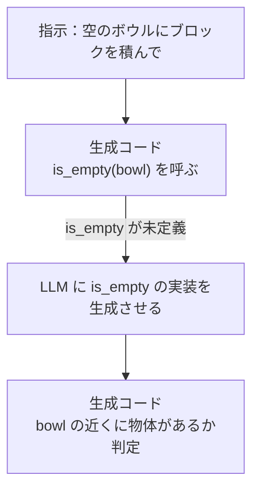
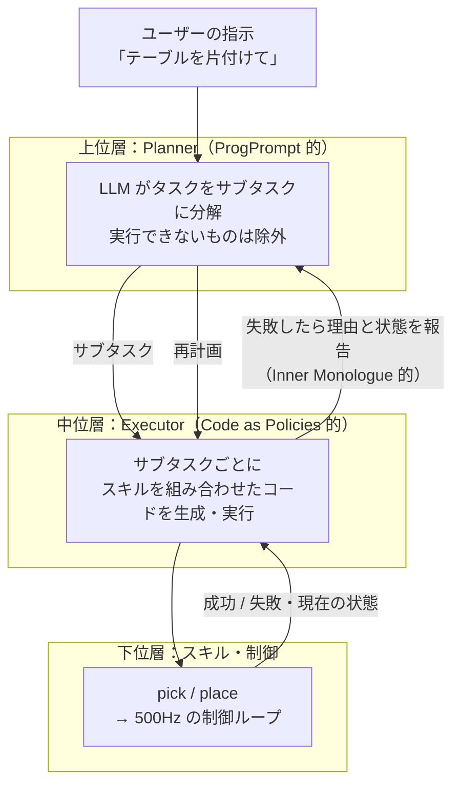
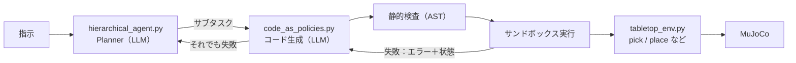

# はじめに

[第1章](./01_ToolCallingからActionへ.md)では、LLM が Function Calling でロボットのスキルを1つずつ呼び出す Agent を作りました。シンプルで安全な構成ですが、タスクが少し複雑になると限界が見えてきます。

- 「届くブロックを**全部**トレイに入れて」→ 物体の数だけ LLM との往復が発生する
- 「赤いブロックの**10cm 右**に置いて」→ 座標の計算を LLM の「暗算」に任せることになる
- 「テーブルを片付けて」→ 何をどの順番でやるかという**計画**と、個々の**動作**が混在する

第2章では、この3つの課題に対する代表的なアプローチを学びます。

- **Code as Policies**：LLM にツールを選ばせるのではなく、**ロボットを動かすコードそのもの**を書かせる
- **ProgPrompt / Inner Monologue**：計画をプログラムとして表現し、**実行結果をフィードバック**して計画を修正する
- **階層型プランニング**：「計画する LLM」と「実行する層」を分け、失敗したら再計画する

実践では、ブロックを掴んで置ける卓上環境を作り、**LLM が生成したコードを安全に実行する仕組み**と、**失敗から再計画する階層型 Agent** を実装します。

:::note info
**前提**
- 第0・1章の環境（`mujoco`, `numpy`, `openai`, `python-dotenv`）
- LLM の接続設定は第1章の 7.5 節と同じです（OpenAI / Azure OpenAI のどちらでも動きます）。実行するディレクトリに `.env` ファイルを置いて設定します
- API キーがなくても、LLM 以外の部分（実行基盤・安全検査）は動作確認できます
:::

---

# 1. ツールの粒度という設計問題

ロボットを LLM で動かすとき、最初に決めなければならないのが **「LLM にどの粒度で指示を出させるか」** です。

| 粒度 | LLM が出力するもの | 例 | 問題点 |
|---|---|---|---|
| ① モーター指令 | 各関節のトルク | `torque=[1.2, -0.4]` | 数百 Hz での判断が必要。LLM では遅すぎる |
| ② 座標 | 手先の目標位置 | `move_hand_to(0.2, 0.35)` | 座標計算を LLM に任せることになる（第1章） |
| ③ スキル | 意味のある動作単位 | `pick("red_block")` | 繰り返しや条件分岐のたびに LLM との往復が必要 |
| ④ プログラム | スキルを組み合わせたコード | `for` 文で全ブロックを処理 | **生成コードの安全な実行が必要** |
| ⑤ 計画 | 自然言語のサブタスク列 | 「赤を掴んでトレイへ」→「緑を…」 | 各サブタスクを実行する仕組みが別途必要 |

第1章は ②〜③ の粒度でした。本章では ④ と ⑤ を扱います。

ソフトウェアエンジニアにとっては、次のように対応づけるとわかりやすいでしょう。

- **③ Function Calling**：REST API を1回ずつ叩くクライアント
- **④ Code as Policies**：API を呼び出すスクリプトを書いて、まとめて実行する（ChatGPT の Code Interpreter に近い）
- **⑤ 階層型プランニング**：ワークフローエンジンがジョブを順に実行し、失敗したらリトライや再スケジュールを行う

---

# 2. Code as Policies：LLM に「方策のコード」を書かせる

## 2.1 アイデア

**Code as Policies**（2022年、Google）は、コード生成に強い LLM を使って、自然言語の指示から **ロボットの方策（Policy）を Python コードとして生成させる** 手法です[^cap]。

ここでいう方策とは、第0章で説明した「状況に応じてどう動くかを決めるもの」です。通常はニューラルネットワークで表現しますが、Code as Policies では、**LLM が書いたプログラムがその役割を担います**。論文ではこれを **LMP（Language Model generated Program）** と呼んでいます。

プロンプトの作り方は、次の2つだけです。

1. 使える API（物体検出、pick、place など）を示す
2. 「コメントとしての指示」と「それに対応するコード」の例を数個並べる（Few-shot）

```python
# 指示: 空のボウルにブロックを積んで   ← 新しい指示（コメント形式）
block_names = detect_objects("blocks")   # ← LLM がここから先を生成する
bowl_names = detect_objects("bowls")
for bowl_name in bowl_names:
    if is_empty(bowl_name):
        empty_bowl = bowl_name
        break
objs_to_stack = [empty_bowl] + block_names
stack_objects(objs_to_stack)
```

（論文の図1の例を簡略化したもの[^cap-pdf]）

## 2.2 コードにすると、どんな利点があるのか

論文では、コードで方策を表すことで次の3つの能力が得られると述べています[^cap]。

| 能力 | 意味 | 例 |
|---|---|---|
| **空間・幾何的な推論** | NumPy などを使って座標を正確に計算できる | 「ブロックを一列に等間隔で並べて」 |
| **新しい指示への汎化** | 例にない指示でも、API を組み合わせ直してコードを作れる | 例にない「一番遠いものから順に」 |
| **行動の常識** | 「もっと速く」のような曖昧な表現を、文脈に応じた具体的な数値に変換できる | 速度を 1.5 倍にする |

Function Calling と比べた最大の違いは、**ループ・条件分岐・計算を、LLM の推論ではなく Python の実行に任せられる** 点です。LLM は「どう書くか」を1回考えるだけで、繰り返しの処理や数値計算は Python が正確に行います。

## 2.3 階層的なコード生成

Code as Policies のもう1つの特徴が **階層的なコード生成（hierarchical code-gen）** です。生成したコードの中に、まだ定義されていない関数（上の例の `is_empty` など）が出てきたら、**その関数の中身を LLM に再帰的に生成させます**[^cap]。



ソフトウェア開発のトップダウン設計（まず大枠を書き、細部の関数を後から実装する）と同じ考え方です。論文では、この手法がロボットだけでなく一般的なコード生成でも有効で、コード生成ベンチマーク HumanEval で 39.8% の問題を解き、当時の最高性能を更新したと報告しています[^cap]。

## 2.4 注意点

便利な反面、Code as Policies には **LLM が書いたコードをそのまま実行する** というリスクがあります。

- 存在しない関数や誤った引数を使う
- 無限ループになる
- 意図しない危険な操作（ファイル操作、外部通信など）を含む

Web 開発でいえば、**ユーザー入力を `eval()` するのと同じ** です。実践パートでは、この対策として **静的検査 + サンドボックス + 実行回数の上限** を実装します。

---

# 3. ProgPrompt：計画をプログラムとして書かせる

**ProgPrompt**（2022年、NVIDIA ほか）も、プログラムの形式を活用したアプローチです[^progprompt]。Code as Policies が「方策のコード」を書かせるのに対し、ProgPrompt は **「タスク計画」をプログラムとして書かせる** ことに重点を置いています。

プロンプトは次のような Python 風の構造になっています（論文の構造を簡略化したイメージで、厳密な Python ではありません）[^progprompt-site]。

```python
from actions import grab, putin, open, close, walk   # 使える行動を import 文で示す
objects = ["salmon", "fridge", "plate", ...]          # 環境にある物体のリスト

def throw_away_apple():                               # 例：関数名がタスク、中身が計画
    # 1. リンゴを掴む
    walk("apple"); grab("apple")
    # 2. ゴミ箱に捨てる
    assert("trash_can" is "open") else: open("trash_can")   # 前提条件の確認と回復動作
    putin("apple", "trash_can")

def put_salmon_in_fridge():                           # ← LLM にこの関数の中身を書かせる
```

ポイントは次の3つです。

- **使える行動と物体を、プログラムの宣言として明示する**：自由記述の文章で計画させると、ロボットにできない行動が紛れ込みがちです。`import` や物体リストで「使えるものの範囲」を明示することで、これを防ぎます[^progprompt]
- **コメントで手順をまとめる**：Chain-of-Thought のように、処理の意図を自然言語で書かせます
- **assert で前提条件を確認し、満たされなければ回復動作を行う**：「冷蔵庫が開いているか確認し、閉じていたら開ける」のような処理を計画の中に書けます

家庭内タスクのシミュレータ VirtualHome で当時の最高水準の成功率を達成し、実機のロボットアームでも動作が確認されました[^progprompt]。

---

# 4. Inner Monologue：実行結果を言葉で返して計画を直す

ここまでの手法は、基本的に **最初に計画（コード）を作って、そのまま実行する** 形でした。しかし物理世界では、掴んだつもりのブロックが滑り落ちる、途中で人が物を動かす、といったことが日常的に起こります。

**Inner Monologue**（2022年、Google）は、環境からのフィードバックを **自然言語として LLM のプロンプトに追加し続ける** ことで、閉ループの計画を実現しました[^im]。LLM の追加学習は不要です。

フィードバックの種類として、論文では次の3つが検討されています[^im]。

| フィードバック | 内容 | 例 |
|---|---|---|
| **成功判定（Success Detection）** | スキルが成功したかどうか | 「行動：コーラを掴む → 失敗」 |
| **シーンの説明（Scene Description）** | 現在見えている物体や状態 | 「見えている物体：コーラ、リンゴ、スポンジ」 |
| **人との対話（Human Interaction）** | 人からの追加指示や質問への回答 | 「ロボット：どの飲み物？ → 人：コーラ」 |

```text
人間: コーラを持ってきて
ロボット: 1. コーラを探す
シーン: コーラ、リンゴが見える
ロボット: 2. コーラを掴む
成功判定: 失敗                       ← フィードバック
ロボット: 3. もう一度コーラを掴む     ← LLM が計画を修正
成功判定: 成功
```

この閉ループのフィードバックによって、シミュレーションと実機の卓上タスク、実際のキッチンでの長いタスクのいずれでも、指示の達成率が大きく向上したと報告されています[^im]。

LLM Agent を開発したことのある方なら、**ReAct（Reasoning + Acting）パターン** と同じ構造だと言えば、すぐにイメージできるはずです。違いは、観測が検索結果ではなく **物理世界の状態** である点です。

---

# 5. 階層型プランニング：現在の標準的な構成

## 5.1 3つのアイデアを組み合わせる

ここまでの研究を組み合わせると、次のような階層構造になります。



それぞれの層の役割は次のとおりです。

| 層 | 役割 | 呼び出し頻度 | 対応する研究 |
|---|---|---|---|
| Planner | 何をどの順番でやるかを決める。失敗したら再計画する | タスクごとに数回 | ProgPrompt、Inner Monologue |
| Executor | サブタスクをスキルの組み合わせ（コード）に変換する | サブタスクごと | Code as Policies |
| スキル・制御 | 実際にロボットを動かす | 数百 Hz | 第0章の制御、将来は VLA |

## 5.2 2026年の最先端との関係

この構造は、現在の最先端のシステムにもそのまま受け継がれています。Google DeepMind の **Gemini Robotics ER 2** は、ロボットの「高レベルな頭脳」として多段階のタスクを計画し、実際の動作は下位の VLA に任せます。さらに、連続した映像を見ながら **自分のタスクの進み具合を追跡し、うまくいかなければ適応し、次のステップに移るタイミングを判断する** ことができるとされています[^er2]。

これは、本章で学ぶ **「計画 → 実行 → 結果を観測 → 再計画」** のループを、映像入力と高性能なモデルで実現したものと見ることができます。違いは主に次の2点です。

- 2022年の研究：スキルの成否を **別の仕組み（成功判定器など）** で判定し、テキストで LLM に伝える
- 2026年のシステム：**マルチモーダルなモデル自身が映像を見て** 進捗や失敗を判断する

本章の実装は 2022年型の構成ですが、層の分け方とフィードバックの考え方は、最新のシステムを理解するうえでもそのまま役立ちます。

---

# 6. 実践：Code as Policies と階層型 Agent を作る

## 6.1 作るもの

第1章のアームに **「掴む」「置く」** の機能を追加し、4つのブロックとトレイを置いた卓上環境を作ります。黄色のブロックだけは、アームの届く範囲の外にあります。

```text
ch02_llm_robot_planning/
├── tabletop_env.py        # 卓上環境とロボット API（スキル層）
├── code_as_policies.py    # コード生成 → 静的検査 → サンドボックス実行 → 失敗時の書き直し
├── hierarchical_agent.py  # Planner → Code as Policies → 再計画
├── demo_without_llm.py    # LLM なしで実行基盤を確認するデモ
└── .env                   # LLM の接続設定（第1章 7.5 節と同じ内容。Git には含めない）
```



## 6.2 スキル層：`tabletop_env.py`

把持は、物理的なグリッパーではなく **手先に到達したら物体を手先に追従させる** 簡易モデルで表現しています（実際の把持の物理は第6章で扱います）。移動には、第0・1章と同じヤコビ転置法の制御ループを使います。

```python:tabletop_env.py
"""第2章: ブロックを掴んで置ける卓上環境（MuJoCo 2関節アーム）

把持は物理的なグリッパーではなく「手先に吸着させる」簡易モデルで表現する。
LLM（生成コード）から呼べるのは ROBOT_API に登録した関数だけ。
"""
import mujoco
import numpy as np

MJCF = """
<mujoco model="tabletop">
  <option timestep="0.002" gravity="0 0 0"/>
  <worldbody>
    <light pos="0 0 3"/>
    <geom type="plane" size="1 1 0.1" rgba="0.9 0.9 0.9 1"/>
    <body name="link1" pos="0 0 0.05">
      <joint name="shoulder" type="hinge" axis="0 0 1" damping="0.5"/>
      <geom type="capsule" fromto="0 0 0 0.3 0 0" size="0.02" rgba="0.2 0.4 0.8 1"/>
      <body name="link2" pos="0.3 0 0">
        <joint name="elbow" type="hinge" axis="0 0 1" damping="0.5"/>
        <geom type="capsule" fromto="0 0 0 0.25 0 0" size="0.02" rgba="0.8 0.4 0.2 1"/>
        <site name="hand" pos="0.25 0 0" size="0.02"/>
      </body>
    </body>
    <site name="red_block"   type="box" size="0.02 0.02 0.02" pos="0.40  0.10 0.05" rgba="1 0 0 1"/>
    <site name="blue_block"  type="box" size="0.02 0.02 0.02" pos="0.30 -0.25 0.05" rgba="0 0 1 1"/>
    <site name="green_block" type="box" size="0.02 0.02 0.02" pos="0.15  0.40 0.05" rgba="0 1 0 1"/>
    <site name="yellow_block" type="box" size="0.02 0.02 0.02" pos="0.62 -0.05 0.05" rgba="1 1 0 1"/>
    <site name="tray" type="cylinder" size="0.06 0.002" pos="-0.25 0.30 0.05" rgba="0.6 0.6 0.6 0.5"/>
  </worldbody>
  <actuator>
    <motor joint="shoulder" gear="1" ctrlrange="-5 5"/>
    <motor joint="elbow"    gear="1" ctrlrange="-5 5"/>
  </actuator>
</mujoco>
"""

BLOCKS = ["red_block", "blue_block", "green_block", "yellow_block"]
PLACES = ["tray"]
R_MAX, R_MIN = 0.55, 0.05


class SkillError(Exception):
    """スキルの実行に失敗したときの例外（エラーメッセージは LLM にも返す）"""


class TabletopEnv:
    def __init__(self):
        self.model = mujoco.MjModel.from_xml_string(MJCF)
        self.data = mujoco.MjData(self.model)
        self.hand_id = self._sid("hand")
        self.held = None                      # 現在掴んでいるブロック名
        self.log = []                         # 実行したスキルの記録
        self.data.qpos[:] = [0.0, 0.8]        # 特異姿勢を避ける（第0章）
        mujoco.mj_forward(self.model, self.data)

    def _sid(self, name):
        sid = mujoco.mj_name2id(self.model, mujoco.mjtObj.mjOBJ_SITE, name)
        if sid < 0:
            raise SkillError(f"unknown object: {name}")
        return sid

    def _hand(self):
        return self.data.site_xpos[self.hand_id][:2].copy()

    def _move(self, target, timeout=3.0):
        """第0・1章と同じヤコビ転置法で手先を動かす（掴んでいる物体は手先に追従）"""
        m, d = self.model, self.data
        jacp = np.zeros((3, m.nv))
        t0 = d.time
        while d.time - t0 < timeout:
            err = target - self._hand()
            mujoco.mj_jacSite(m, d, jacp, None, self.hand_id)
            d.ctrl[:] = np.clip(300.0 * jacp[:2].T @ err - 1.0 * d.qvel, -5, 5)
            mujoco.mj_step(m, d)
            if self.held:                                   # 吸着モデル
                self.model.site_pos[self._sid(self.held)][:2] = self._hand()
            if np.linalg.norm(err) < 0.002 and np.linalg.norm(d.qvel) < 0.05:
                break
        mujoco.mj_forward(m, d)
        return float(np.linalg.norm(target - self._hand()))

    # ================= LLM に公開するロボット API =================
    def get_object_names(self):
        """シーン内の物体名のリストを返す"""
        return BLOCKS + PLACES

    def get_obj_pos(self, name):
        """物体の位置 [x, y]（メートル）を返す"""
        return [round(float(v), 3) for v in self.model.site_pos[self._sid(name)][:2]]

    def is_reachable(self, x, y):
        """手先が (x, y) に届くかを返す"""
        r = float(np.hypot(x, y))
        return R_MIN + 0.02 <= r <= R_MAX - 0.02

    def holding(self):
        """現在掴んでいる物体名（何も持っていなければ None）"""
        return self.held

    def pick(self, name):
        """物体を掴む"""
        if name not in BLOCKS:
            raise SkillError(f"{name} は掴める物体ではありません")
        if self.held:
            raise SkillError(f"すでに {self.held} を持っています")
        x, y = self.get_obj_pos(name)
        if not self.is_reachable(x, y):
            raise SkillError(f"{name} ({x}, {y}) は届く範囲外です")
        err = self._move(np.array([x, y]))
        if err > 0.005:
            raise SkillError(f"{name} に到達できませんでした（誤差 {err*1000:.1f} mm）")
        self.held = name
        self.log.append(f"pick({name})")

    def place(self, x, y):
        """掴んでいる物体を (x, y) に置く"""
        if not self.held:
            raise SkillError("何も持っていません")
        if not self.is_reachable(x, y):
            raise SkillError(f"({x:.3f}, {y:.3f}) は届く範囲外です")
        err = self._move(np.array([x, y]))
        if err > 0.005:
            raise SkillError(f"({x:.3f}, {y:.3f}) に到達できませんでした")
        self.log.append(f"place({self.held} -> {x:.3f}, {y:.3f})")
        self.held = None

    def api(self):
        """生成コードから呼び出してよい関数の一覧（ホワイトリスト）"""
        return {f.__name__: f for f in [self.get_object_names, self.get_obj_pos,
                                        self.is_reachable, self.holding,
                                        self.pick, self.place]}
```

設計のポイントは次の2つです。

- **各スキルが自分で前提条件を検査する**：`pick` は「すでに何か持っていないか」「掴める物体か」「届く位置か」を確認し、満たさなければ `SkillError` を投げます。ProgPrompt の assert に相当する確認を、LLM 任せにせず **スキル側に実装** しています
- **公開する関数をホワイトリストで管理する**：`api()` が返す6つの関数だけが、生成コードから呼び出せます

## 6.3 Code as Policies：`code_as_policies.py`

LLM にコードを書かせ、安全に実行し、失敗したら書き直させる部分です。

```python:code_as_policies.py
"""第2章 (1): Code as Policies ― LLM にロボット制御コードを書かせて安全に実行する"""
import ast
import math
import os
import re
import sys

import numpy as np
from dotenv import load_dotenv
from openai import OpenAI

from tabletop_env import SkillError, TabletopEnv

load_dotenv()   # このディレクトリの .env から OPENAI_API_KEY / OPENAI_BASE_URL / LLM_MODEL を読み込む

# ---------- 1. プロンプト：API 仕様 + Few-shot 例 ----------
API_DOC = '''
# 使える関数（これ以外の関数・モジュールは使用禁止。import も禁止）
get_object_names() -> list[str]        # シーン内の物体名
get_obj_pos(name: str) -> [x, y]       # 物体の位置 [m]。ロボットの基部が原点
is_reachable(x: float, y: float) -> bool  # 手先が届く位置か
holding() -> str | None                # 掴んでいる物体名
pick(name: str) -> None                # 物体を掴む（失敗すると例外）
place(x: float, y: float) -> None      # 掴んでいる物体を置く（失敗すると例外）
say(text: str) -> None                 # ユーザーへの報告
# 数値計算には np（NumPy）と math を使ってよい
'''

FEW_SHOT = '''
# 指示: 赤いブロックをトレイに置いて
pick("red_block")
place(*get_obj_pos("tray"))

# 指示: 青いブロックを赤いブロックの右に 10cm ずらして置いて
x, y = get_obj_pos("red_block")
pick("blue_block")
place(x, y - 0.10)   # ロボットから見て右 = y のマイナス方向

# 指示: 届くブロックを全部トレイに入れて
tx, ty = get_obj_pos("tray")
for name in get_object_names():
    if not name.endswith("_block"):
        continue
    if not is_reachable(*get_obj_pos(name)):
        say(f"{name} は届かないのでスキップします")
        continue
    pick(name)
    place(tx, ty)
'''

SYSTEM_PROMPT = f"""あなたは2関節ロボットアームを制御する Python コードを書くアシスタントです。
ユーザーの指示を実行するコードだけを ```python ``` ブロックで1つ出力してください。
{API_DOC}
# 例
{FEW_SHOT}"""


# ---------- 2. 生成コードの静的検査（AST） ----------
FORBIDDEN_NAMES = {"eval", "exec", "compile", "open", "__import__", "getattr",
                   "setattr", "delattr", "globals", "locals", "vars", "input"}


def validate(code: str) -> None:
    """危険な構文を含むコードを実行前に拒否する"""
    tree = ast.parse(code)
    for node in ast.walk(tree):
        if isinstance(node, (ast.Import, ast.ImportFrom)):
            raise ValueError("import は禁止されています")
        if isinstance(node, (ast.While, ast.AsyncFunctionDef, ast.Await)):
            raise ValueError(f"{type(node).__name__} は禁止されています（無限ループ防止）")
        if isinstance(node, ast.Name) and node.id in FORBIDDEN_NAMES:
            raise ValueError(f"{node.id} は使用禁止です")
        if isinstance(node, ast.Attribute) and node.attr.startswith("_"):
            raise ValueError("アンダースコアで始まる属性へのアクセスは禁止です")


# ---------- 3. サンドボックス実行 ----------
SAFE_BUILTINS = {k: __builtins__[k] if isinstance(__builtins__, dict) else getattr(__builtins__, k)
                 for k in ["abs", "min", "max", "sum", "len", "range", "enumerate", "zip",
                           "sorted", "round", "float", "int", "str", "list", "dict",
                           "print", "isinstance", "any", "all"]}


def execute(code: str, env: TabletopEnv, max_skill_calls: int = 20) -> dict:
    """ホワイトリストの関数だけを渡して実行する。ロボットを動かすスキルの呼び出し回数にも上限を設ける"""
    validate(code)
    reports, calls = [], {"n": 0}

    def limited(fn):
        def wrapper(*args, **kwargs):
            calls["n"] += 1
            if calls["n"] > max_skill_calls:
                raise SkillError(f"スキル呼び出しが上限 {max_skill_calls} 回を超えました")
            return fn(*args, **kwargs)
        return wrapper

    api = env.api()
    for name in ["pick", "place"]:                    # 物理的に動くスキルだけ回数を制限
        api[name] = limited(api[name])
    api["say"] = reports.append
    sandbox = {"__builtins__": SAFE_BUILTINS, "np": np, "math": math, **api}
    try:
        exec(compile(code, "<llm_policy>", "exec"), sandbox)
        return {"success": True, "reports": reports, "log": list(env.log)}
    except Exception as e:                            # 失敗理由は LLM へのフィードバックに使う
        return {"success": False, "error": f"{type(e).__name__}: {e}",
                "reports": reports, "log": list(env.log)}


# ---------- 4. LLM 呼び出し ----------
def generate_code(messages) -> str:
    client = OpenAI()   # OPENAI_API_KEY / OPENAI_BASE_URL を環境変数から読む
    res = client.chat.completions.create(model=os.environ["LLM_MODEL"], messages=messages)
    text = res.choices[0].message.content
    m = re.search(r"```(?:python)?\n(.*?)```", text, re.S)
    return (m.group(1) if m else text).strip()


def describe_state(env: TabletopEnv) -> str:
    pos = {n: env.get_obj_pos(n) for n in env.get_object_names()}
    return f"物体の位置: {pos} / 掴んでいる物体: {env.holding()}"


def run(instruction: str, env: TabletopEnv | None = None, max_retries: int = 2) -> dict:
    """コードを生成して実行。失敗したらエラーと現在の状態を返して書き直させる"""
    env = env or TabletopEnv()
    messages = [{"role": "system", "content": SYSTEM_PROMPT},
                {"role": "user", "content": f"# 指示: {instruction}"}]
    for attempt in range(max_retries + 1):
        code = generate_code(messages)
        print(f"----- 生成コード (attempt {attempt}) -----\n{code}\n")
        try:
            result = execute(code, env)
        except (ValueError, SyntaxError) as e:        # 静的検査で拒否された
            result = {"success": False, "error": f"検査で拒否: {e}", "log": list(env.log)}
        print(f"----- 実行結果 -----\n{result}\n")
        if result["success"]:
            return result
        messages += [{"role": "assistant", "content": f"```python\n{code}\n```"},
                     {"role": "user", "content":
                      f"実行に失敗しました: {result['error']}\n"
                      f"現在の状態: {describe_state(env)}\n"
                      "すでに実行済みの動作は繰り返さず、残りを実行するコードを書き直してください。"}]
    return result


if __name__ == "__main__":
    run(sys.argv[1] if len(sys.argv) > 1 else "トレイから一番遠いブロックから順に、届くものをトレイに入れて")
```

このファイルは4つのブロックで構成されています。

**① プロンプト（`API_DOC` + `FEW_SHOT`）**
Code as Policies と同じく、使える関数の仕様と、「コメント形式の指示 → コード」の例を3つ示しています。3つ目の例は、`for` 文と `if` 文を使ったパターンです。「ロボットから見て右 = y のマイナス方向」のような **座標系の約束事もコメントで教えている** 点に注目してください。LLM が座標を計算するには、こうした取り決めが必要です（座標系は第3章で詳しく扱います）。

**② 静的検査（`validate`）**
実行する前に、Python の `ast` モジュールで構文木を調べ、`import`、`eval` / `open` などの危険な関数、`while` 文、`__class__` のような内部属性へのアクセスを拒否します。

**③ サンドボックス実行（`execute`）**
`exec()` に渡す名前空間を、ホワイトリストの関数・安全な組み込み関数・`np`・`math` だけに制限します。さらに、ロボットが物理的に動く `pick` / `place` は **呼び出し回数に上限（20回）** を設けています。`for i in range(100000)` のようなコードで、ロボットが延々と動き続けることを防ぐためです。

**④ 失敗時の書き直し（`run`）**
実行に失敗したら、**エラーメッセージと現在の状態（物体の位置、掴んでいる物体）** を LLM に返して、コードを書き直させます。ここで重要なのは「すでに実行済みの動作は繰り返さない」よう伝えることです。物理世界では、**途中まで実行した結果が残る** からです。Web API のリトライのように「同じリクエストをもう一度送る」と、置いたはずのブロックをもう一度掴みに行ってしまいます。

:::note warn
**この「サンドボックス」は学習用です。**
Python の `exec()` を AST 検査と名前空間の制限で守る方法は、セキュリティの境界としては不十分であることが知られています。実運用で LLM 生成コードを実行する場合は、**別プロセス・コンテナ・権限を絞った実行環境** で隔離し、ロボット側にも速度制限や緊急停止などの物理的な安全機構を必ず設けてください。
:::

## 6.4 LLM なしで実行基盤を確認する

まずは LLM を使わずに、「LLM が生成したつもりのコード」を実行して、検査とサンドボックスの動作を確認します。

```python:demo_without_llm.py
"""LLM を使わずに、実行基盤（検査 + サンドボックス + スキル）だけを確認する"""
import code_as_policies as cap
from tabletop_env import TabletopEnv

# LLM が生成した「つもり」のコード（Few-shot の3つ目の例と同じ）
POLICY = '''
tx, ty = get_obj_pos("tray")
for name in get_object_names():
    if not name.endswith("_block"):
        continue
    if not is_reachable(*get_obj_pos(name)):
        say(f"{name} は届かないのでスキップします")
        continue
    pick(name)
    place(tx, ty)
'''

env = TabletopEnv()
result = cap.execute(POLICY, env)
print("success:", result["success"])
print("reports:", result["reports"])
for line in result["log"]:
    print("  ", line)

# 危険なコードは実行前に拒否される
for bad in ['import os', 'open("secret.txt")', 'while True:\n    pick("red_block")']:
    try:
        cap.validate(bad)
    except ValueError as e:
        print(f"拒否: {bad!r:40} -> {e}")
```

```bash
python demo_without_llm.py
```

実行結果：

```text
success: True
reports: ['yellow_block は届かないのでスキップします']
   pick(red_block)
   place(red_block -> -0.250, 0.300)
   pick(blue_block)
   place(blue_block -> -0.250, 0.300)
   pick(green_block)
   place(green_block -> -0.250, 0.300)
拒否: 'import os'                              -> import は禁止されています
拒否: 'open("secret.txt")'                     -> open は使用禁止です
拒否: 'while True:\n    pick("red_block")'     -> While は禁止されています（無限ループ防止）
```

10行足らずのコードで、届く3つのブロックをトレイ（座標 (-0.25, 0.30)）に運び、届かない黄色のブロックはスキップして報告しています。Function Calling で同じことをすると、`get_scene` → 4回の `check_affordance` → 3回ずつの `pick` と `place` で **10回以上の LLM 往復** が必要ですが、Code as Policies なら **LLM の呼び出しは1回** で済みます。

## 6.5 階層型 Agent：`hierarchical_agent.py`

最後に、上位層として Planner を載せます。

```python:hierarchical_agent.py
"""第2章 (2): 階層型プランニング ― Planner が分解し、Code as Policies が実行し、結果で再計画する"""
import json
import os
import sys

from dotenv import load_dotenv
from openai import OpenAI

import code_as_policies as cap
from tabletop_env import TabletopEnv

load_dotenv()   # このディレクトリの .env から OPENAI_API_KEY / OPENAI_BASE_URL / LLM_MODEL を読み込む

PLANNER_PROMPT = """あなたはロボットのタスクプランナーです。
ユーザーの指示を、ロボットが1つずつ実行できる短いサブタスク（日本語）に分解してください。
- 1つのサブタスクは「〇〇を掴んで△△に置く」程度の粒度にする
- 物理的に不可能なサブタスク（届かない物体の操作など）は計画に含めず、skipped に理由を書く
- 次の JSON だけを出力する: {"steps": ["...", "..."], "skipped": ["..."]}
"""


def plan(messages) -> dict:
    client = OpenAI()
    res = client.chat.completions.create(model=os.environ["LLM_MODEL"], messages=messages,
                                         response_format={"type": "json_object"})
    return json.loads(res.choices[0].message.content)


def run(instruction: str, max_replans: int = 2):
    env = TabletopEnv()
    history = []                                             # Inner Monologue：実行結果の記録
    messages = [{"role": "system", "content": PLANNER_PROMPT},
                {"role": "user", "content":
                 f"指示: {instruction}\n現在の状態: {cap.describe_state(env)}\n"
                 f"届く範囲: 基部から 0.07〜0.53 m"}]

    for replan in range(max_replans + 1):
        p = plan(messages)
        print(f"===== 計画 (replan {replan}) =====\n{json.dumps(p, ensure_ascii=False, indent=2)}\n")
        failed = None
        for step in p["steps"]:
            print(f">>> サブタスク: {step}")
            result = cap.run(step, env=env, max_retries=1)   # 下位層：コード生成と実行
            history.append({"step": step, "success": result["success"],
                            "error": result.get("error")})
            if not result["success"]:
                failed = step
                break
        if failed is None:
            print(f"===== 完了 =====\n実行ログ: {env.log}\nスキップ: {p.get('skipped')}")
            return env.log
        # 失敗したら、実行履歴と現在の状態を渡して残りを再計画する
        messages += [{"role": "assistant", "content": json.dumps(p, ensure_ascii=False)},
                     {"role": "user", "content":
                      f"サブタスク「{failed}」が失敗しました。\n"
                      f"これまでの実行結果: {json.dumps(history, ensure_ascii=False)}\n"
                      f"現在の状態: {cap.describe_state(env)}\n"
                      "残りの作業を再計画してください。"}]
    print("===== 再計画の上限に達しました =====")
    return env.log


if __name__ == "__main__":
    run(sys.argv[1] if len(sys.argv) > 1 else "テーブルを片付けて。ブロックは全部トレイに入れて")
```

処理の流れは次のとおりです。

1. **計画**：Planner（LLM）が、指示と現在の状態から、サブタスクのリストを JSON で出力します。届かない物体の操作は `skipped` に理由を書かせ、計画から除外させます（SayCan の「Can」を、LLM に状態を見せることで代用しています）
2. **実行**：サブタスクごとに `code_as_policies.run()` を呼び、コードの生成・実行・1回までの書き直しを行います
3. **再計画**：それでもサブタスクが失敗したら、**実行履歴と現在の状態** を Planner に返し、残りの作業を計画し直させます（Inner Monologue の考え方）

つまり、**失敗への対応が2段構え** になっています。小さな失敗（関数名の間違いなど）は Executor がコードを書き直して吸収し、それでも解決しない場合は Planner が計画レベルで考え直します。

## 6.6 LLM を使って実行する

第1章の 7.5 節と同じ設定（`OPENAI_API_KEY`、`LLM_MODEL`、Azure OpenAI の場合だけ `OPENAI_BASE_URL`）を、このディレクトリの `.env` ファイルに書いてから実行します。OpenAI を使う場合、`OPENAI_BASE_URL` は書かないでください（空の値で書くと接続に失敗します）。`hierarchical_agent.py` では JSON モード（`response_format`）を使うため、これに対応したモデルを指定してください。

```bash
# Code as Policies 単体
python code_as_policies.py "トレイから一番遠いブロックから順に、届くものをトレイに入れて"

# 階層型 Agent
python hierarchical_agent.py "テーブルを片付けて。ブロックは全部トレイに入れて"
```

LLM の出力は実行のたびに変わりますが、次の点を観察してみてください。

- **Code as Policies**：「一番遠いものから順に」という、Few-shot の例にない指示に対して、`np.hypot` や `sorted` を使って距離を計算するコードを生成するか
- **階層型 Agent**：Planner が黄色のブロックを最初から `skipped` に入れるか。それとも計画に含めてしまい、実行時の失敗をきっかけに再計画するか
- **ログの量**：どちらの場合も、`pick` / `place` の内部では数百ステップの制御が実行されている一方、LLM の呼び出しは数回にとどまっていること

## 6.7 3つの方式の比較

第1章の方式も含めて整理します。

| | Function Calling（第1章） | Code as Policies | 階層型（Planner + CaP） |
|---|---|---|---|
| LLM の出力 | 1回に1つのツール呼び出し | スキルを組み合わせたコード | サブタスク列 + 各サブタスクのコード |
| LLM の呼び出し回数 | 多い（行動ごと） | 少ない（指示ごとに1回〜） | 中程度 |
| 計算・繰り返し | LLM が推論する | **Python が正確に実行** | Python が実行 |
| 途中の失敗への対応 | 毎ステップ結果を観測できる | コード全体が終わるまで介入できない | **サブタスク単位で検知・再計画** |
| 安全性の確保 | スキル層での検証 | **検査とサンドボックスが必須** | Code as Policies と同じ + 計画段階での除外 |
| 向いているタスク | 対話的・短いタスク | 計算や繰り返しを含むタスク | 長く、失敗がありうるタスク |

どれか1つが常に優れているわけではありません。実際のシステムでは、**上位は計画、中位はコードや VLA、下位は制御** というように、層ごとに適した方式を組み合わせます。

## 6.8 演習

1. `FEW_SHOT` に例を追加せずに、「ブロックをトレイの周りに円形に並べて」と指示してみましょう。LLM は `math.cos` / `math.sin` を使ったコードを書けるでしょうか。届かない位置が含まれた場合はどうなるでしょうか。
2. `pick` に 20% の確率で失敗する処理（`np.random.rand() < 0.2` なら `SkillError`）を追加し、Executor の書き直しと Planner の再計画がどう働くか観察しましょう。
3. Code as Policies の **階層的なコード生成** を実装してみましょう。ヒント：生成コードを `ast` で解析し、ホワイトリストにも定義にもない関数呼び出しが見つかったら、その関数の実装を LLM に別途生成させてから実行します。
4. Planner の出力に、ProgPrompt のような **前提条件（例：「トレイが届く範囲にあること」）** を含めさせ、実行前に検証する仕組みを追加してみましょう。

---

# 7. まとめ

- LLM でロボットを動かすときは、**どの粒度で LLM に出力させるか** が最初の設計判断になる
- **Code as Policies** は、LLM にスキルを組み合わせたコードを書かせることで、ループ・条件分岐・幾何計算を Python に任せ、LLM の呼び出し回数も減らせる。その代わり **生成コードの安全な実行** が必須になる
- **ProgPrompt** は、使える行動と物体をプログラムの形で明示し、assert で前提条件を確認させる
- **Inner Monologue** は、成功判定やシーンの説明を自然言語で LLM に返し、閉ループで計画を修正する
- これらを組み合わせた **階層型プランニング**（Planner → Executor → スキル・制御）は、2026年の最先端システムにも受け継がれている
- 実践では、**AST 検査 + サンドボックス + 実行回数の上限** による安全な実行基盤と、**Executor による書き直し + Planner による再計画** という2段構えの失敗対応を実装した

## 次回予告

Part 1 では、LLM とロボットをつなぐ上位層を見てきました。ここで何度も出てきた「座標」「届く範囲」「手先の位置」を、しっかり理解しておかなければ、これ以上先には進めません。

**第3章「座標変換と運動学」** からは Part 2 に入り、ロボット工学の基礎を学びます。ロボットが「自分の手がどこにあるか」をどう計算しているのか、同次変換とクォータニオンを使って、NumPy で順運動学を実装します。

---

# 参考文献

[^cap]: J. Liang et al., "Code as Policies: Language Model Programs for Embodied Control", ICRA 2023. arXiv:2209.07753. https://arxiv.org/abs/2209.07753 （プロジェクトページ: https://code-as-policies.github.io/ ）
[^cap-pdf]: 同論文 PDF, Fig. 1. https://arxiv.org/pdf/2209.07753
[^progprompt]: I. Singh et al., "ProgPrompt: Generating Situated Robot Task Plans using Large Language Models", ICRA 2023. arXiv:2209.11302. https://arxiv.org/abs/2209.11302
[^progprompt-site]: ProgPrompt プロジェクトページ. https://progprompt.github.io/
[^im]: W. Huang et al., "Inner Monologue: Embodied Reasoning through Planning with Language Models", CoRL 2022. arXiv:2207.05608. https://arxiv.org/abs/2207.05608
[^er2]: Google, "Introducing Gemini Robotics ER 2", 2026-07-30. https://blog.google/innovation-and-ai/models-and-research/google-deepmind/gemini-robotics-er-2/
