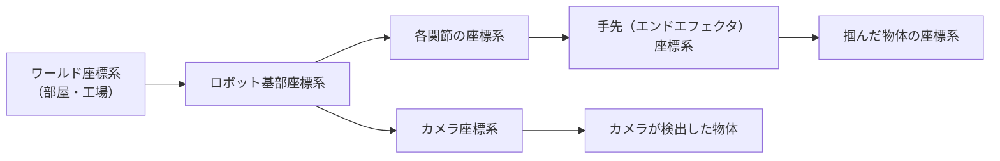

# はじめに

Part 1 では、LLM がロボットのスキルを呼び出す上位層を作りました。その中で、何気なく次のようなことを書いていました。

- `get_obj_pos("tray")` が返す `[-0.25, 0.30]` という座標
- 「ロボットから見て右 = y のマイナス方向」というプロンプトの注意書き
- 「手先が届く範囲は基部から 0.05〜0.55 m」という判定

これらはすべて **座標系** の話です。「どこを原点として、どちら向きを x とするか」が決まっていなければ、座標はただの数字の並びにすぎません。

第3章からは Part 2「ロボット工学の基礎」に入ります。本章のゴールは次の3つです。

- **座標系・回転行列・同次変換行列** を使って、「ある座標系で見た位置」を「別の座標系で見た位置」に変換できるようになる
- 回転の表現方法（**オイラー角・クォータニオン・回転行列**）の違いと、それぞれの落とし穴を知る
- 関節角から手先の位置と姿勢を計算する **順運動学（Forward Kinematics）** を NumPy で実装し、MuJoCo の計算結果と答え合わせする

:::note info
**前提**
- 第0章の環境（`mujoco`, `numpy`）
- 行列とベクトルの積がわかれば読めます。三角関数（sin / cos）を少し使います
:::

---

# 1. なぜ座標系が重要なのか

ロボットには、たくさんの座標系があります。



典型的な処理の流れを考えてみましょう。

1. カメラが、画像からコップを検出する → 位置は **カメラ座標系** で得られる
2. ロボットはその位置に手を伸ばしたい → 目標は **ロボット基部座標系** で指定する必要がある
3. 手先がコップを掴む → コップの位置は、以後 **手先座標系** に対して固定される

つまり、**同じ物体の位置を、複数の座標系の間で何度も変換する** 必要があります。この変換を間違えると、ロボットはまったく違う場所に手を伸ばします。しかもエラーは出ません。

ソフトウェアエンジニアにとって身近な例でいえば、**タイムゾーンの変換** に近い問題です。「10:00」だけでは意味がなく、「JST の 10:00」のように基準を明示して初めて意味を持ちます。そして変換を間違えても、プログラムは何事もなかったように動き続けます。

---

# 2. 座標系の約束事

## 2.1 右手座標系

ロボティクスでは、ほとんどの場合 **右手座標系** を使います。右手の親指・人差し指・中指を、それぞれ x 軸・y 軸・z 軸に対応させた座標系です。

MuJoCo、Isaac Lab、ROS では、さらに **z 軸を上向き（Z-up）** にするのが一般的です。ロボットの基部座標系では「x = 前、y = 左、z = 上」とすることが多いです[^groot-conv]。

:::note warn
Unity（左手系・Y-up）や、人の動きのデータ形式（BVH など、Y-up）のように、約束事が異なるツールもあります。異なるツール間でデータを受け渡すときは、**まず座標系の約束事を確認する** 習慣をつけてください[^groot-conv]。
:::

第2章の「ロボットから見て右 = y のマイナス方向」は、この「x = 前、y = 左」の約束事から来ています。

## 2.2 本記事での表記

本記事では、座標系を明示するために次の表記を使います。

| 表記 | 意味 |
|---|---|
| ${}^{A}\boldsymbol{p}$ | 座標系 A で見た点 $\boldsymbol{p}$ の位置 |
| ${}^{A}R_{B}$ | 座標系 B の向きを、座標系 A から見た回転行列 |
| ${}^{A}T_{B}$ | 座標系 B の位置と向きを、座標系 A から見た同次変換行列 |

コードでは `T_base_cam`（＝ ${}^{\text{base}}T_{\text{cam}}$）のように、**`T_<基準>_<対象>`** という変数名にします。こうしておくと、後で説明する変換の連鎖で、添え字が正しくつながっているかを目で確認できます。

---

# 3. 回転行列

## 3.1 2次元の回転

まずは平面で考えます。点を原点まわりに角度 $\theta$ だけ回転させる行列は次のとおりです。

$$
R(\theta) = \begin{pmatrix} \cos\theta & -\sin\theta \\ \sin\theta & \cos\theta \end{pmatrix}
$$

たとえば $\theta = 90^\circ$ なら、x 軸方向のベクトル $(1, 0)$ は y 軸方向の $(0, 1)$ に移ります。

## 3.2 3次元の基本回転

3次元では、x・y・z の各軸まわりの回転を、次の3つの行列で表します。

$$
R_x(\theta) = \begin{pmatrix} 1 & 0 & 0 \\ 0 & \cos\theta & -\sin\theta \\ 0 & \sin\theta & \cos\theta \end{pmatrix},\quad
R_y(\theta) = \begin{pmatrix} \cos\theta & 0 & \sin\theta \\ 0 & 1 & 0 \\ -\sin\theta & 0 & \cos\theta \end{pmatrix},\quad
R_z(\theta) = \begin{pmatrix} \cos\theta & -\sin\theta & 0 \\ \sin\theta & \cos\theta & 0 \\ 0 & 0 & 1 \end{pmatrix}
$$

回転の向きは、**回転軸の正の方向に右手の親指を向けたとき、残りの指が巻く向き** が正です。

## 3.3 回転行列の2つの読み方

回転行列 ${}^{A}R_{B}$ は、次の2通りに読めます。

1. **向きを表す**：${}^{A}R_{B}$ の各列は、座標系 B の x・y・z 軸が、座標系 A から見てどちらを向いているかを表す
2. **座標を変換する**：B で見た点の座標を、A で見た座標に変換する

$$
{}^{A}\boldsymbol{p} = {}^{A}R_{B}\, {}^{B}\boldsymbol{p}
$$

## 3.4 回転行列の性質

回転行列 $R$ には、次の重要な性質があります。

$$
R^\top R = I, \qquad \det R = 1
$$

- $R^\top R = I$：各列が長さ1で、互いに直交している。そのため **逆行列は転置するだけ** で求まる（$R^{-1} = R^\top$）
- $\det R = 1$：鏡に映したような反転を含まない

逆行列を転置で求められるのは、計算上の大きな利点です。座標系 A→B の変換がわかれば、B→A の変換はすぐに求まります。

## 3.5 回転は順番を入れ替えられない

回転の合成は行列の積で表します。行列の積は一般に順番を入れ替えられないので、回転の場合も **順番を入れ替えると結果が変わります**。実装パートで実際に確認しますが、「y 軸まわりに 90° 回してから z 軸まわりに 90°」と、「z 軸まわりに 90° 回してから y 軸まわりに 90°」では、まったく違う向きになります。

---

# 4. 同次変換行列：回転と移動をまとめて扱う

## 4.1 なぜ 4×4 なのか

座標系の関係には、回転だけでなく **位置のずれ（並進）** もあります。カメラ座標系から基部座標系への変換は、次のように書けます。

$$
{}^{A}\boldsymbol{p} = {}^{A}R_{B}\, {}^{B}\boldsymbol{p} + {}^{A}\boldsymbol{t}_{B}
$$

- ${}^{A}\boldsymbol{t}_{B}$：座標系 B の原点が、座標系 A から見てどこにあるか

このままでも計算はできますが、変換を何段も重ねると式が複雑になります。そこで、3次元の点に 1 を付け加えて4次元のベクトルとして扱い、回転と並進を **1つの 4×4 行列** にまとめます。

$$
{}^{A}T_{B} = \begin{pmatrix} {}^{A}R_{B} & {}^{A}\boldsymbol{t}_{B} \\ \boldsymbol{0}^\top & 1 \end{pmatrix},
\qquad
\begin{pmatrix} {}^{A}\boldsymbol{p} \\ 1 \end{pmatrix} = {}^{A}T_{B} \begin{pmatrix} {}^{B}\boldsymbol{p} \\ 1 \end{pmatrix}
$$

これを **同次変換行列（Homogeneous Transformation Matrix）** と呼びます。3D グラフィックスの「モデル行列」「ビュー行列」と同じ種類の行列です。

## 4.2 変換の連鎖

同次変換行列の最大の利点は、**変換を行列の積でつなげられる** ことです。

$$
{}^{A}T_{C} = {}^{A}T_{B}\; {}^{B}T_{C}
$$

添え字に注目してください。**内側の B と B が打ち消し合い、外側の A と C が残ります**。これが、`T_<基準>_<対象>` という命名規則が役に立つ理由です。`T_base_hand @ T_hand_obj` は添え字がつながっているので正しく、`T_base_hand @ T_cam_obj` は添え字がつながらないので間違いだと、コードを見ただけで気づけます。

## 4.3 逆変換

逆向きの変換（A から見た B の姿勢がわかっていて、B から見た A の姿勢を知りたい）は、回転行列の性質 $R^{-1} = R^\top$ を使って次のように求まります。

$$
{}^{B}T_{A} = \left({}^{A}T_{B}\right)^{-1} = \begin{pmatrix} R^\top & -R^\top \boldsymbol{t} \\ \boldsymbol{0}^\top & 1 \end{pmatrix}
$$

`np.linalg.inv` で一般的な逆行列を計算することもできますが、この式のほうが高速で、数値的にも安定しています。

---

# 5. 回転の表し方：オイラー角・クォータニオン・回転行列

3次元の回転には、自由度が3つあります。一方、それを表す方法は1つではありません。代表的な表現と、それぞれの特徴を見ていきます。

| 表現 | 数値の数 | 長所 | 短所 |
|---|---|---|---|
| **オイラー角**（roll, pitch, yaw） | 3 | 人間にわかりやすい | ジンバルロック。軸の順番の約束事がバラバラ |
| **回転ベクトル**（軸 × 角度） | 3 | コンパクト。「どの軸まわりに何度」が直感的 | 180° 付近で表現が不連続になる |
| **クォータニオン** | 4 | ジンバルロックがない。補間しやすい。計算が軽い | 直感的に読めない。成分の順番の約束事がバラバラ |
| **回転行列** | 9 | 合成・座標変換がそのまま計算できる | 数値が多い。誤差がたまると回転行列でなくなる |

## 5.1 オイラー角とジンバルロック

**オイラー角** は、回転を「z 軸まわりに yaw、y 軸まわりに pitch、x 軸まわりに roll」のように、3回の基本回転の組み合わせで表します。飛行機やドローンの姿勢表示でおなじみです。

$$
R = R_z(\text{yaw})\, R_y(\text{pitch})\, R_x(\text{roll})
$$

わかりやすい反面、オイラー角には **ジンバルロック** という問題があります。上の式で pitch がちょうど 90° になると、yaw の回転と roll の回転が **同じ軸まわりの回転になってしまい**、区別できなくなります。実装パートで確認しますが、(yaw, pitch, roll) = (30°, 90°, 0°)、(0°, 90°, −30°)、(50°, 90°, 20°) は、**どれもまったく同じ姿勢** になります。

これにより、次のような問題が起こります。

- 姿勢からオイラー角に逆変換するとき、答えが一意に決まらない
- この姿勢の近くで、わずかな姿勢の変化に対してオイラー角が大きく跳ねる
- 回転の自由度が実質的に1つ失われる

また、回転軸の順番や、固定した軸まわりに回すのか回転後の軸まわりに回すのか、といった約束事がライブラリごとに異なる点も、バグの温床です[^rot-cheat]。

## 5.2 クォータニオン

**クォータニオン（四元数）** は、回転を4つの数で表します。回転軸を単位ベクトル $\boldsymbol{u}$、回転角を $\theta$ とすると、次のようになります。

$$
\boldsymbol{q} = \left(\cos\frac{\theta}{2},\; \sin\frac{\theta}{2}\, \boldsymbol{u}\right) = (w,\; x,\; y,\; z)
$$

- $w$：スカラー部（回転角の大きさに関係する）
- $(x, y, z)$：ベクトル部（回転軸の方向に関係する）
- 長さが1（$w^2 + x^2 + y^2 + z^2 = 1$）の **単位クォータニオン** が回転を表す

たとえば z 軸まわりの 90° 回転は、$\boldsymbol{q} = (\cos 45^\circ, 0, 0, \sin 45^\circ) \approx (0.707, 0, 0, 0.707)$ です。

クォータニオンの詳しい代数（虚数単位 $i, j, k$ を使った積の定義）は省略しますが、使う側として押さえておくべきポイントは次の5つです。

1. **回転の合成はクォータニオンの積** $\boldsymbol{q}_1 \boldsymbol{q}_2$ で計算できる（回転行列の積 $R_1 R_2$ に対応）
2. **逆回転は共役** $\boldsymbol{q}^* = (w, -x, -y, -z)$ で求まる
3. **$\boldsymbol{q}$ と $-\boldsymbol{q}$ は同じ回転を表す**。そのため、2つのクォータニオンを比較するときは符号に注意する
4. **ジンバルロックが起きない**
5. **姿勢の補間（slerp）が自然にできる**：2つの姿勢の間を、一定の角速度で滑らかにつなげる。ロボットの手先の姿勢を、ある向きから別の向きへ滑らかに変える軌道生成でよく使われる

## 5.3 最大の落とし穴：成分の順番

クォータニオンで最もよくあるバグは、数学の間違いではなく **成分の順番の取り違え** です。

| ライブラリ・ツール | 順番 |
|---|---|
| MuJoCo、Isaac Lab | $(w, x, y, z)$（スカラーが先） |
| SciPy（`Rotation`）、ROS | $(x, y, z, w)$（スカラーが後） |

（出典：NVIDIA GR00T-WholeBodyControl のドキュメント[^groot-conv]、SciPy のドキュメント[^scipy-quat]）

同じ4つの数でも、順番を取り違えると **まったく別の回転** になります。しかもどちらも正しい単位クォータニオンなので、エラーは出ません。SciPy では `as_quat(scalar_first=True)` のように順番を指定できるので[^scipy-quat]、ライブラリ間でデータを受け渡すときは、必ず順番を明示しましょう。

## 5.4 ニューラルネットワークで回転を扱うときは

後の章で扱う VLA や模倣学習では、ニューラルネットワークに手先の姿勢を **出力させる** ことがあります。このとき、どの回転表現を使うかが学習のしやすさに影響します。

Zhou らの研究（CVPR 2019）は、3次元の回転を4次元以下の数で表す方法（オイラー角、クォータニオンなど）は、**どれも必ずどこかで不連続になる** ことを示しました。不連続な表現はニューラルネットワークが学習しにくく、特定の角度で大きな誤差が出やすくなります。そのうえで、**回転行列の最初の2列（6つの数）を使う「6D 表現」** のように、5次元以上の連続な表現のほうが学習に適していることを示しています[^rot6d]。

実際に、NVIDIA の人型ロボット制御のコードベースでも、観測の一部に回転行列の最初の2列を使う 6D 表現が使われています[^groot-conv]。

| 用途 | よく使われる表現 |
|---|---|
| シミュレータや通信での姿勢の保存・受け渡し | クォータニオン |
| 座標変換・順運動学の計算 | 回転行列 / 同次変換行列 |
| 人間への表示・設定ファイル | オイラー角（度） |
| ニューラルネットワークの入出力 | 6D 表現など、連続な表現 |

---

# 6. 順運動学（Forward Kinematics）

## 6.1 順運動学とは

ここまでの道具を使うと、ロボットの **順運動学** が計算できます。

> **順運動学：各関節の角度 $\boldsymbol{q}$ から、手先の位置と姿勢 $T(\boldsymbol{q})$ を求めること**

$$
{}^{\text{base}}T_{\text{hand}}(\boldsymbol{q}) = {}^{0}T_{1}(q_1)\; {}^{1}T_{2}(q_2)\; \cdots\; {}^{n-1}T_{n}(q_n)
$$

ロボットアームは、リンク（腕の骨）と関節が交互につながった鎖のような構造をしています。そこで、**「親リンクに対する子リンクの姿勢」を表す同次変換を、根元から順番に掛けていく** だけで、手先の姿勢が求まります。

各関節の変換 ${}^{i-1}T_{i}(q_i)$ は、さらに2つの部分に分けられます。

$$
{}^{i-1}T_{i}(q_i) = \underbrace{T_{\text{offset}}}_{\text{リンクの形で決まる固定の変換}} \cdot \underbrace{T_{\text{joint}}(q_i)}_{\text{関節の回転}}
$$

- **固定の変換**：「前のリンクの先端は、関節から 0.3 m 先にある」のような、ロボットの形状で決まる部分
- **関節の回転**：関節軸まわりに $q_i$ だけ回転する部分

逆に、「手先をこの位置に持っていくには、各関節を何度にすればよいか」を求めるのが **逆運動学（Inverse Kinematics, IK）** です。順運動学は掛け算だけで必ず答えが1つ求まりますが、逆運動学は答えが複数あったり、存在しなかったりします。逆運動学は第4章で扱います。

## 6.2 2関節アームで確認する

第0〜2章で使った平面の2関節アーム（上腕 $L_1 = 0.3$ m、前腕 $L_2 = 0.25$ m）なら、順運動学は手計算でも求まります。

$$
x = L_1 \cos q_1 + L_2 \cos(q_1 + q_2), \qquad y = L_1 \sin q_1 + L_2 \sin(q_1 + q_2)
$$

第0章の初期姿勢 $\boldsymbol{q} = (0, 0.8)$ を代入すると、$x = 0.3 + 0.25 \cos 0.8 \approx 0.474$、$y = 0.25 \sin 0.8 \approx 0.179$ となり、第0章の実行結果の最初の行「手先 = [0.474 0.179]」と一致します。

第1章の「届く範囲は 0.05〜0.55 m」も、この式から説明できます。腕を伸ばしきったとき（$q_2 = 0$）の距離が $L_1 + L_2 = 0.55$ m、肘を折りたたんだとき（$q_2 = \pi$）の距離が $|L_1 - L_2| = 0.05$ m です。

## 6.3 実際のロボットの定義：URDF / MJCF

実際のロボットでは、この「固定の変換」と「関節の軸」を、設定ファイルで定義します。

| 形式 | 主な利用先 | 内容 |
|---|---|---|
| **URDF** | ROS、多くのロボットメーカー | リンクと関節の親子関係、各関節の位置・向き・回転軸を XML で記述 |
| **MJCF** | MuJoCo | URDF とほぼ同じ情報に加え、物理パラメータなども記述 |

どちらも、**「親に対する子の位置（`pos` / `origin`）」と「関節の回転軸（`axis`）」を木構造で並べたもの** です。シミュレータやライブラリは、このファイルを読み込んで、本章で実装するのと同じ「同次変換の掛け算」を行っています。

:::note info
**DH パラメータについて**
ロボット工学の教科書では、各関節の変換を4つのパラメータで表す **DH（Denavit-Hartenberg）法** がよく登場します。パラメータが少なく済む一方、座標系の置き方に独特のルールがあり、慣れるまでわかりにくい手法です。現在のシミュレータや ROS では、本章のように「親に対する位置 + 関節軸」で直接記述する URDF / MJCF 形式が主流なので、本連載では DH 法には深入りしません。
:::

---

# 7. 実践：座標変換と順運動学を NumPy で実装する

## 7.1 ファイル構成

```text
ch03_kinematics/
├── transforms.py        # 回転行列・同次変換・クォータニオンの関数群
├── demo_transforms.py   # 座標変換の基本を確かめるデモ
└── fk.py                # 4自由度アームの順運動学と MuJoCo との答え合わせ
```

## 7.2 座標変換の関数群：`transforms.py`

本章で説明した数式を、そのまま NumPy で実装します。クォータニオンは MuJoCo と同じ **$(w, x, y, z)$ の順** で扱います。

```python:transforms.py
"""第3章: 座標変換の基本ツール（NumPy だけで実装）

- 回転行列 / 同次変換行列
- クォータニオン（MuJoCo と同じ [w, x, y, z] の順）
"""
import numpy as np


# ================= 回転行列 =================
def rot_x(theta):
    """x 軸まわりに theta [rad] 回転する回転行列"""
    c, s = np.cos(theta), np.sin(theta)
    return np.array([[1, 0, 0], [0, c, -s], [0, s, c]])


def rot_y(theta):
    """y 軸まわりに theta [rad] 回転する回転行列"""
    c, s = np.cos(theta), np.sin(theta)
    return np.array([[c, 0, s], [0, 1, 0], [-s, 0, c]])


def rot_z(theta):
    """z 軸まわりに theta [rad] 回転する回転行列"""
    c, s = np.cos(theta), np.sin(theta)
    return np.array([[c, -s, 0], [s, c, 0], [0, 0, 1]])


# ================= 同次変換行列 =================
def make_T(R=np.eye(3), p=np.zeros(3)):
    """回転 R と並進 p から 4x4 の同次変換行列を作る"""
    T = np.eye(4)
    T[:3, :3] = R
    T[:3, 3] = p
    return T


def trans(x, y, z):
    """並進だけの同次変換行列"""
    return make_T(p=np.array([x, y, z], dtype=float))


def inv_T(T):
    """同次変換の逆行列（np.linalg.inv より速く、数値的にも安定）"""
    R, p = T[:3, :3], T[:3, 3]
    return make_T(R.T, -R.T @ p)


def transform_point(T, p):
    """点 p（3次元）を同次変換 T で変換する"""
    return (T @ np.append(p, 1.0))[:3]


# ================= クォータニオン [w, x, y, z] =================
def quat_from_axis_angle(axis, theta):
    """回転軸 axis まわりに theta [rad] 回転するクォータニオン"""
    axis = np.asarray(axis, dtype=float)
    axis = axis / np.linalg.norm(axis)
    return np.concatenate([[np.cos(theta / 2)], np.sin(theta / 2) * axis])


def quat_mul(q1, q2):
    """クォータニオンの積 q1 * q2（「q2 の回転をしてから q1 の回転」に相当）"""
    w1, x1, y1, z1 = q1
    w2, x2, y2, z2 = q2
    return np.array([
        w1 * w2 - x1 * x2 - y1 * y2 - z1 * z2,
        w1 * x2 + x1 * w2 + y1 * z2 - z1 * y2,
        w1 * y2 - x1 * z2 + y1 * w2 + z1 * x2,
        w1 * z2 + x1 * y2 - y1 * x2 + z1 * w2,
    ])


def quat_conj(q):
    """共役（単位クォータニオンでは逆回転）"""
    return np.array([q[0], -q[1], -q[2], -q[3]])


def quat_rotate(q, v):
    """ベクトル v を q で回転する: q * (0, v) * q^-1"""
    return quat_mul(quat_mul(q, np.concatenate([[0.0], v])), quat_conj(q))[1:]


def quat_to_mat(q):
    """クォータニオン → 回転行列"""
    w, x, y, z = q / np.linalg.norm(q)
    return np.array([
        [1 - 2 * (y * y + z * z), 2 * (x * y - w * z), 2 * (x * z + w * y)],
        [2 * (x * y + w * z), 1 - 2 * (x * x + z * z), 2 * (y * z - w * x)],
        [2 * (x * z - w * y), 2 * (y * z + w * x), 1 - 2 * (x * x + y * y)],
    ])


def slerp(q0, q1, t):
    """球面線形補間：2つの姿勢の間を「一定の角速度」で補間する"""
    q0, q1 = q0 / np.linalg.norm(q0), q1 / np.linalg.norm(q1)
    dot = np.dot(q0, q1)
    if dot < 0:              # q と -q は同じ回転。近い方の経路を選ぶ
        q1, dot = -q1, -dot
    if dot > 0.9995:         # ほぼ同じ姿勢なら線形補間で十分
        q = q0 + t * (q1 - q0)
        return q / np.linalg.norm(q)
    omega = np.arccos(dot)
    return (np.sin((1 - t) * omega) * q0 + np.sin(t * omega) * q1) / np.sin(omega)
```

## 7.3 座標変換の基本を確かめる：`demo_transforms.py`

本章で説明した性質を、1つずつ数値で確かめます。

```python:demo_transforms.py
"""第3章 (1): 座標変換の基本を動かして確かめる"""
import numpy as np

from transforms import (inv_T, make_T, quat_from_axis_angle, quat_mul, quat_rotate,
                        quat_to_mat, rot_x, rot_y, rot_z, slerp, transform_point, trans)

np.set_printoptions(precision=3, suppress=True)
deg = np.deg2rad

print("=== 1. 回転行列の性質 ===")
R = rot_z(deg(30)) @ rot_y(deg(45)) @ rot_x(deg(60))
print("R^T R = I ?", np.allclose(R.T @ R, np.eye(3)), "/ det(R) =", round(np.linalg.det(R), 6))

print("\n=== 2. 回転の順番を入れ替えると結果が変わる ===")
v = np.array([1.0, 0.0, 0.0])
print("Rz(90)·Ry(90)·v =", rot_z(deg(90)) @ rot_y(deg(90)) @ v)
print("Ry(90)·Rz(90)·v =", rot_y(deg(90)) @ rot_z(deg(90)) @ v)

print("\n=== 3. カメラ座標 → ロボット基部座標 ===")
# カメラはロボット基部から見て (0.5, 0, 0.6) の位置にあり、真下（-z 方向）を向いている
# カメラ座標系：z = 視線方向、x = 画像の右、y = 画像の下（OpenCV の慣習）
R_base_cam = np.array([[0, -1, 0],
                       [-1, 0, 0],
                       [0, 0, -1]], dtype=float)
T_base_cam = make_T(R_base_cam, [0.5, 0.0, 0.6])
p_cam = np.array([0.10, -0.05, 0.55])          # カメラが検出した物体の位置（カメラ座標）
p_base = transform_point(T_base_cam, p_cam)
print("物体（カメラ座標）:", p_cam, "→ 物体（基部座標）:", p_base)
print("逆変換で戻す      :", transform_point(inv_T(T_base_cam), p_base))

print("\n=== 4. 変換の連鎖：基部 → 手先 → 掴んだ物体 ===")
T_base_hand = make_T(rot_z(deg(90)), [0.3, 0.2, 0.1])   # 手先の姿勢
T_hand_obj = trans(0.0, 0.0, 0.05)                      # 物体は手先から z 方向に 5cm
T_base_obj = T_base_hand @ T_hand_obj
print("物体の位置（基部座標）:", T_base_obj[:3, 3])

print("\n=== 5. クォータニオン ===")
q1 = quat_from_axis_angle([0, 0, 1], deg(90))           # z 軸まわり 90°
q2 = quat_from_axis_angle([1, 0, 0], deg(90))           # x 軸まわり 90°
print("q1 =", q1)
print("回転行列と一致する？", np.allclose(quat_to_mat(q1), rot_z(deg(90))))
print("q1 で [1,0,0] を回転:", quat_rotate(q1, v))
print("合成 q1*q2 と Rz·Rx が一致？", np.allclose(quat_to_mat(quat_mul(q1, q2)),
                                              rot_z(deg(90)) @ rot_x(deg(90))))
print("q と -q は同じ回転？", np.allclose(quat_to_mat(q1), quat_to_mat(-q1)))

print("\n=== 6. 姿勢の補間（slerp） ===")
q_start = np.array([1.0, 0, 0, 0])                      # 回転なし
q_goal = quat_from_axis_angle([0, 0, 1], deg(120))
for t in [0.0, 0.25, 0.5, 0.75, 1.0]:
    q = slerp(q_start, q_goal, t)
    angle = np.rad2deg(2 * np.arccos(np.clip(q[0], -1, 1)))
    print(f"t={t:.2f}  回転角 = {angle:6.1f}°")

print("\n=== 7. ジンバルロック ===")
# ZYX オイラー角（yaw, pitch, roll）で pitch = 90° のとき
R_a = rot_z(deg(30)) @ rot_y(deg(90)) @ rot_x(deg(0))
R_b = rot_z(deg(0)) @ rot_y(deg(90)) @ rot_x(deg(-30))
R_c = rot_z(deg(50)) @ rot_y(deg(90)) @ rot_x(deg(20))
print("(yaw,pitch,roll)=(30,90,0) と (0,90,-30) は同じ姿勢？", np.allclose(R_a, R_b))
print("(yaw,pitch,roll)=(30,90,0) と (50,90,20) は同じ姿勢？", np.allclose(R_a, R_c))
```

```bash
python demo_transforms.py
```

実行結果：

```text
=== 1. 回転行列の性質 ===
R^T R = I ? True / det(R) = 1.0

=== 2. 回転の順番を入れ替えると結果が変わる ===
Rz(90)·Ry(90)·v = [ 0.  0. -1.]
Ry(90)·Rz(90)·v = [ 0.  1. -0.]

=== 3. カメラ座標 → ロボット基部座標 ===
物体（カメラ座標）: [ 0.1  -0.05  0.55] → 物体（基部座標）: [ 0.55 -0.1   0.05]
逆変換で戻す      : [ 0.1  -0.05  0.55]

=== 4. 変換の連鎖：基部 → 手先 → 掴んだ物体 ===
物体の位置（基部座標）: [0.3  0.2  0.15]

=== 5. クォータニオン ===
q1 = [0.707 0.    0.    0.707]
回転行列と一致する？ True
q1 で [1,0,0] を回転: [0. 1. 0.]
合成 q1*q2 と Rz·Rx が一致？ True
q と -q は同じ回転？ True

=== 6. 姿勢の補間（slerp） ===
t=0.00  回転角 =    0.0°
t=0.25  回転角 =   30.0°
t=0.50  回転角 =   60.0°
t=0.75  回転角 =   90.0°
t=1.00  回転角 =  120.0°

=== 7. ジンバルロック ===
(yaw,pitch,roll)=(30,90,0) と (0,90,-30) は同じ姿勢？ True
(yaw,pitch,roll)=(30,90,0) と (50,90,20) は同じ姿勢？ True
```

結果を順番に見ていきます。

1. **回転行列の性質**：3つの回転を合成した行列でも、$R^\top R = I$、$\det R = 1$ が成り立っています。
2. **回転の順番**：同じ2つの回転でも、順番を入れ替えると `[0, 0, -1]` と `[0, 1, 0]` という、まったく違う結果になります。
3. **カメラ座標 → 基部座標**：真下を向いたカメラが、カメラ座標で `(0.10, -0.05, 0.55)` の位置に物体を検出しました。これを基部座標に変換すると `(0.55, -0.10, 0.05)` になります。カメラは高さ 0.6 m にあり、物体までの奥行きが 0.55 m なので、物体の高さは 0.6 − 0.55 = 0.05 m です。計算と直感が一致しています。逆変換で元の座標に戻ることも確認できます。
4. **変換の連鎖**：手先から z 方向に 5 cm の位置にある物体の、基部から見た位置を `T_base_hand @ T_hand_obj` で求めています。隣り合う添え字の `hand` と `hand` が一致していることに注目してください。
5. **クォータニオン**：z 軸まわり 90° のクォータニオンは `(0.707, 0, 0, 0.707)` で、回転行列と同じ回転を表します。クォータニオンの積が回転行列の積に対応すること、$\boldsymbol{q}$ と $-\boldsymbol{q}$ が同じ回転であることも確認できます。
6. **slerp**：0° から 120° への補間で、$t$ に比例して回転角が 30° ずつ増えています。一定の角速度で姿勢が変わる、ということです。
7. **ジンバルロック**：pitch = 90° のとき、3つの異なるオイラー角がすべて同じ姿勢を表しています。この姿勢では yaw − roll の値（ここではすべて 30°）しか意味を持たず、自由度が1つ失われています。

## 7.4 4自由度アームの順運動学：`fk.py`

次に、3次元で動くアームの順運動学を実装します。第0〜2章の平面アームに、根元の **旋回関節** と、手首の **ロール関節** を追加した4自由度のアームです。

| 関節 | 回転軸 | 動き |
|---|---|---|
| `yaw` | z 軸 | アーム全体を水平に旋回する |
| `shoulder` | y 軸 | 上腕を上下に振る |
| `elbow` | y 軸 | 前腕を上下に振る |
| `wrist_roll` | x 軸 | 手首をひねる |

```python:fk.py
"""第3章 (2): 4自由度アームの順運動学を NumPy で実装し、MuJoCo と答え合わせする"""
import mujoco
import numpy as np

from transforms import make_T, quat_to_mat, rot_x, rot_y, rot_z, trans

np.set_printoptions(precision=4, suppress=True)

# ---- ロボットの定義（MJCF）: 旋回 → 肩 → 肘 → 手首ロール ----
MJCF = """
<mujoco model="arm4dof">
  <worldbody>
    <body name="base" pos="0 0 0.1">
      <joint name="yaw" type="hinge" axis="0 0 1"/>
      <geom type="cylinder" size="0.04 0.02" rgba="0.3 0.3 0.3 1"/>
      <body name="upper_arm">
        <joint name="shoulder" type="hinge" axis="0 1 0"/>
        <geom type="capsule" fromto="0 0 0 0.3 0 0" size="0.02" rgba="0.2 0.4 0.8 1"/>
        <body name="forearm" pos="0.3 0 0">
          <joint name="elbow" type="hinge" axis="0 1 0"/>
          <geom type="capsule" fromto="0 0 0 0.25 0 0" size="0.018" rgba="0.8 0.4 0.2 1"/>
          <body name="wrist" pos="0.25 0 0">
            <joint name="wrist_roll" type="hinge" axis="1 0 0"/>
            <geom type="box" size="0.02 0.03 0.01" pos="0.025 0 0" rgba="0.2 0.7 0.3 1"/>
            <site name="hand" pos="0.05 0 0" size="0.01"/>
          </body>
        </body>
      </body>
    </body>
  </worldbody>
</mujoco>
"""

L0, L1, L2, L3 = 0.10, 0.30, 0.25, 0.05   # 基部の高さ・上腕・前腕・手先までの長さ [m]


def forward_kinematics(q, return_all=False):
    """関節角 q = [yaw, shoulder, elbow, wrist_roll] から手先の姿勢 T_base_hand を計算する

    各関節について「親リンクからの固定オフセット」→「関節の回転」を順に掛けていく。
    """
    q1, q2, q3, q4 = q
    T_yaw      = trans(0, 0, L0) @ make_T(rot_z(q1))   # 基部の高さに上がって、z 軸まわりに旋回
    T_shoulder = make_T(rot_y(q2))                     # 肩：y 軸まわり
    T_elbow    = trans(L1, 0, 0) @ make_T(rot_y(q3))   # 上腕の先端で、肘：y 軸まわり
    T_wrist    = trans(L2, 0, 0) @ make_T(rot_x(q4))   # 前腕の先端で、手首：x 軸まわり
    T_hand     = trans(L3, 0, 0)                       # 手首から手先まで

    frames = [T_yaw]
    for T in [T_shoulder, T_elbow, T_wrist, T_hand]:
        frames.append(frames[-1] @ T)                  # T_0n = T_01 · T_12 · ... · T_(n-1)n
    return frames if return_all else frames[-1]


def mujoco_fk(model, data, q):
    """同じ関節角での手先姿勢を MuJoCo に計算させる（答え合わせ用）"""
    data.qpos[:] = q
    mujoco.mj_kinematics(model, data)                  # 物理は進めず、運動学だけ計算
    sid = mujoco.mj_name2id(model, mujoco.mjtObj.mjOBJ_SITE, "hand")
    return data.site_xpos[sid].copy(), data.site_xmat[sid].reshape(3, 3).copy()


if __name__ == "__main__":
    model = mujoco.MjModel.from_xml_string(MJCF)
    data = mujoco.MjData(model)

    # 1) 特定の姿勢で比較
    q = np.deg2rad([30, -45, 60, 90])
    T = forward_kinematics(q)
    p_mj, R_mj = mujoco_fk(model, data, q)
    print("関節角 [deg]:", np.rad2deg(q))
    print("手先位置  NumPy :", T[:3, 3])
    print("手先位置  MuJoCo:", p_mj)
    print("手先の姿勢（回転行列） NumPy:\n", T[:3, :3])

    # 2) ランダムな 1000 姿勢で誤差を確認
    rng = np.random.default_rng(0)
    pos_err, rot_err = [], []
    for _ in range(1000):
        q = rng.uniform(-np.pi, np.pi, size=4)
        T = forward_kinematics(q)
        p_mj, R_mj = mujoco_fk(model, data, q)
        pos_err.append(np.linalg.norm(T[:3, 3] - p_mj))
        rot_err.append(np.abs(T[:3, :3] - R_mj).max())
    print(f"\nランダム 1000 姿勢: 位置誤差の最大 {max(pos_err):.2e} m / 回転行列の誤差の最大 {max(rot_err):.2e}")

    # 3) MuJoCo のクォータニオン（[w, x, y, z]）とも一致するか
    q = np.deg2rad([30, -45, 60, 90])
    frames = forward_kinematics(q, return_all=True)
    mujoco_fk(model, data, q)
    bid = mujoco.mj_name2id(model, mujoco.mjtObj.mjOBJ_BODY, "wrist")
    quat_wxyz = data.xquat[bid]
    print("\n手首のクォータニオン（MuJoCo, wxyz）:", quat_wxyz)
    print("wxyz として解釈 → FK と一致？", np.allclose(quat_to_mat(quat_wxyz), frames[3][:3, :3]))
    quat_xyzw = quat_wxyz[[1, 2, 3, 0]]               # SciPy / ROS の順番に並べ替えたもの
    print("xyzw を wxyz と誤解釈 → 一致？", np.allclose(quat_to_mat(quat_xyzw), frames[3][:3, :3]))

    # 4) 各関節の位置（どの座標系が、どこにあるか）
    print("\n各座標系の原点（基部座標）:")
    names = ["旋回(yaw)", "肩(shoulder)", "肘(elbow)", "手首(wrist)", "手先(hand)"]
    for name, F in zip(names, forward_kinematics(np.deg2rad([30, -45, 60, 90]), return_all=True)):
        print(f"  {name:14s} {F[:3, 3]}")
```

```bash
python fk.py
```

実行結果：

```text
関節角 [deg]: [ 30. -45.  60.  90.]
手先位置  NumPy : [0.4347 0.251  0.2345]
手先位置  MuJoCo: [0.4347 0.251  0.2345]
手先の姿勢（回転行列） NumPy:
 [[ 0.8365  0.2241  0.5   ]
 [ 0.483   0.1294 -0.866 ]
 [-0.2588  0.9659  0.    ]]

ランダム 1000 姿勢: 位置誤差の最大 2.56e-16 m / 回転行列の誤差の最大 6.66e-16

手首のクォータニオン（MuJoCo, wxyz）: [0.7011 0.6533 0.2706 0.0923]
wxyz として解釈 → FK と一致？ True
xyzw を wxyz と誤解釈 → 一致？ False

各座標系の原点（基部座標）:
  旋回(yaw)        [0.  0.  0.1]
  肩(shoulder)    [0.  0.  0.1]
  肘(elbow)       [0.1837 0.1061 0.3121]
  手首(wrist)      [0.3928 0.2268 0.2474]
  手先(hand)       [0.4347 0.251  0.2345]
```

## 7.5 コードの解説

### ① MJCF と `forward_kinematics` の対応

`forward_kinematics` の各行は、MJCF の `<body>` の入れ子構造と1対1で対応しています。

| MJCF | NumPy |
|---|---|
| `<body name="base" pos="0 0 0.1">` + `<joint axis="0 0 1">` | `trans(0, 0, L0) @ make_T(rot_z(q1))` |
| `<body name="upper_arm">` + `<joint axis="0 1 0">` | `make_T(rot_y(q2))` |
| `<body name="forearm" pos="0.3 0 0">` + `<joint axis="0 1 0">` | `trans(L1, 0, 0) @ make_T(rot_y(q3))` |
| `<body name="wrist" pos="0.25 0 0">` + `<joint axis="1 0 0">` | `trans(L2, 0, 0) @ make_T(rot_x(q4))` |
| `<site name="hand" pos="0.05 0 0">` | `trans(L3, 0, 0)` |

つまり、**「`pos` で親から移動し、`axis` まわりに関節角だけ回す」を根元から順に掛け算する** のが順運動学のすべてです。MuJoCo も内部では同じ計算をしています。

### ② MuJoCo との答え合わせ

`mujoco_fk` では、`mj_step`（物理シミュレーションを1ステップ進める）ではなく `mj_kinematics`（運動学の計算だけを行う）を使っています。関節角を直接設定して、そのときの手先の位置と姿勢を MuJoCo に計算させています。

ランダムな 1000 通りの関節角で比較した結果、位置・回転行列の誤差の最大値は $10^{-16}$ のオーダーでした。これは浮動小数点の丸め誤差のレベルで、**自分で書いた順運動学が MuJoCo と一致している** ことを意味します。

### ③ 姿勢の符号に注意

`shoulder` に −45° を与えると、上腕は **上向き** に持ち上がります。y 軸まわりの正の回転は、右手の法則により x 軸を下（−z 方向）に向けるためです。実際、肘の高さは $0.1 + 0.3 \sin 45^\circ \approx 0.312$ m で、基部より高くなっています。「上げたいのに下がった」という符号ミスは非常によくあるので、**関節を少しだけ動かして、どちらに動くかを確かめる** 習慣をつけましょう。

### ④ クォータニオンの順番の罠を再現する

MuJoCo が返す手首のクォータニオン `data.xquat` を $(w, x, y, z)$ として解釈すると、順運動学で求めた回転行列と一致します。一方、SciPy や ROS の順番 $(x, y, z, w)$ に並べ替えたものを、誤って $(w, x, y, z)$ として解釈すると一致しません。**どちらも長さ1の正しいクォータニオンなので、エラーは出ずに、違う姿勢として扱われてしまう** ことがわかります。

## 7.6 演習

1. `fk.py` で `shoulder` と `elbow` を少しずつ変えながら、手先の位置をグラフ（matplotlib の散布図など）にプロットして、アームの **作業領域（Workspace）** を可視化してみましょう。
2. `forward_kinematics` を、関節角を **まとめて N 個** 受け取れるようにベクトル化してみましょう（`np.einsum` や配列のブロードキャストを使います）。強化学習や模倣学習では、大量の姿勢をまとめて計算する場面がよくあります。
3. `demo_transforms.py` の「カメラ座標 → 基部座標」で、カメラの取り付け位置を 1 cm ずらしたり、向きを 1° 傾けたりすると、物体の位置はどれだけずれるでしょうか。カメラの取り付け位置と向きを正確に求める作業（**ハンドアイ・キャリブレーション**）が、なぜ重要なのかを体感できます。
4. 回転行列から 6D 表現（最初の2列）を作り、そこから回転行列に戻す関数を実装してみましょう。ヒント：2つの列ベクトルをグラム・シュミットの直交化で正規直交化し、3列目は外積で求めます[^rot6d]。

---

# 8. まとめ

- ロボットには、ワールド・基部・関節・手先・カメラなど **多数の座標系** があり、物体の位置をそれらの間で何度も変換する
- **回転行列** は $R^\top R = I$、$\det R = 1$ を満たし、逆行列は転置で求まる。回転は **順番を入れ替えられない**
- **同次変換行列** は回転と並進を 4×4 の行列にまとめたもの。${}^{A}T_{C} = {}^{A}T_{B}\,{}^{B}T_{C}$ のように、**添え字をつなげて掛け算** できる
- 回転の表現には、**オイラー角**（わかりやすいがジンバルロックがある）、**クォータニオン**（扱いやすいが成分の順番に注意）、**回転行列**（計算に便利）などがあり、ニューラルネットワークでは **6D 表現** のような連続な表現が学習しやすい
- **順運動学** は、「親に対する固定のオフセット」と「関節の回転」を根元から順に掛け合わせるだけで求まる。実装した順運動学は MuJoCo と浮動小数点誤差のレベルで一致した

## 次回予告

順運動学は「関節角 → 手先の位置」でした。しかし、実際に必要なのはその逆、**「手先をこの位置に持っていきたい。各関節を何度にすればよいか」** です。

**第4章「逆運動学（IK）」** では、第0章から使ってきた **ヤコビアン** の正体を明らかにし、数値計算で逆運動学を解く方法を実装します。第0章で出てきた **特異姿勢** の問題にも、正面から向き合います。

---

# 参考文献

[^groot-conv]: NVIDIA, "Coordinate Frame and Rotation Conventions — GR00T-WholeBodyControl Documentation". https://nvlabs.github.io/GR00T-WholeBodyControl/references/conventions.html
[^rot-cheat]: RoboSimTools, "Rotation Conventions Cheat Sheet — quaternion order, Euler sequences, by library", 2026-07-10. https://robosimtools.com/wiki/rotation-conventions-cheat-sheet/
[^scipy-quat]: SciPy Documentation, "scipy.spatial.transform.Rotation.as_quat". https://docs.scipy.org/doc/scipy/reference/generated/scipy.spatial.transform.Rotation.as_quat.html
[^rot6d]: Y. Zhou, C. Barnes, J. Lu, J. Yang, H. Li, "On the Continuity of Rotation Representations in Neural Networks", CVPR 2019. arXiv:1812.07035. https://arxiv.org/abs/1812.07035
