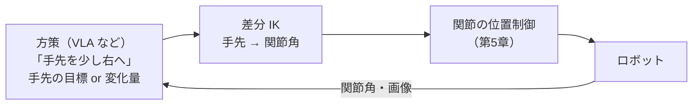

# はじめに

[第3章](./03_座標変換と運動学.md)では、関節角から手先の位置と姿勢を求める **順運動学（FK）** を実装しました。しかし、ロボットに仕事をさせるときに本当に必要なのは、その逆です。

> 「コップの位置 (0.4, 0.1, 0.05) に手を伸ばしたい。各関節を何度にすればよいか？」

これが **逆運動学（Inverse Kinematics, IK）** です。第0章から何度も使ってきた **ヤコビアン** は、まさにこの問題を解くための道具でした。本章では、これまで「おまじない」として使ってきた部分の正体を明らかにします。

本章のゴールは次の4つです。

- IK が FK より難しい理由（**解が複数・解がない・式で解けない**）を理解する
- **ヤコビアン** の意味を理解し、解析解・数値微分・MuJoCo の3通りで一致を確かめる
- 数値 IK の3つの代表的な手法（**ヤコビ転置法・擬似逆行列法・減衰最小二乗法（DLS）**）を実装して比較する
- **特異姿勢** で何が起きるのかを数値で確かめ、その対策を知る

:::note info
**前提**
- 第3章の `transforms.py` と `fk.py` を、本章のディレクトリにコピーしてください（4自由度アームの定義と順運動学を再利用します）
- 必要なライブラリは `mujoco` と `numpy` だけです
:::

---

# 1. なぜ IK は難しいのか

順運動学は「行列を順に掛けるだけ」で、必ず答えが1つ求まりました。逆運動学には、次の3つの難しさがあります。

| 難しさ | 内容 | 例 |
|---|---|---|
| **解が複数ある** | 同じ手先位置を、異なる関節角で実現できる | 肘を上げても下げても、同じ場所に手が届く |
| **解がない** | 目標が届く範囲の外にある | 腕の長さより遠い場所 |
| **式で解けないことが多い** | 関節が増えると、三角関数の連立方程式を解析的に解くのが難しくなる | 6〜7自由度のアーム、人型ロボット |

ソフトウェアエンジニア向けにたとえると、FK は **ハッシュ関数の計算**、IK は **ハッシュ値から元の入力を探す** ようなものです。順方向は簡単でも、逆方向は「答えが1つとは限らない」「そもそも存在しないかもしれない」問題になります。

IK の解き方は、大きく2種類に分かれます。

| 方式 | 方法 | 長所 | 短所 |
|---|---|---|---|
| **解析的 IK** | 幾何学や代数で、関節角を式で直接求める | 速い。すべての解を列挙できる | ロボットごとに式を導く必要がある。構造によっては解けない |
| **数値 IK** | 「少し動かして、誤差が減る方向に更新」を繰り返す | どんなロボットにも使える | 反復計算が必要。初期値によって結果が変わる。特異姿勢に弱い |

現在のロボット開発、特にシミュレータや学習ベースのシステムでは、**数値 IK（とくに差分 IK）** が主流です。本章も数値 IK を中心に扱いますが、IK の性質をつかむために、まずは解析的 IK から見ていきます。

---

# 2. 解析的 IK：2関節アームを幾何学で解く

第0〜2章の平面2関節アーム（上腕 $L_1 = 0.3$ m、前腕 $L_2 = 0.25$ m）なら、IK を手で解けます。

手先の目標を $(x, y)$ とすると、基部から手先までの距離 $r = \sqrt{x^2 + y^2}$ を1辺とし、2本のリンクを残りの2辺とする三角形ができます。**余弦定理** から、肘の角度 $q_2$ が求まります。

$$
\cos q_2 = \frac{x^2 + y^2 - L_1^2 - L_2^2}{2 L_1 L_2}
$$

肩の角度 $q_1$ は、「目標の方向」から「肘を曲げた分のずれ」を引いて求めます。

$$
q_1 = \operatorname{atan2}(y, x) - \operatorname{atan2}(L_2 \sin q_2,\; L_1 + L_2 \cos q_2)
$$

この式から、IK の3つの性質がそのまま読み取れます。

- **解が2つ**：$\cos q_2$ が決まっても、$\sin q_2 = \pm\sqrt{1 - \cos^2 q_2}$ の **符号が2通り** ある。これが「肘を上げる解」と「肘を下げる解」に対応する
- **解がない**：右辺の絶対値が1を超えると、その値を $\cos q_2$ として持つ角度は存在しない。これが「届かない」ことを意味する
- **解が1つ**：ちょうど腕を伸ばしきった位置（$r = L_1 + L_2$）では、2つの解が重なって1つになる。この姿勢が後で説明する **特異姿勢** です

:::note info
**`atan2` を使う理由**
`atan(y / x)` では、$x$ と $y$ の符号の組み合わせによって角度の象限が区別できず、$x = 0$ でゼロ除算も起こります。`atan2(y, x)` は 4 つの象限を正しく区別できるので、ロボットの角度計算ではほぼ必ずこちらを使います。
:::

---

# 3. ヤコビアン：「関節を少し動かすと、手先はどう動くか」

## 3.1 定義

数値 IK の主役が **ヤコビアン** です。手先の位置 $\boldsymbol{x}$ は関節角 $\boldsymbol{q}$ の関数 $\boldsymbol{x} = f(\boldsymbol{q})$ でした（順運動学）。ヤコビアン $J$ は、この関数の **偏微分を並べた行列** です。

$$
J(\boldsymbol{q}) = \frac{\partial f}{\partial \boldsymbol{q}} =
\begin{pmatrix}
\dfrac{\partial x_1}{\partial q_1} & \cdots & \dfrac{\partial x_1}{\partial q_n} \\
\vdots & \ddots & \vdots \\
\dfrac{\partial x_m}{\partial q_1} & \cdots & \dfrac{\partial x_m}{\partial q_n}
\end{pmatrix}
$$

- 行の数 $m$：手先の自由度（位置だけなら 3、位置と姿勢なら 6）
- 列の数 $n$：関節の数
- **$j$ 列目**：「関節 $j$ だけを少し動かしたとき、手先がどちらへどれだけ動くか」

機械学習に慣れている方なら、**ニューラルネットワークの出力を入力で微分したもの** と同じだと考えるとわかりやすいでしょう。

## 3.2 ヤコビアンの3つの使い道

ヤコビアンは、ロボティクスで次の3つの役割を持ちます。

**① 速度の変換**：関節の速度 $\dot{\boldsymbol{q}}$ から、手先の速度 $\dot{\boldsymbol{x}}$ を求める。

$$
\dot{\boldsymbol{x}} = J(\boldsymbol{q})\, \dot{\boldsymbol{q}}
$$

**② 小さな変化の変換（数値 IK の基礎）**：関節角を $\Delta \boldsymbol{q}$ だけ変えると、手先はおよそ $\Delta \boldsymbol{x} \approx J \Delta \boldsymbol{q}$ だけ動く。IK では、この式を **逆向きに** 使います。「手先を $\Delta \boldsymbol{x}$ 動かしたいなら、$\Delta \boldsymbol{q}$ はいくつか」を解くわけです。

**③ 力の変換**：手先に力 $\boldsymbol{F}$ を出したいとき、各関節が出すべきトルク $\boldsymbol{\tau}$ は、**ヤコビアンの転置** で求まる。

$$
\boldsymbol{\tau} = J(\boldsymbol{q})^\top \boldsymbol{F}
$$

③が、第0章から使ってきた **ヤコビ転置法** の正体です。第0章の `tau = kp * jacp.T @ error` は、「手先を目標の方向へ $K_p \times$ 誤差 の力で引っ張る」ための関節トルクを、この式で計算していたのです。

## 3.3 ヤコビアンの求め方

ヤコビアンを求める方法は3つあります。

| 方法 | やり方 | 特徴 |
|---|---|---|
| **解析的に微分** | 順運動学の式を手で微分する | 速くて正確。ただしロボットごとに導出が必要 |
| **数値微分** | 各関節を $\varepsilon$ だけ動かして、手先の変化を測る | どんなロボットにも使える。わずかな誤差がある |
| **ライブラリに任せる** | MuJoCo の `mj_jacSite`、Pinocchio、PyTorch の自動微分など | 実用ではこれが一般的 |

2関節アームのヤコビアンを解析的に求めると、次のようになります（第3章 6.2 節の順運動学を $q_1, q_2$ で微分したもの）。

$$
J = \begin{pmatrix}
-L_1 \sin q_1 - L_2 \sin(q_1 + q_2) & -L_2 \sin(q_1 + q_2) \\
L_1 \cos q_1 + L_2 \cos(q_1 + q_2) & L_2 \cos(q_1 + q_2)
\end{pmatrix}
$$

実践パートで、この解析解・数値微分・MuJoCo の3つが一致することを確かめます。

---

# 4. 数値 IK の3つの手法

## 4.1 基本の考え方

数値 IK は、次の反復で解きます。

1. 現在の関節角 $\boldsymbol{q}$ で、手先の誤差 $\boldsymbol{e} = \boldsymbol{x}^{*} - f(\boldsymbol{q})$ を計算する
2. ヤコビアン $J(\boldsymbol{q})$ を使って、誤差を減らす $\Delta \boldsymbol{q}$ を求める
3. $\boldsymbol{q} \leftarrow \boldsymbol{q} + \Delta \boldsymbol{q}$ と更新し、誤差が十分小さくなるまで繰り返す

ステップ 2 で $J \Delta \boldsymbol{q} = \boldsymbol{e}$ を「どう解くか」で、手法が分かれます。

## 4.2 ヤコビ転置法

$$
\Delta \boldsymbol{q} = \alpha\, J^\top \boldsymbol{e}
$$

逆行列を使わず、転置を掛けるだけの手法です。実は、誤差の二乗 $\frac{1}{2}\|\boldsymbol{e}\|^2$ を最小化する **勾配降下法** そのものになっています（$-\nabla_{\boldsymbol{q}} \frac{1}{2}\|\boldsymbol{e}\|^2 = J^\top \boldsymbol{e}$）。

- 長所：計算が軽い。特異姿勢でも値が発散しない
- 短所：収束が遅い。ステップ幅 $\alpha$ の調整が必要（本章の実装では、Buss の文献にある方法で毎回自動調整します[^buss]）

## 4.3 擬似逆行列法

$$
\Delta \boldsymbol{q} = J^{+} \boldsymbol{e}, \qquad J^{+} = J^\top (J J^\top)^{-1}
$$

$J$ が正方行列でない（関節の数と手先の自由度が違う）ことが多いので、普通の逆行列の代わりに **擬似逆行列（Moore-Penrose 逆行列）** $J^{+}$ を使います。最小二乗の意味で $J \Delta \boldsymbol{q} = \boldsymbol{e}$ を解き、さらに解が複数あるときは **$\|\Delta \boldsymbol{q}\|$ が最小のもの** を選びます。

これは **ガウス・ニュートン法** に相当します。

- 長所：収束が速い
- 短所：**特異姿勢の近くで $\Delta \boldsymbol{q}$ が爆発する**

## 4.4 減衰最小二乗法（DLS）

$$
\Delta \boldsymbol{q} = J^\top (J J^\top + \lambda^2 I)^{-1} \boldsymbol{e}
$$

擬似逆行列の $(J J^\top)^{-1}$ では、逆行列を取る前に、$J J^\top$ に小さな値 $\lambda^2 I$ を足します。これは次の最適化問題の解になっています。

$$
\min_{\Delta \boldsymbol{q}}\; \|J \Delta \boldsymbol{q} - \boldsymbol{e}\|^2 + \lambda^2 \|\Delta \boldsymbol{q}\|^2
$$

つまり、「誤差を減らしたい」と「関節を大きく動かしたくない」のバランスを取る手法です。機械学習でいえば、**L2 正則化（リッジ回帰）** とまったく同じ形です。最適化の分野では **レーベンバーグ・マーカート法** と呼ばれます。

- 長所：特異姿勢の近くでも、関節の動きが暴れない
- 短所：$\lambda$ の分だけ、誤差の減りが遅くなる。$\lambda$ の調整が必要

## 4.5 3手法の関係

| 手法 | 最適化としての見方 | 速さ | 特異姿勢での安定性 |
|---|---|---|---|
| ヤコビ転置 | 勾配降下法 | 遅い | 安定 |
| 擬似逆行列 | ガウス・ニュートン法 | 速い | **不安定** |
| DLS | レーベンバーグ・マーカート法（L2 正則化付き） | 中程度 | 安定 |

この3手法は、現在の主要なツールにもそのまま実装されています。たとえば NVIDIA Isaac Lab の差分 IK コントローラでは、ヤコビアンの逆行列の計算方法として `trans`（転置）、`pinv`（擬似逆行列）、`dls`（減衰付き擬似逆行列）に加えて、`svd`（適応的 SVD）も選べるようになっています[^isaaclab-ik]。

---

# 5. 特異姿勢：ヤコビアンが「つぶれる」とき

## 5.1 特異姿勢とは

ヤコビアンの **階数（ランク）が落ちる** 姿勢を **特異姿勢（Singularity）** と呼びます。直感的には、**どの関節をどう動かしても、手先をある方向へは動かせなくなる** 姿勢です。

2関節アームでは、腕をまっすぐ伸ばしきったとき（$q_2 = 0$）が特異姿勢です。このとき、両方の関節を回しても、手先は腕に垂直な方向にしか動けず、**腕の方向（さらに遠く、または手前）へは動けません**。第0章で、腕を一直線にした初期姿勢から始めると手先が目標に届かなかったのは、このためでした。

## 5.2 特異姿勢の近くで何が起きるか

特異姿勢そのものより、実際に問題になるのは **特異姿勢の近く** です。手先を「動かしにくい方向」へ少しだけ動かそうとすると、擬似逆行列は **非常に大きな関節速度** を要求します。

これは、ヤコビアンの **特異値分解（SVD）** で説明できます。$J = U \Sigma V^\top$ と分解すると、擬似逆行列は特異値 $\sigma_i$ の **逆数** $1/\sigma_i$ を使います。

$$
J^{+} = V \Sigma^{+} U^\top, \qquad \Sigma^{+} = \operatorname{diag}\left(\frac{1}{\sigma_1}, \frac{1}{\sigma_2}, \dots\right)
$$

特異姿勢に近づくと、ある特異値 $\sigma_i$ が 0 に近づき、$1/\sigma_i$ が爆発します。一方、DLS では、この部分が次のように置き換わります[^buss]。

$$
\frac{1}{\sigma_i} \quad\longrightarrow\quad \frac{\sigma_i}{\sigma_i^2 + \lambda^2}
$$

$\sigma_i$ が大きいときは $1/\sigma_i$ とほぼ同じですが、$\sigma_i \to 0$ では **0 に近づく** ため、爆発しません。その代わり、「動かしにくい方向」への動きを **あきらめる** ことになります。

## 5.3 特異姿勢からの距離を測る

特異姿勢にどれだけ近いかを表す指標として、次の2つがよく使われます。

| 指標 | 定義 | 意味 |
|---|---|---|
| **可操作度**（Yoshikawa） | $w = \sqrt{\det(J J^\top)}$ | 手先をあらゆる方向に動かせる度合い。特異姿勢で 0 |
| **条件数** | $\kappa = \sigma_{\max} / \sigma_{\min}$ | 動かしやすい方向と動かしにくい方向の差。特異姿勢で ∞ |

軌道計画では、可操作度が小さい姿勢を避ける、あるいは IK の解の候補から可操作度が大きいものを選ぶ、といった使い方をします。

---

# 6. 現在の IK：差分 IK と学習ベースの方策

## 6.1 「解いて終わり」ではなく「毎ステップ少しずつ」

本章の数値 IK は、目標に収束するまで反復しました。一方、実際のロボット制御では、**制御周期ごとに1回だけ $\Delta \boldsymbol{q}$ を計算して少しだけ動かす** 方式がよく使われます。これを **差分 IK（Differential IK）** と呼びます。

目標が刻々と変わる場面（動く物体を追う、遠隔操作で人の手の動きを追うなど）では、毎回ゼロから IK を解くより、**前の姿勢から少しずつ追いかける** ほうが自然で、動きも滑らかになります。

## 6.2 制約を扱う：QP ベースの IK

本章の実装では、関節の可動範囲を `np.clip` で強制的に守っています。しかし実際には、関節の可動範囲・速度の上限・障害物との衝突回避など、守るべき制約がたくさんあります。

そこで現在は、差分 IK を **二次計画問題（QP）** として解く方式が広く使われています。たとえば MuJoCo ベースの IK ライブラリ **mink** は、複数の目標（手先の位置、姿勢の維持など）と制約（関節の可動範囲・速度、衝突回避）を1つの QP にまとめ、制御周期ごとに最適な関節速度を求めます[^mink-doc]。DLS の $\lambda^2 \|\Delta \boldsymbol{q}\|^2$ にあたる減衰項も、レーベンバーグ・マーカート型の減衰としてパラメータで指定できます[^mink-api]。単腕のアームから、両腕・ハンド・人型ロボット・四脚ロボットまで、幅広いロボットに対応しています[^mink-pypi]。

## 6.3 フィジカルAIの中での IK の位置づけ

「VLA のような学習ベースの方策があれば、IK はいらないのでは？」と思うかもしれません。実際には、IK は今もフィジカルAIの中で重要な役割を担っています。



学習済みの方策の出力形式には、大きく分けて **関節角を直接出力する方式** と、**手先の位置・姿勢（またはその変化量）を出力する方式** があります。後者の場合、方策の出力を実際のモーター指令に変換するのは IK の役目です。手先の動きで方策を表すと、関節の構成が違うロボットの間でもデータや方策を共有しやすくなるという利点があります。

実践パートの最後では、この構成の最小版として、**「手先の目標」を差分 IK で関節角に変換し、MuJoCo の位置制御アクチュエータで追従させる** プログラムを作ります。

---

# 7. 実践：IK を実装して比較する

## 7.1 ファイル構成

```text
ch04_inverse_kinematics/
├── transforms.py     # 第3章からコピー
├── fk.py             # 第3章からコピー（4自由度アームの MJCF と順運動学）
├── ik_2link.py       # 解析的 IK・ヤコビアンの比較・特異姿勢の実験
├── ik_numeric.py     # 4自由度アームの数値 IK（3手法の比較）
└── ik_mujoco.py      # 差分 IK で手先に円を描かせる
```

## 7.2 2関節アームで基本を確かめる：`ik_2link.py`

```python:ik_2link.py
"""第4章 (1): 2関節アームで「解析的 IK」「ヤコビアン」「特異姿勢」を確かめる"""
import mujoco
import numpy as np

np.set_printoptions(precision=4, suppress=True)
L1, L2 = 0.30, 0.25


def fk(q):
    """順運動学（第3章 6.2 節の式）"""
    return np.array([L1 * np.cos(q[0]) + L2 * np.cos(q[0] + q[1]),
                     L1 * np.sin(q[0]) + L2 * np.sin(q[0] + q[1])])


def analytic_ik(x, y):
    """解析的 IK：余弦定理で肘の角度を求める。解は最大2つ（肘を上げる / 下げる）"""
    c2 = (x**2 + y**2 - L1**2 - L2**2) / (2 * L1 * L2)
    if abs(c2) > 1:
        return []                                    # 届かない：解なし
    sols = []
    for s2 in [np.sqrt(1 - c2**2), -np.sqrt(1 - c2**2)]:
        q2 = np.arctan2(s2, c2)
        q1 = np.arctan2(y, x) - np.arctan2(L2 * s2, L1 + L2 * c2)
        sols.append(np.array([q1, q2]))
    return sols


def jacobian(q):
    """解析的ヤコビアン：J[i, j] = ∂x_i / ∂q_j"""
    s1, c1 = np.sin(q[0]), np.cos(q[0])
    s12, c12 = np.sin(q[0] + q[1]), np.cos(q[0] + q[1])
    return np.array([[-L1 * s1 - L2 * s12, -L2 * s12],
                     [ L1 * c1 + L2 * c12,  L2 * c12]])


def numeric_jacobian(f, q, eps=1e-6):
    """数値微分のヤコビアン：各関節を少しだけ動かして、手先の変化を測る"""
    x0 = f(q)
    J = np.zeros((len(x0), len(q)))
    for j in range(len(q)):
        dq = np.zeros(len(q)); dq[j] = eps
        J[:, j] = (f(q + dq) - x0) / eps
    return J


MJCF = """
<mujoco><worldbody>
  <body><joint type="hinge" axis="0 0 1"/>
    <geom type="capsule" fromto="0 0 0 0.3 0 0" size="0.02"/>
    <body pos="0.3 0 0"><joint type="hinge" axis="0 0 1"/>
      <geom type="capsule" fromto="0 0 0 0.25 0 0" size="0.02"/>
      <site name="hand" pos="0.25 0 0"/>
    </body></body>
</worldbody></mujoco>"""

if __name__ == "__main__":
    print("=== 1. 解析的 IK：解は 2つ・0個のこともある ===")
    for target in [(0.2, 0.35), (0.6, 0.3)]:
        sols = analytic_ik(*target)
        print(f"目標 {target}: 解の数 = {len(sols)}")
        for q in sols:
            print(f"   q = {np.rad2deg(q).round(1)} deg  → FK で確認: {fk(q)}")

    print("\n=== 2. ヤコビアン：解析解・数値微分・MuJoCo の比較 ===")
    q = np.array([0.3, 0.8])
    model = mujoco.MjModel.from_xml_string(MJCF); data = mujoco.MjData(model)
    data.qpos[:] = q; mujoco.mj_kinematics(model, data); mujoco.mj_comPos(model, data)
    jacp = np.zeros((3, 2)); mujoco.mj_jacSite(model, data, jacp, None, 0)
    print("解析的   :\n", jacobian(q))
    print("数値微分 :\n", numeric_jacobian(fk, q))
    print("MuJoCo   :\n", jacp[:2])

    print("\n=== 3. 特異姿勢に近づくと何が起きるか ===")
    print(" 肘の角度 | 可操作度 w | 条件数    | x方向へ 1cm/s 動かす関節速度 (pinv) | 同 (DLS, λ=0.01)")
    v = np.array([0.01, 0.0])                       # 手先を x 方向に 1cm/s で動かしたい
    for q2_deg in [90, 30, 10, 3, 1, 0.1]:
        q = np.array([0.0, np.deg2rad(q2_deg)])
        J = jacobian(q)
        w = np.sqrt(np.linalg.det(J @ J.T))         # 可操作度（Yoshikawa）
        cond = np.linalg.cond(J)
        dq_pinv = np.linalg.pinv(J) @ v
        lam = 0.01
        dq_dls = J.T @ np.linalg.solve(J @ J.T + lam**2 * np.eye(2), v)
        print(f" {q2_deg:7.1f}° | {w:.5f}   | {cond:9.1f} | {np.linalg.norm(dq_pinv):10.3f} rad/s"
              f"                | {np.linalg.norm(dq_dls):.3f} rad/s")
```

```bash
python ik_2link.py
```

実行結果：

```text
=== 1. 解析的 IK：解は 2つ・0個のこともある ===
目標 (0.2, 0.35): 解の数 = 2
   q = [22.  86.2] deg  → FK で確認: [0.2  0.35]
   q = [ 98.5 -86.2] deg  → FK で確認: [0.2  0.35]
目標 (0.6, 0.3): 解の数 = 0

=== 2. ヤコビアン：解析解・数値微分・MuJoCo の比較 ===
解析的   :
 [[-0.3115 -0.2228]
 [ 0.4     0.1134]]
数値微分 :
 [[-0.3115 -0.2228]
 [ 0.4     0.1134]]
MuJoCo   :
 [[-0.3115 -0.2228]
 [ 0.4     0.1134]]

=== 3. 特異姿勢に近づくと何が起きるか ===
 肘の角度 | 可操作度 w | 条件数    | x方向へ 1cm/s 動かす関節速度 (pinv) | 同 (DLS, λ=0.01)
    90.0° | 0.07500   |       2.5 |      0.040 rad/s                | 0.040 rad/s
    30.0° | 0.03750   |       9.1 |      0.149 rad/s                | 0.146 rad/s
    10.0° | 0.01302   |      27.8 |      0.460 rad/s                | 0.379 rad/s
     3.0° | 0.00393   |      92.9 |      1.538 rad/s                | 0.457 rad/s
     1.0° | 0.00131   |     278.8 |      4.615 rad/s                | 0.207 rad/s
     0.1° | 0.00013   |    2788.4 |     46.154 rad/s                | 0.022 rad/s
```

**① 解析的 IK**：目標 (0.2, 0.35) には **2つの解** があります。肘の角度が +86.2° と −86.2° の「肘を上げる解」と「肘を下げる解」で、どちらも順運動学で確認すると目標と一致します。一方、届く範囲（0.55 m）の外にある (0.6, 0.3) には解がありません。

**② ヤコビアン**：解析的に求めたもの、数値微分で求めたもの、MuJoCo の `mj_jacSite` で求めたものが、表示桁ですべて一致しています。

**③ 特異姿勢**：肘を伸ばしきる（0°）に近づけながら、「手先を腕の方向（x 方向）へ 1 cm/s で動かすには、関節をどれだけの速度で動かす必要があるか」を計算しています。

- 肘が 90° のときは、擬似逆行列でも DLS でも 0.04 rad/s 程度です
- 肘が 0.1° まで伸びると、擬似逆行列は **46 rad/s**（1秒間に約7回転）を要求します。実際のモーターでは現実的でない速度です
- DLS は 0.022 rad/s に抑えられています。ただしこれは、**x 方向への動きをほとんどあきらめた** ことを意味します。安定性と引き換えに、正確さを手放しているわけです

可操作度が小さく、条件数が大きくなるにつれて、擬似逆行列の関節速度が急増していく様子がわかります。

## 7.3 4自由度アームで3手法を比較する：`ik_numeric.py`

第3章の4自由度アームで、手先の **位置**（3次元）を目標に合わせる IK を解きます。

```python:ik_numeric.py
"""第4章 (2): 4自由度アームの数値 IK（ヤコビ転置・擬似逆行列・DLS）を比較する

第3章の transforms.py と fk.py を同じディレクトリに置いて実行する。
"""
import mujoco
import numpy as np

from fk import MJCF, forward_kinematics

np.set_printoptions(precision=4, suppress=True)
Q_MIN = np.deg2rad([-170, -120, -150, -180])       # 関節の可動範囲（関節リミット）
Q_MAX = np.deg2rad([170, 120, 150, 180])


def hand_pos(q):
    return forward_kinematics(q)[:3, 3]


def numeric_jacobian(q, eps=1e-6):
    """位置ヤコビアン（3×4）を数値微分で求める"""
    x0 = hand_pos(q)
    J = np.zeros((3, len(q)))
    for j in range(len(q)):
        dq = np.zeros(len(q)); dq[j] = eps
        J[:, j] = (hand_pos(q + dq) - x0) / eps
    return J


def ik_step(J, e, method, lam=0.05):
    """誤差 e を減らす関節角の更新量 Δq を計算する"""
    if method == "transpose":                       # Δq = α Jᵀ e
        g = J @ J.T @ e                             # α は Buss の方法で毎回自動調整する
        alpha = (e @ g) / (g @ g + 1e-12)
        return alpha * J.T @ e
    if method == "pinv":                            # Δq = J⁺ e
        return np.linalg.pinv(J) @ e
    if method == "dls":                             # Δq = Jᵀ (J Jᵀ + λ² I)⁻¹ e
        return J.T @ np.linalg.solve(J @ J.T + lam**2 * np.eye(J.shape[0]), e)
    raise ValueError(method)


def solve_ik(target, q0, method, max_iter=200, tol=1e-4, max_step=0.2):
    """反復計算で IK を解く。戻り値: (関節角, 収束したか, 反復回数, 1回の最大更新量)"""
    q = q0.copy()
    biggest = 0.0
    for i in range(max_iter):
        e = target - hand_pos(q)
        if np.linalg.norm(e) < tol:
            return q, True, i, biggest
        dq = ik_step(numeric_jacobian(q), e, method)
        biggest = max(biggest, np.abs(dq).max())
        dq = np.clip(dq, -max_step, max_step)      # 1回の更新量を制限（暴れ防止）
        q = np.clip(q + dq, Q_MIN, Q_MAX)          # 関節リミットを守る
    return q, False, max_iter, biggest


if __name__ == "__main__":
    model = mujoco.MjModel.from_xml_string(MJCF)
    data = mujoco.MjData(model)
    sid = mujoco.mj_name2id(model, mujoco.mjtObj.mjOBJ_SITE, "hand")

    print("=== 1. 数値ヤコビアンと MuJoCo の mj_jacSite を比較 ===")
    q = np.deg2rad([30, -45, 60, 90])
    data.qpos[:] = q; mujoco.mj_forward(model, data)
    jacp = np.zeros((3, model.nv)); mujoco.mj_jacSite(model, data, jacp, None, sid)
    print("数値微分:\n", numeric_jacobian(q))
    print("MuJoCo  :\n", jacp)
    print("→ 4列目（手首ロール）が 0：手首をひねっても手先の『位置』は変わらない")

    print("\n=== 2. 届く目標 300 個で 3 手法を比較 ===")
    rng = np.random.default_rng(0)
    targets = [hand_pos(rng.uniform(Q_MIN * 0.8, Q_MAX * 0.8)) for _ in range(300)]
    q0 = np.deg2rad([0, -30, 60, 0])               # 毎回同じ初期姿勢から解く
    for method in ["transpose", "pinv", "dls"]:
        res = [solve_ik(t, q0, method) for t in targets]
        ok = [r for r in res if r[1]]
        print(f"{method:9s}: 成功率 {len(ok) / len(res) * 100:5.1f}%  "
              f"平均反復 {np.mean([r[2] for r in ok]):5.1f} 回  "
              f"更新量の最大 {max(r[3] for r in res):8.2f} rad")

    print("\n=== 3. 届かない目標（基部から 1m 先）を与えたとき ===")
    far = np.array([1.0, 0.0, 0.3])
    for method in ["transpose", "pinv", "dls"]:
        q, ok, it, big = solve_ik(far, q0, method)
        print(f"{method:9s}: 収束={ok}  最終誤差 {np.linalg.norm(far - hand_pos(q)):.3f} m  "
              f"更新量の最大 {big:10.2f} rad  最終姿勢 {np.rad2deg(q).round(1)} deg")
```

```bash
python ik_numeric.py
```

実行結果：

```text
=== 1. 数値ヤコビアンと MuJoCo の mj_jacSite を比較 ===
数値微分:
 [[-0.251   0.1165 -0.0672  0.    ]
 [ 0.4347  0.0672 -0.0388  0.    ]
 [ 0.     -0.5019 -0.2898  0.    ]]
MuJoCo  :
 [[-0.251   0.1165 -0.0672  0.    ]
 [ 0.4347  0.0672 -0.0388 -0.    ]
 [ 0.     -0.5019 -0.2898 -0.    ]]
→ 4列目（手首ロール）が 0：手首をひねっても手先の『位置』は変わらない

=== 2. 届く目標 300 個で 3 手法を比較 ===
transpose: 成功率  69.0%  平均反復  48.4 回  更新量の最大     5.84 rad
pinv     : 成功率  95.7%  平均反復  11.0 回  更新量の最大    25.11 rad
dls      : 成功率  95.7%  平均反復  18.5 回  更新量の最大     4.85 rad

=== 3. 届かない目標（基部から 1m 先）を与えたとき ===
transpose: 収束=False  最終誤差 0.420 m  更新量の最大       0.54 rad  最終姿勢 [ -0.  -11.3   0.    0. ] deg
pinv     : 収束=False  最終誤差 0.739 m  更新量の最大      25.69 rad  最終姿勢 [ 0.  38.8 -8.8  0. ] deg
dls      : 収束=False  最終誤差 0.456 m  更新量の最大       2.97 rad  最終姿勢 [-0.   5.8 -8.8  0. ] deg
```

### ① ヤコビアンの4列目が 0

数値微分のヤコビアンが MuJoCo と一致しています。注目したいのは **4列目（手首ロール）がすべて 0** になっている点です。このアームでは手先が手首のロール軸の上にあるため、**手首をひねっても手先の位置は変わりません**。ヤコビアンの各列が「その関節を動かしたときの手先の動き」を表していることが、数値からも確認できます。手先の **姿勢** まで目標に含めれば、手首ロールの列にも値が入ります。

### ② 届く目標での比較

| 手法 | 成功率 | 平均反復回数 | 1回の更新量の最大 |
|---|---|---|---|
| ヤコビ転置 | 約 69% | 約 48 回 | 約 5.8 rad |
| 擬似逆行列 | 約 96% | **約 11 回** | **約 25 rad** |
| DLS | 約 96% | 約 19 回 | 約 4.9 rad |

- **ヤコビ転置法** は、200 回の反復では収束しきれないケースが多く残りました。勾配降下法なので、ゴール付近で収束が遅くなります
- **擬似逆行列法** は、最も少ない反復で収束しました。しかし、途中で **25 rad（約4回転分）** もの更新量を計算している場面があります。コードでは1回の更新量を 0.2 rad に制限しているので問題になりませんが、制限がなければ関節が大きく暴れます
- **DLS** は、擬似逆行列より反復は多いものの、更新量の最大が小さく、同じ成功率を保っています

擬似逆行列と DLS で約4%残った失敗は、関節の可動範囲や初期姿勢の影響で、局所解に入ったケースと考えられます。数値 IK は **初期値によって結果が変わる** ため、実用では複数の初期値から解いて最も良い解を選ぶ、といった工夫をします（演習3）。

### ③ 届かない目標での比較

基部から 1 m 先という、絶対に届かない目標を与えました。理想的な振る舞いは「目標の方向へ腕を伸ばしきって、できるだけ近づく」ことです。

- **ヤコビ転置法** は、腕を目標の方向に伸ばした姿勢で止まり、誤差 0.420 m で落ち着きました。肩の位置（高さ 0.1 m）から目標までの距離は約 1.02 m、腕の長さは 0.6 m なので、これが理論上の最小誤差です
- **擬似逆行列法** は、伸ばしきった特異姿勢の付近で大きな更新量を出し続けて振動し、最終誤差は 0.739 m と、かえって悪化しました
- **DLS** は、更新量を抑えながら 0.456 m まで近づいています

届かない目標は、実際のシステムでもよく起こります（VLA が届かない位置を指示する、人が遠隔操作で腕を伸ばしすぎる、など）。**届かない目標が来ても暴れない** ことは、IK に求められる重要な性質です。

## 7.4 差分 IK で手先に円を描かせる：`ik_mujoco.py`

最後に、6.3 節の構成の最小版を作ります。手先の目標が円を描くように動き、差分 IK がそれを関節角の指令に変換し、MuJoCo の **位置制御アクチュエータ**（関節角の目標値を受け取って、その角度に近づくようにトルクを出すモーター）が実際に関節を動かします。

```python:ik_mujoco.py
"""第4章 (3): 差分 IK で、手先に円を描かせる（MuJoCo の位置制御アクチュエータで実行）

VLA などの学習済み方策が「手先をこれだけ動かせ」という指令（Δx）を出し、
差分 IK が関節角の指令に変換する ― という現在よく使われる構成の最小版。
"""
import mujoco
import numpy as np

from fk import MJCF, forward_kinematics
from ik_numeric import numeric_jacobian

# 第3章のアームに、位置制御アクチュエータ（関節角の目標値を受け取るモーター）を追加
MJCF_ACT = MJCF.replace("<mujoco model=\"arm4dof\">",
                        "<mujoco model=\"arm4dof\">\n  <option gravity=\"0 0 0\"/>"
                        "\n  <default><joint damping=\"2\"/></default>")
MJCF_ACT = MJCF_ACT.replace("</mujoco>", """  <actuator>
    <position joint="yaw" kp="200"/> <position joint="shoulder" kp="200"/>
    <position joint="elbow" kp="200"/> <position joint="wrist_roll" kp="50"/>
  </actuator>
</mujoco>""")


def dls(J, e, lam=0.05):
    return J.T @ np.linalg.solve(J @ J.T + lam**2 * np.eye(J.shape[0]), e)


model = mujoco.MjModel.from_xml_string(MJCF_ACT)
data = mujoco.MjData(model)
sid = mujoco.mj_name2id(model, mujoco.mjtObj.mjOBJ_SITE, "hand")
data.qpos[:] = np.deg2rad([0, -30, 60, 0])
data.ctrl[:] = data.qpos
mujoco.mj_forward(model, data)

center, radius, period = np.array([0.40, 0.0, 0.25]), 0.10, 4.0   # 円の中心・半径・周期
q_cmd = data.qpos.copy()                       # 関節角の指令値
errors = []

for step in range(int(8.0 / model.opt.timestep)):          # 8 秒（円を 2 周）
    t = data.time
    # 1) 方策（ここでは決め打ちの軌道）が手先の目標位置を出す
    target = center + radius * np.array([0, np.cos(2 * np.pi * t / period),
                                         np.sin(2 * np.pi * t / period)])
    # 2) 差分 IK：指令値 q_cmd の手先と目標の差 Δx を、関節角の変化 Δq に変換
    #    （実機の現在値ではなく指令値で計算すると、追従遅れで指令が暴走しない）
    e_cmd = target - forward_kinematics(q_cmd)[:3, 3]
    q_cmd = q_cmd + dls(numeric_jacobian(q_cmd), e_cmd)
    e = target - data.site_xpos[sid]                         # 実際の追従誤差（評価用）
    # 3) 位置制御アクチュエータに関節角の指令を送る
    data.ctrl[:] = q_cmd
    mujoco.mj_step(model, data)
    if t > 1.0:                                              # 最初の 1 秒（立ち上がり）は除く
        errors.append(np.linalg.norm(e))
    if step % 500 == 0:
        print(f"t={t:4.1f}s  目標={target.round(3)}  手先={data.site_xpos[sid].round(3)}  "
              f"誤差={np.linalg.norm(e) * 1000:5.1f} mm")

print(f"\n追従誤差（1秒以降）: 平均 {np.mean(errors) * 1000:.1f} mm / 最大 {np.max(errors) * 1000:.1f} mm")
```

```bash
python ik_mujoco.py
```

実行結果：

```text
t= 0.0s  目標=[0.4  0.1  0.25]  手先=[0.52 0.   0.1 ]  誤差=216.4 mm
t= 1.0s  目標=[ 0.4  -0.    0.35]  手先=[0.4   0.002 0.35 ]  誤差=  1.9 mm
t= 2.0s  目標=[ 0.4  -0.1   0.25]  手先=[ 0.4   -0.1    0.252]  誤差=  1.9 mm
t= 3.0s  目標=[ 0.4  -0.    0.15]  手先=[ 0.4   -0.002  0.15 ]  誤差=  1.9 mm
t= 4.0s  目標=[0.4  0.1  0.25]  手先=[0.4   0.1   0.248]  誤差=  1.9 mm
t= 5.0s  目標=[0.4  0.   0.35]  手先=[0.4   0.002 0.35 ]  誤差=  1.9 mm
t= 6.0s  目標=[ 0.4  -0.1   0.25]  手先=[ 0.4   -0.1    0.252]  誤差=  1.9 mm
t= 7.0s  目標=[ 0.4  -0.    0.15]  手先=[ 0.4   -0.002  0.15 ]  誤差=  1.9 mm

追従誤差（1秒以降）: 平均 1.9 mm / 最大 1.9 mm
```

立ち上がりの1秒を除くと、手先は半径 10 cm の円の上を、約 1.9 mm の誤差で追従しています。

### 実装のポイント：指令値で IK を計算する

コードのコメントにあるとおり、差分 IK の誤差は **実際の関節角ではなく、指令値 `q_cmd` の手先位置** から計算しています。最初の実装では、実際の手先位置を使って `q_cmd += Δq` としたところ、シミュレーションが不安定になりました。

位置制御アクチュエータは、指令値に対して少し遅れて追従します。実際の手先位置で誤差を計算すると、「まだ届いていない」と判断して指令値を毎ステップ足し続けてしまい、指令値が暴走するのです。積分器のワインドアップと同じ現象です。

**IK（どの関節角にするか）と制御（その関節角にどう追従するか）を分けて考える** と、この問題を避けられます。残っている約 1.9 mm の誤差は、IK の誤差ではなく、位置制御アクチュエータの **追従遅れ** です。この遅れをどう減らすかが、次章の制御のテーマです。

## 7.5 演習

1. `ik_2link.py` の DLS で、$\lambda$ を 0.001、0.01、0.1 と変えて、特異姿勢付近の関節速度と、手先が実際に動く速度（$J \dot{\boldsymbol{q}}$）がどう変わるかを比べてみましょう。安定性と正確さのトレードオフが見えるはずです。
2. `ik_numeric.py` の IK を、手先の位置に加えて **姿勢** も目標に含めるように拡張してみましょう。ヒント：姿勢の誤差は、目標の回転行列と現在の回転行列から回転ベクトルとして求め、ヤコビアンを 6 行に拡張します（MuJoCo の `mj_jacSite` の第4引数 `jacr` で回転部分のヤコビアンが取れます）。
3. `solve_ik` を、ランダムな初期値で複数回解いて最も誤差の小さい解を返すように改良し、成功率がどう変わるか確かめてみましょう。
4. `ik_mujoco.py` で、円の周期 `period` を 4 秒から 1 秒に縮めると、追従誤差はどう変わるでしょうか。アクチュエータの `kp` を変えると、誤差はどう変わるでしょうか。
5. （発展）`pip install mink` で mink をインストールし、本章の4自由度アームの MJCF を読み込んで、同じ円の追従を mink で実装してみましょう[^mink-doc]。

---

# 8. まとめ

- **逆運動学（IK）** は、手先の目標から関節角を求める問題。**解が複数ある・解がない・式で解けない** ことがあり、順運動学より難しい
- 2関節アームなら、余弦定理で **解析的 IK** が解ける。「肘を上げる / 下げる」の2つの解が現れる
- **ヤコビアン** は「関節を少し動かすと手先がどう動くか」を表す行列で、**速度の変換**（$\dot{\boldsymbol{x}} = J\dot{\boldsymbol{q}}$）、**IK の更新**、**力の変換**（$\boldsymbol{\tau} = J^\top \boldsymbol{F}$）に使われる。第0章のヤコビ転置法の正体は、この力の変換だった
- 数値 IK の3手法は、**ヤコビ転置＝勾配降下法**、**擬似逆行列＝ガウス・ニュートン法**、**DLS＝レーベンバーグ・マーカート法（L2 正則化付き）** に対応する。擬似逆行列は速いが特異姿勢で暴れ、DLS は少し遅いが安定する
- **特異姿勢** の近くでは、ヤコビアンの特異値が 0 に近づき、擬似逆行列が要求する関節速度が爆発する。可操作度や条件数で、特異姿勢からの距離を測れる
- 現在は、制御周期ごとに少しずつ解く **差分 IK** や、制約を QP で扱う方式が主流で、VLA などの学習ベースの方策の出力を関節の指令に変換する役割も担っている

## 次回予告

本章の最後で、差分 IK の誤差は小さかったものの、**位置制御アクチュエータの追従遅れ** が残りました。また、第0章では `kp` と `kd` に具体的な値を与えましたが、その決め方はまだ説明していません。

**第5章「制御と軌道生成」** では、ロボットが「指令された関節角に、どう滑らかに、正確に追従するか」を扱います。**PID 制御** の仕組みと調整方法、そして急な動きを避けるための **軌道生成** を実装します。

---

# 参考文献

[^buss]: S. R. Buss, "Introduction to Inverse Kinematics with Jacobian Transpose, Pseudoinverse and Damped Least Squares methods", 2009（未出版のサーベイ）. https://math.ucsd.edu/~sbuss/ResearchWeb/ikmethods/iksurvey.pdf
[^isaaclab-ik]: Isaac Lab Documentation, "isaaclab.controllers — DifferentialIKController". https://isaac-sim.github.io/IsaacLab/main/source/api/lab/isaaclab.controllers.html
[^mink-doc]: K. Zakka, "mink: Python inverse kinematics based on MuJoCo", Documentation. https://kevinzakka.github.io/mink/
[^mink-api]: mink Documentation, "Inverse kinematics — solve_ik". https://kevinzakka.github.io/mink/api/inverse_kinematics.html
[^mink-pypi]: mink, PyPI. https://pypi.org/project/mink/
