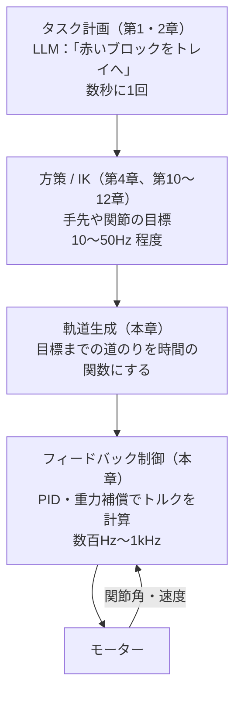
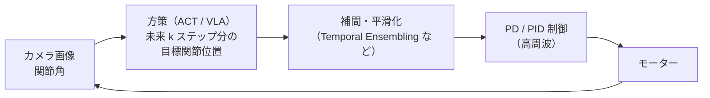

# はじめに

[第4章](./04_逆運動学.md)では、逆運動学（IK）で「手先の目標」を「関節角の目標」に変換しました。最後の実験では、手先は円の上を追従したものの、約 2 mm の **追従遅れ** が残りました。また第0章では、`kp=300, kd=1` のような値を、決め方を説明しないまま使っていました。

本章では、IK の下の層、つまり **「関節角の目標が決まったあと、モーターにどんなトルクを出せば、その角度に正確に、なめらかにたどり着けるか」** を扱います。

本章のゴールは次の4つです。

- **PID 制御** の P・I・D それぞれの役割と、典型的な失敗（定常偏差・振動・積分ワインドアップ）を理解する
- 重力に逆らって腕を支えるための **重力補償** を理解する
- 急な動きを避けるための **軌道生成**（台形速度・5次多項式）を実装して比べる
- VLA などの学習済み方策の出力を、**低レベルの制御ループでどう実行するか** を理解する

:::note info
**前提**
- 必要なライブラリは `mujoco` と `numpy` だけです
- 本章のコードは、ディレクトリ内で完結しています（第3・4章のファイルは不要です）
:::

---

# 1. 制御の全体像：どの層が、何を、どの速さで決めるか

ここまでの章で作ってきた層を、下から並べると次のようになります。



本章で扱うのは、下の2つの層です。

| 層 | 決めること | ソフトウェアでたとえると |
|---|---|---|
| **軌道生成** | 現在地から目標まで、**いつ・どこを・どの速さで** 通るか | アニメーションの easing 関数（ease-in-out） |
| **フィードバック制御** | 目標と現在のずれから、**今この瞬間に出すトルク** | オートスケーラーのような「目標値とのずれを見て、操作量を決め続ける」制御ループ |

---

# 2. フィードバック制御と PID

## 2.1 PID 制御の式

関節角の目標を $q^{*}$、現在の角度を $q$、誤差を $e = q^{*} - q$ とすると、PID 制御はトルク $\tau$ を次のように決めます。

$$
\tau = K_p\, e + K_i \int_0^t e\, dt + K_d\, \dot{e}
$$

| 項 | 何に反応するか | 物理的なイメージ | 役割 |
|---|---|---|---|
| **P（比例）** | 今のずれの大きさ | バネ | ずれているほど強く戻す |
| **I（積分）** | ずれの蓄積 | 「ずっとずれているなら、もっと押す」 | 残り続けるずれ（定常偏差）を消す |
| **D（微分）** | ずれの変化の速さ | ダンパー（ショックアブソーバー） | 動きにブレーキをかけ、行き過ぎや振動を抑える |

第0章のヤコビ転置法 $\tau = K_p J^\top e - K_d \dot{q}$ は、手先の位置について P と D を使う **PD 制御** でした。

:::note info
**D 項の実装の工夫**
本章の実装では、D 項に誤差の微分 $\dot{e}$ ではなく、**関節速度にマイナスを付けたもの** $-\dot{q}$ を使っています（目標が動く場合は $\dot{q}^{*} - \dot{q}$）。目標が階段状に急に変わると $\dot{e}$ が瞬間的に巨大になり、トルクが跳ねる（**微分キック**）ためです。実際の PID 実装でも、この形がよく使われます。
:::

## 2.2 それぞれの項が「ないと何が起きるか」

実践パートの実験（重力のある1関節アームを、水平から 45° 持ち上げる）の結果を先に示します。

| 制御則 | オーバーシュート | 整定時間 | 定常偏差 |
|---|---|---|---|
| P のみ | 約 80% | 整定しない（振動し続ける） | — |
| PD | 0% | 0.17 秒 | **0.60°** |
| PID | 6.8% | 0.74 秒 | ほぼ 0° |
| PD + 重力補償 | 0% | **0.14 秒** | **ほぼ 0°** |

**P だけ** だと、バネだけで吊るしたおもりのように、目標の周りで振動し続けます。**D を足す** と振動は収まりますが、目標に 0.6° 届きません。**I を足す** とずれは消えますが、行き過ぎ（オーバーシュート）が出て、落ち着くまで時間がかかります。そして **PD + 重力補償** が、最も速く、行き過ぎなく、ずれなく目標にたどり着きます。

以降の節で、なぜこうなるのかを説明します。

## 2.3 定常偏差はなぜ生まれるのか

PD 制御で 0.6° のずれが残ったのは、**重力** のせいです。腕を 45° に保つには、重力に逆らうトルク $g(q)$ が必要です。腕が止まっている（$\dot{q} = 0$）とき、PD 制御が出すトルクは $K_p e$ だけなので、つり合いの条件は次のようになります。

$$
K_p\, e = g(q) \quad\Rightarrow\quad e = \frac{g(q)}{K_p}
$$

つまり、**重力を支えるためには、わざとずれていなければならない** のです。実験のアーム（質量 1 kg、重心まで 0.15 m）では $g = 1 \times 9.81 \times 0.15 \times \cos 45^\circ \approx 1.04$ Nm、$K_p = 100$ なので、$e \approx 0.0104$ rad $\approx 0.60°$ となり、実験結果と一致します。

$K_p$ を大きくすればずれは小さくなりますが、振動しやすくなり、ノイズにも敏感になります。ずれを消す方法としては、次の2つがあります。

1. **I 項を足す**：ずれが残っている間、積分値が増え続けて、やがて重力を支えるトルクになる
2. **重力の分を最初から足しておく**（重力補償）：次の節で説明

## 2.4 積分ワインドアップ

I 項には、**積分ワインドアップ** という有名な落とし穴があります。

モーターが出せるトルクには上限があります。目標までの距離が大きいと、モーターはしばらく上限いっぱいのトルクで動きます（**飽和**）。この間も誤差は大きいままなので、**積分値はどんどん溜まり続けます**。目標に到着した時点では、積分値が過剰に溜まっているため、目標を大きく **行き過ぎて** しまいます。

実験では、トルク上限を 2.5 Nm に絞って 60° 持ち上げたところ、次のようになりました。

| 実装 | オーバーシュート | 整定時間 |
|---|---|---|
| 積分値の上限なし | **36.7%** | 1.69 秒 |
| 積分値の上限あり（アンチワインドアップ） | 1.1% | 0.30 秒 |

対策は、**積分値に上限を設ける**、**出力が飽和している間は積分を止める** などです。ソフトウェアでいえば、障害中に溜まったリトライのキューが、復旧した瞬間に一斉に流れ込んで再びサービスを落とす状況に似ています。第4章の差分 IK で指令値が暴走したのも、同じ種類の現象でした。

---

# 3. 重力補償：「支える力」は先に足しておく

## 3.1 ロボットの運動方程式

ロボットアームの関節トルクと動きの関係は、次の **運動方程式** で表されます（導出は省略します）。

$$
\boldsymbol{\tau} = M(\boldsymbol{q})\, \ddot{\boldsymbol{q}} + C(\boldsymbol{q}, \dot{\boldsymbol{q}})\, \dot{\boldsymbol{q}} + \boldsymbol{g}(\boldsymbol{q})
$$

| 項 | 意味 | たとえ |
|---|---|---|
| $M(\boldsymbol{q})\ddot{\boldsymbol{q}}$ | 加速させるのに必要なトルク（$M$ は慣性行列） | ニュートンの $F = ma$ の $ma$ |
| $C(\boldsymbol{q}, \dot{\boldsymbol{q}})\dot{\boldsymbol{q}}$ | コリオリ力・遠心力 | 回転しながら腕を伸ばすと外に振られる力 |
| $\boldsymbol{g}(\boldsymbol{q})$ | 重力に逆らって姿勢を保つトルク | 腕を水平に上げ続けるのに必要な力 |

$M$ と $\boldsymbol{g}$ が姿勢 $\boldsymbol{q}$ によって変わる点が重要です。腕を伸ばしているときと縮めているときでは、動かしにくさも、支えるのに必要な力も違います。

## 3.2 PD + 重力補償

**重力補償** は、この $\boldsymbol{g}(\boldsymbol{q})$ をモデルから計算して、PD 制御の出力に **最初から足しておく** 方法です。

$$
\boldsymbol{\tau} = K_p (\boldsymbol{q}^{*} - \boldsymbol{q}) + K_d (\dot{\boldsymbol{q}}^{*} - \dot{\boldsymbol{q}}) + \boldsymbol{g}(\boldsymbol{q})
$$

重力の分は補償項が支えてくれるので、PD 部分は「ずれを直す」ことだけに集中できます。その結果、定常偏差がなくなり、I 項も不要になります。

MuJoCo では、重力とコリオリ力・遠心力をまとめた項が `data.qfrc_bias` に毎ステップ計算されているので、これを足すだけで実装できます。

さらに進んで、慣性 $M(\boldsymbol{q})$ まで含めて補償する方法を **計算トルク法**（Computed Torque Control）と呼びます。手先の空間で同じことを行う **操作空間制御**（Operational Space Control）は、NVIDIA Isaac Lab にもコントローラとして用意されています[^isaaclab-ctrl]。

:::note warn
重力補償は **モデルが正確であること** が前提です。リンクの質量や重心位置がずれていたり、未知の物体を掴んでいたりすると、補償しきれない分が誤差として残ります。実用では、PD + 重力補償に小さな I 項を組み合わせることもあります。
:::

---

# 4. ゲインの決め方

## 4.1 2次系としての見方

1つの関節を、慣性 $I$ の回転体とみなし、重力補償済みの PD 制御をかけると、運動方程式は次のようになります。

$$
I \ddot{q} = K_p (q^{*} - q) - K_d \dot{q}
$$

これは、**バネ・ダンパー・おもり** の振動系と同じ形です。この系の性質は、2つの数で決まります。

$$
\omega_n = \sqrt{\frac{K_p}{I}}, \qquad \zeta = \frac{K_d}{2\sqrt{K_p\, I}}
$$

- $\omega_n$（**固有角周波数**）：応答の速さ。$K_p$ を大きくすると速くなる
- $\zeta$（**減衰比**）：揺れにくさ（大きいほど振動が収まりやすい）

| 減衰比 $\zeta$ | 応答 |
|---|---|
| $\zeta < 1$（不足減衰） | 速いが、行き過ぎて振動する |
| $\zeta = 1$（臨界減衰） | **行き過ぎずに最も速く** 目標に着く |
| $\zeta > 1$（過減衰） | 行き過ぎないが、ゆっくり |

ここから、ゲイン調整の基本方針が得られます。

1. 欲しい応答の速さ $\omega_n$ を決め、$K_p = I \omega_n^2$ とする
2. $\zeta \approx 1$ になるように $K_d = 2\sqrt{K_p I}$ とする

MuJoCo の位置制御アクチュエータには、$K_d$ を直接指定する代わりに **減衰比で指定する** `dampratio` 属性が用意されています[^mujoco-pos]。上で説明した考え方に対応する機能です。

## 4.2 シミュレータでの「ゲイン」

Isaac Lab や mjlab などのロボット学習フレームワークでは、関節の **stiffness**（剛性）と **damping**（減衰）を設定します[^isaaclab-act][^mjlab-act]。これは、ここまでの $K_p$ と $K_d$ そのものです。

トルクの計算方法には、さらに2種類あります。

| 方式 | 仕組み | 特徴 |
|---|---|---|
| **組み込み（implicit）** | PD 制御を物理エンジンのソルバーの中で計算する | 大きなゲインや大きな時間刻みでも安定しやすい |
| **明示的（explicit）** | ユーザーのコードでトルクを計算して渡す | 遅延・飽和・モーター特性などを自由にモデル化できるが、数値的には不安定になりやすい |

mjlab のドキュメントでは、明示的な方式は外部で計算した速度依存の力を積分器が考慮できないため、組み込み型より数値的に不安定になりやすいと説明されています[^mjlab-act]。本章の実装は、学習のためにトルクを自分で計算する **明示的な方式** です。実践パートで、これが原因の不安定さに実際に遭遇します。

---

# 5. 軌道生成：目標までの「道のり」を設計する

## 5.1 なぜ軌道が必要か

目標の関節角を **いきなり** PD 制御に渡すと、最初の瞬間に誤差が最大になり、モーターは上限いっぱいのトルクを出します。その結果、次のような問題が起こります。

- 関節が急加速し、ロボットや掴んでいる物体に大きな衝撃がかかる
- トルクが飽和し、関節ごとに到着のタイミングがばらばらになる（手先がまっすぐ動かない）
- モーターや減速機の寿命が縮む

そこで、目標までの道のりを **時間の関数** $q^{*}(t)$ として設計し、PD 制御にはその時々の目標位置と目標速度を渡します。これが **軌道生成** です。

## 5.2 台形速度プロファイル

最もよく使われる軌道の1つが **台形速度プロファイル** です。「一定の加速度で加速 → 一定の速度で移動 → 一定の加速度で減速」の3つの区間からなり、速度のグラフが台形になります。

- 長所：最高速度と加速度を直接指定できる。計算が簡単
- 短所：区間の境目で **加速度が不連続にジャンプ** する

加速度の不連続は、トルクの急な変化として現れ、振動や衝撃の原因になります。

## 5.3 5次多項式（最小躍度軌道）

加速度まで連続にしたい場合は、**5次多項式** を使います。始点 $q_0$ から終点 $q_1$ まで、時間 $T$ で移動する軌道を、正規化した時間 $s = t / T$ を使って次のように書きます。

$$
q^{*}(t) = q_0 + (q_1 - q_0)\left(10 s^3 - 15 s^4 + 6 s^5\right)
$$

この多項式は、**始点と終点で、速度も加速度も 0** になるように係数が決められています。加速度が連続なので、トルクもなめらかに変化します。

この軌道は、加速度の変化率である **躍度（ジャーク）** の二乗の積分を最小にする軌道（**最小躍度軌道**）にもなっています。人が手を伸ばすときの動きもこれに近いと言われており、なめらかな動きの基準としてよく使われます。

## 5.4 関節空間と作業空間

軌道は、**どの空間で補間するか** によっても性質が変わります。

| 補間する空間 | 方法 | 手先の動き | 使いどころ |
|---|---|---|---|
| **関節空間** | 各関節の角度を補間する | 曲線を描く（直線にならない） | 単純な移動。特異姿勢の心配が少ない |
| **作業空間** | 手先の位置（と姿勢）を補間し、各時刻で IK を解く | 直線など、狙った形を描ける | 物体に近づく、表面をなぞるなど。姿勢の補間には第3章の slerp を使う |

本章の実践では、関節空間での補間を扱います。

---

# 6. 学習済み方策と低レベル制御の関係

## 6.1 方策は「トルク」ではなく「目標位置」を出すことが多い

第4章で、VLA などの学習済み方策は、手先や関節の **目標** を出力し、それを IK や低レベル制御が実行する、と説明しました。本章の内容を踏まえると、この構成をより具体的に理解できます。

模倣学習の代表的な手法 **ACT（Action Chunking with Transformers）** を例にとります。ACT は、カメラ画像と関節角を入力として、**未来の数十ステップ分の目標関節位置**（アクションチャンク）をまとめて出力し、それを **低レベルの PID 制御器が追従** する構成になっています[^act-paper][^act-jp]。



方策がトルクではなく目標位置を出すのは、次のような理由からです。

- **学習が安定する**：トルクは重力や慣性によって姿勢ごとに大きく変わるが、目標位置なら低レベル制御がそれを吸収してくれる
- **推論の頻度を下げられる**：方策の推論が 10〜50Hz 程度でも、低レベル制御が 1kHz 近い周期で安定化してくれる
- **安全**：トルクの上限や速度の制限を、低レベル制御の側で確実にかけられる

さらに興味深いのは、**目標位置と実際の位置のずれが、PD 制御を通じて「力」になる** という点です。物体を押し付けるとき、方策は物体の少し奥を目標位置として出力し、そのずれ × $K_p$ の力で押し付けます。ACT の論文では、人間の操作で記録した「操作用アームの位置」を、追従側アームの実際の位置ではなく **目標位置としてそのまま学習ラベルに使う** ことの重要性が議論されています[^act-jp]。**$K_p$ と $K_d$ は、方策の「出力の意味」の一部** なのです。

## 6.2 周波数の違いをどう埋めるか

方策の出力周期（たとえば 10Hz）と、制御ループの周期（たとえば 1kHz）には大きな差があります。方策の出力を、制御ループでどう使うかによって、動きの質が変わります。

| 方法 | やり方 | 問題点 |
|---|---|---|
| **ゼロ次ホールド** | 次の出力が来るまで、同じ目標を保持する | 目標が階段状になり、周期ごとにトルクが跳ねる |
| **補間** | 前の目標と次の目標の間を、線形や高次の多項式で補間する | 少し遅れる。補間方法によっては周期の境目で速度が不連続 |
| **アクションチャンク + 平滑化** | 未来の複数ステップをまとめて出力し、重なった予測を加重平均する | 推論コストと反応速度のトレードオフ |

ACT の **Temporal Ensembling** は3つ目の方法で、各時刻について過去の複数回の予測を指数的な重みで平均し、動きの小刻みな揺れを抑えます[^act-forge]。実践パートでは、1つ目と2つ目の違いを実際に確かめます。

---

# 7. 実践：制御と軌道生成を MuJoCo で確かめる

## 7.1 ファイル構成

```text
ch05_control_trajectory/
├── pid_pendulum.py      # 1関節アームで P / PD / PID / PD+重力補償・積分ワインドアップ
├── arm_model.py         # 重力のある4自由度アームと PD + 重力補償
├── trajectory.py        # ステップ・台形速度・5次多項式の比較
└── chunk_execution.py   # 10Hz の方策出力を 1kHz で実行する（ホールド vs 補間）
```

## 7.2 PID 制御の比較：`pid_pendulum.py`

水平な軸まわりに回る1関節のアーム（長さ 0.3 m、質量 1 kg）を、重力に逆らって水平から 45° 持ち上げます。トルクの上限は 20 Nm です。

```python:pid_pendulum.py
"""第5章 (1): 重力のある1関節アームで P / PD / PID / PD+重力補償 を比較する"""
import mujoco
import numpy as np

MJCF = """
<mujoco model="pendulum">
  <option timestep="0.001" gravity="0 0 -9.81"/>
  <worldbody>
    <body name="link" pos="0 0 0.5">
      <!-- 水平な y 軸まわりに回る関節：角度 0 で腕が水平（x 方向）を向く -->
      <joint name="j" type="hinge" axis="0 -1 0" damping="0.05"/>
      <geom type="capsule" fromto="0 0 0 0.3 0 0" size="0.02" mass="1.0"/>
    </body>
  </worldbody>
  <actuator><motor joint="j" ctrlrange="-@LIM@ @LIM@"/></actuator>
</mujoco>
"""


class PID:
    def __init__(self, kp, ki=0.0, kd=0.0, i_limit=None):
        self.kp, self.ki, self.kd, self.i_limit = kp, ki, kd, i_limit
        self.integral = 0.0

    def __call__(self, target, q, qdot, dt):
        e = target - q
        self.integral += e * dt
        if self.i_limit is not None:                       # アンチワインドアップ（積分値の上限）
            self.integral = np.clip(self.integral, -self.i_limit, self.i_limit)
        # D 項は誤差の微分ではなく「-速度」を使う（目標が急に変わっても D 項が跳ねない）
        return self.kp * e + self.ki * self.integral - self.kd * qdot


def run(ctrl, target, gravity_comp=False, torque_limit=20.0, T=3.0):
    model = mujoco.MjModel.from_xml_string(MJCF.replace("@LIM@", str(torque_limit)))
    data = mujoco.MjData(model)
    mujoco.mj_forward(model, data)
    log_q, log_tau = [], []
    for _ in range(int(T / model.opt.timestep)):
        q, qdot = data.qpos[0], data.qvel[0]
        tau = ctrl(target, q, qdot, model.opt.timestep)
        if gravity_comp:
            tau += data.qfrc_bias[0]                         # 重力（+コリオリ力）を打ち消すトルク
        data.ctrl[0] = np.clip(tau, -torque_limit, torque_limit)
        mujoco.mj_step(model, data)
        log_q.append(data.qpos[0]); log_tau.append(data.ctrl[0])
    return np.array(log_q), np.array(log_tau), model.opt.timestep


def metrics(q, target, dt, band=np.deg2rad(1.0)):
    """オーバーシュート・整定時間（±1°に収まって以後出ない時刻）・定常偏差"""
    overshoot = max(0.0, (q.max() - target) / target * 100)
    outside = np.where(np.abs(q - target) > band)[0]
    settle = (outside[-1] + 1) * dt if len(outside) else 0.0
    if settle > len(q) * dt - 0.2:
        return overshoot, float("nan"), float("nan")        # 時間内に整定しなかった
    sse = np.rad2deg(target - q[-200:].mean())
    return overshoot, settle, sse


if __name__ == "__main__":
    target = np.deg2rad(45)                                 # 水平から 45° 持ち上げる
    cases = [
        ("P   (Kp=20)",              PID(20),                     False),
        ("P   (Kp=100)",             PID(100),                    False),
        ("PD  (Kp=100, Kd=4)",       PID(100, kd=4),              False),
        ("PID (Kp=100, Ki=200, Kd=4)", PID(100, ki=200, kd=4),    False),
        ("PD + 重力補償",             PID(100, kd=4),              True),
    ]
    print(f"目標: {np.rad2deg(target):.0f}°（重力に逆らって持ち上げる）\n")
    print(f"{'制御則':28s} {'オーバーシュート':>10s} {'整定時間':>8s} {'定常偏差':>8s} {'最大トルク':>8s}")
    for name, ctrl, gc in cases:
        q, tau, dt = run(ctrl, target, gravity_comp=gc)
        os_, st, sse = metrics(q, target, dt)
        st_s = f"{st:.2f} s" if not np.isnan(st) else "未整定"
        sse_s = f"{sse:6.2f}°" if not np.isnan(sse) else "（振動）"
        print(f"{name:28s} {os_:9.1f} % {st_s:>8s} {sse_s:>8s} {np.abs(tau).max():7.1f} Nm")

    print("\n=== 積分ワインドアップ：トルク上限が厳しい（2.5 Nm）とき ===")
    target2 = np.deg2rad(60)
    for name, ctrl in [("PID（積分の上限なし）", PID(100, ki=200, kd=4)),
                       ("PID（積分の上限あり）", PID(100, ki=200, kd=4, i_limit=0.01))]:
        q, tau, dt = run(ctrl, target2, torque_limit=2.5, T=6.0)
        os_, st, sse = metrics(q, target2, dt)
        st_s = f"{st:.2f} s" if not np.isnan(st) else "未整定"
        print(f"{name:24s} オーバーシュート {os_:5.1f} %  整定時間 {st_s:>8s}  定常偏差 {sse:6.2f}°")
```

```bash
python pid_pendulum.py
```

実行結果：

```text
目標: 45°（重力に逆らって持ち上げる）

制御則                            オーバーシュート     整定時間     定常偏差    最大トルク
P   (Kp=20)                       78.2 %      未整定     （振動）    15.7 Nm
P   (Kp=100)                      81.8 %      未整定     （振動）    20.0 Nm
PD  (Kp=100, Kd=4)                 0.0 %   0.17 s    0.60°    20.0 Nm
PID (Kp=100, Ki=200, Kd=4)         6.8 %   0.74 s   -0.01°    20.0 Nm
PD + 重力補償                          0.0 %   0.14 s    0.00°    20.0 Nm

=== 積分ワインドアップ：トルク上限が厳しい（2.5 Nm）とき ===
PID（積分の上限なし）             オーバーシュート  36.7 %  整定時間   1.69 s  定常偏差  -0.00°
PID（積分の上限あり）             オーバーシュート   1.1 %  整定時間   0.30 s  定常偏差  -0.00°
```

2.2 節と 2.4 節で示したとおりの結果です。

- **P のみ** は、$K_p$ を 20 にしても 100 にしても振動が収まりません。$K_p$ を大きくすると、振動の周期が短くなるだけです
- **PD** は振動なく 0.17 秒で整定しますが、**0.60° の定常偏差** が残ります。2.3 節の計算値と一致しています
- **PID** は定常偏差を消しますが、オーバーシュートが 6.8% 出て、整定に 0.74 秒かかります
- **PD + 重力補償** は、0.14 秒で、オーバーシュートも定常偏差もなく整定しました

最大トルクの列がほぼすべて 20 Nm になっているのは、動き始めの瞬間に誤差が最大になり、トルクが上限に張り付くためです。これを避けるのが軌道生成です。

積分ワインドアップの実験では、トルク上限を 2.5 Nm に絞っています。積分値に上限を設けるだけで、オーバーシュートが 36.7% から 1.1% に、整定時間が 1.69 秒から 0.30 秒に改善しました。

## 7.3 4自由度アームのモデル：`arm_model.py`

第3・4章と同じ形の4自由度アームに、**質量（密度）・重力・トルク上限付きのモーター** を追加します。制御則は PD + 重力補償です。

```python:arm_model.py
"""第5章: 重力のある4自由度アーム（第3・4章と同じ形状に、質量・重力・モーターを追加）"""
import mujoco
import numpy as np

MJCF_DYN = """
<mujoco model="arm4dof_dynamics">
  <option timestep="0.001" gravity="0 0 -9.81"/>
  <default><joint damping="0.1" armature="0.01"/><geom density="1000"/></default>
  <worldbody>
    <body name="base" pos="0 0 0.1">
      <joint name="yaw" type="hinge" axis="0 0 1"/>
      <geom type="cylinder" size="0.04 0.02" rgba="0.3 0.3 0.3 1"/>
      <body name="upper_arm">
        <joint name="shoulder" type="hinge" axis="0 1 0"/>
        <geom type="capsule" fromto="0 0 0 0.3 0 0" size="0.02" rgba="0.2 0.4 0.8 1"/>
        <body name="forearm" pos="0.3 0 0">
          <joint name="elbow" type="hinge" axis="0 1 0"/>
          <geom type="capsule" fromto="0 0 0 0.25 0 0" size="0.018" rgba="0.8 0.4 0.2 1"/>
          <body name="wrist" pos="0.25 0 0">
            <joint name="wrist_roll" type="hinge" axis="1 0 0"/>
            <geom type="box" size="0.02 0.03 0.01" pos="0.025 0 0" rgba="0.2 0.7 0.3 1"/>
            <site name="hand" pos="0.05 0 0" size="0.01"/>
          </body>
        </body>
      </body>
    </body>
  </worldbody>
  <actuator>
    <motor joint="yaw" ctrlrange="-30 30"/> <motor joint="shoulder" ctrlrange="-30 30"/>
    <motor joint="elbow" ctrlrange="-30 30"/> <motor joint="wrist_roll" ctrlrange="-5 5"/>
  </actuator>
</mujoco>
"""

KP = np.array([150.0, 150.0, 100.0, 10.0])    # 関節ごとの比例ゲイン
KD = np.array([10.0, 10.0, 6.0, 0.5])         # 関節ごとの微分ゲイン
LIMIT = np.array([30.0, 30.0, 30.0, 5.0])     # トルク上限 [Nm]


def make(q0):
    """モデルを作り、関節角 q0 から始める"""
    model = mujoco.MjModel.from_xml_string(MJCF_DYN)
    data = mujoco.MjData(model)
    data.qpos[:] = q0
    mujoco.mj_forward(model, data)
    return model, data


def pd_gravity(data, q_ref, qd_ref):
    """PD + 重力補償：τ = Kp (q_ref − q) + Kd (q̇_ref − q̇) + g(q)

    data.qfrc_bias には重力とコリオリ力・遠心力の項が入っている（MuJoCo が毎ステップ計算）。
    """
    tau = KP * (q_ref - data.qpos) + KD * (qd_ref - data.qvel) + data.qfrc_bias
    return np.clip(tau, -LIMIT, LIMIT)
```

### つまずいたポイント：アーマチュア

最初の実装では、このファイルの `armature="0.01"` を付けていませんでした。すると、どの軌道で動かしてもシミュレーションが暴れ、トルクが上限に張り付いたまま目標に到達しませんでした。

原因は、**手首のリンクが非常に軽い** ことです。手首の小さな箱（約 50 g）は、ロール軸まわりの慣性が $10^{-5}$ kg·m² 程度しかありません。4.1 節の式で考えると、慣性 $I$ が極端に小さいと、同じ $K_p$・$K_d$ でも系の応答が非常に「速く」なります。そのため、1 ms の時間刻みで明示的に計算したトルクでは、1ステップの間に速度が行き過ぎ、数値的に発散します。4.2 節で触れた、明示的な方式の弱点がそのまま現れた形です。

`armature` は、**モーターの回転子や減速機の慣性** を関節に追加する設定です。実際のロボットでは、減速機を通したモーターの回転子の慣性が、軽いリンクの慣性よりずっと大きいことがよくあります。この値を加えると、物理的にもより現実に近くなり、シミュレーションも安定しました。

**「リンクの質量だけでなく、モーター側の慣性もモデルに入れる」** ことは、シミュレーションで学習した方策を実機に移す（Sim2Real、第18章）うえでも重要なポイントです。

## 7.4 軌道の比較：`trajectory.py`

アームに、1 秒かけて旋回しながら腕を持ち上げ、手首を 90° ひねる動きをさせます。同じ始点・終点・制御則で、軌道だけを変えて比べます。

```python:trajectory.py
"""第5章 (2): 同じ移動を「ステップ」「台形速度」「5次多項式」の3つの軌道で比べる"""
import mujoco
import numpy as np

from arm_model import LIMIT, make, pd_gravity

np.set_printoptions(precision=3, suppress=True)


def step_traj(q0, q1, T, t):
    """目標を一瞬で切り替える（軌道なし）"""
    return q1.copy(), np.zeros_like(q0)


def trapezoid_traj(q0, q1, T, t, ratio=0.25):
    """台形速度：加速 → 等速 → 減速。加速度は区間ごとに一定（境界で不連続）"""
    ta = ratio * T                                  # 加速にかける時間
    vmax = 1.0 / (T - ta)                           # 正規化した最高速度（全体の移動量を 1 とする）
    if t < ta:
        s, sd = 0.5 * vmax / ta * t**2, vmax / ta * t
    elif t < T - ta:
        s, sd = 0.5 * vmax * ta + vmax * (t - ta), vmax
    elif t < T:
        tr = T - t
        s, sd = 1.0 - 0.5 * vmax / ta * tr**2, vmax / ta * tr
    else:
        s, sd = 1.0, 0.0
    return q0 + s * (q1 - q0), sd * (q1 - q0)


def quintic_traj(q0, q1, T, t):
    """5次多項式：始点と終点で速度・加速度がともに 0。加速度まで連続になる"""
    tau = np.clip(t / T, 0.0, 1.0)
    s = 10 * tau**3 - 15 * tau**4 + 6 * tau**5
    sd = (30 * tau**2 - 60 * tau**3 + 30 * tau**4) / T
    return q0 + s * (q1 - q0), sd * (q1 - q0)


def run(traj, q0, q1, T=1.0, total=2.0):
    model, data = make(q0)
    dt = model.opt.timestep
    errs, taus, vmax = [], [], 0.0
    for k in range(int(total / dt)):
        q_ref, qd_ref = traj(q0, q1, T, k * dt)
        tau = pd_gravity(data, q_ref, qd_ref)
        data.ctrl[:] = tau
        mujoco.mj_step(model, data)
        errs.append(np.abs(q_ref - data.qpos).max())
        taus.append(tau.copy())
        vmax = max(vmax, np.abs(data.qvel).max())
    taus = np.array(taus)
    dtau = np.abs(np.diff(taus, axis=0)).max() / dt          # トルクの変化率の最大値
    final = np.rad2deg(np.abs(q1 - data.qpos).max())
    sat = int((np.abs(taus) >= LIMIT - 1e-9).any(axis=1).sum())  # トルクが上限に張り付いたステップ数
    return np.rad2deg(max(errs)), np.abs(taus).max(), dtau, np.rad2deg(vmax), final, sat


if __name__ == "__main__":
    q0 = np.deg2rad([0, -20, 60, 0])
    q1 = np.deg2rad([90, -60, 30, 90])                       # 旋回しながら腕を持ち上げる
    print("移動: ", np.rad2deg(q0), "→", np.rad2deg(q1), "deg（1.0 秒で）\n")
    print(f"{'軌道':10s} {'最大追従誤差':>8s} {'最大トルク':>8s} {'トルク変化率の最大':>10s} {'最大関節速度':>8s} {'最終誤差':>7s} {'飽和ステップ':>6s}")
    for name, traj in [("ステップ", step_traj), ("台形速度", trapezoid_traj), ("5次多項式", quintic_traj)]:
        e, tmax, dtau, vmax, fin, sat = run(traj, q0, q1)
        print(f"{name:10s} {e:9.2f}° {tmax:7.1f} Nm {dtau:9.0f} Nm/s {vmax:8.0f}°/s {fin:7.3f}° {sat:8d}")
```

```bash
python trajectory.py
```

実行結果：

```text
移動:  [  0. -20.  60.   0.] → [ 90. -60.  30.  90.] deg（1.0 秒で）

軌道           最大追従誤差    最大トルク  トルク変化率の最大   最大関節速度    最終誤差 飽和ステップ
ステップ           89.98°    30.0 Nm      7600 Nm/s      999°/s   0.000°       40
台形速度            1.29°     2.3 Nm        85 Nm/s      123°/s   0.000°        0
5次多項式           1.62°     2.3 Nm         7 Nm/s      170°/s   0.000°        0
```

| 軌道 | 結果の読み方 |
|---|---|
| **ステップ** | 目標が一瞬で切り替わるので、追従誤差の最大は移動量そのもの（約 90°）です。トルクが上限に 40 ステップ張り付き、関節速度は最大 **約 1000°/s** に達しました。実機なら危険な動きです |
| **台形速度** | 最大トルクは 2.3 Nm まで下がり、関節速度も 123°/s に抑えられました。ただし、加速度が切り替わる瞬間に、トルクが **85 Nm/s** の速さで変化しています |
| **5次多項式** | 最大トルクは台形速度と同じですが、トルクの変化率は **7 Nm/s** と、台形速度の 10 分の 1 以下です。加速度が連続であることの効果です |

5次多項式は、台形速度より最大関節速度が大きく（170°/s）、追従誤差もわずかに大きくなっています。同じ時間で同じ距離を移動するために、始めと終わりの動きを台形速度よりもゆるやかにした分、中間で速く動く必要があるからです。**なめらかさと最高速度はトレードオフ** の関係にあります。

3つとも最終誤差は 0.000° です。PD + 重力補償のおかげで、どの軌道でも最終的には目標にぴったり到着しています。

## 7.5 方策の出力を実行する：`chunk_execution.py`

最後に、6.2 節の問題を確かめます。方策の代わりに、**10Hz で「次の周期の終わりにいるべき関節角」を返す関数** を用意し、1kHz の制御ループで2通りの方法で実行します。

```python:chunk_execution.py
"""第5章 (3): 学習済み方策（10Hz）の出力を、1kHz の制御ループでどう実行するか

方策の代わりに「10Hz で関節角の目標を返す関数」を使い、
(a) 届いた目標をそのまま保持する（ゼロ次ホールド）
(b) 前の目標から次の目標まで線形補間する
の2通りで実行して比べる。
"""
import mujoco
import numpy as np

from arm_model import make, pd_gravity

POLICY_HZ = 10                                   # 方策の出力周波数（VLA などを想定）


def policy(t):
    """方策の代役：時刻 t にいるべき関節角を返す（なめらかな往復運動）"""
    q = np.deg2rad([0, -40, 60, 0])
    return q + np.deg2rad([40, 15, -20, 45]) * np.sin(2 * np.pi * 0.5 * t)


def run(mode, total=4.0):
    model, data = make(policy(0.0))
    dt = model.opt.timestep
    per = int(1 / (POLICY_HZ * dt))              # 方策1回あたりの制御ステップ数（= 100）
    prev = cur = policy(0.0)
    errs, dtaus, last_tau = [], [], None
    for k in range(int(total / dt)):
        t = k * dt
        if k % per == 0:                         # 10Hz：方策が「次の周期の終わりの姿勢」を出す
            prev, cur = cur, policy(t + 1 / POLICY_HZ)
        if mode == "hold":                       # (a) 目標を階段状に切り替える
            q_ref, qd_ref = cur, np.zeros(4)
        else:                                    # (b) 周期内で等速に補間し、速度も指令する
            a = (k % per) / per
            q_ref, qd_ref = prev + a * (cur - prev), (cur - prev) * POLICY_HZ
        tau = pd_gravity(data, q_ref, qd_ref)    # 1kHz：PD + 重力補償
        data.ctrl[:] = tau
        mujoco.mj_step(model, data)
        if t > 1.0:                              # 立ち上がりの1秒を除いて評価
            errs.append(np.abs(policy(t + dt) - data.qpos).max())
            if last_tau is not None:
                dtaus.append(np.abs(tau - last_tau).max() / dt)
        last_tau = tau
    return np.rad2deg(np.mean(errs)), np.rad2deg(np.max(errs)), np.max(dtaus)


if __name__ == "__main__":
    for mode, name in [("hold", "ゼロ次ホールド"), ("interp", "線形補間")]:
        mean_e, max_e, dtau = run(mode)
        print(f"{name:8s}: 理想の軌道からの誤差 平均 {mean_e:.2f}° / 最大 {max_e:.2f}°   "
              f"トルク変化率の最大 {dtau:7.0f} Nm/s")
```

```bash
python chunk_execution.py
```

実行結果：

```text
ゼロ次ホールド : 理想の軌道からの誤差 平均 1.43° / 最大 3.35°   トルク変化率の最大   30944 Nm/s
線形補間    : 理想の軌道からの誤差 平均 0.95° / 最大 1.49°   トルク変化率の最大    6834 Nm/s
```

**線形補間** にすると、理想の軌道からの誤差が平均・最大ともに小さくなり、トルクの変化率の最大は約 4.5 分の 1 になりました。

ゼロ次ホールドでは、100 ms ごとに目標が階段状に切り替わるため、そのたびに PD 制御が「急に遠くなった目標」に向かってトルクを跳ね上げます。線形補間では、目標を少しずつ動かし、さらに **目標速度** も PD 制御に渡しているため、制御器は「今どこにいるべきか」に加えて「どの速さで動いているべきか」も知ることができます。

ただし、線形補間でも、周期の境目では目標速度が不連続に切り替わるため、トルクの変化率はまだ 6,800 Nm/s あります。ここをさらになめらかにするのが、高次の補間や、ACT の Temporal Ensembling のような工夫です（演習4）。

## 7.6 演習

1. `pid_pendulum.py` で、4.1 節の式を使って $\zeta = 0.5,\ 1.0,\ 2.0$ になるように $K_d$ を決め、応答を比べてみましょう。慣性 $I$ は、MuJoCo の `model.body_inertia` と `data.qM`（慣性行列）から確認できます。
2. `pid_pendulum.py` の重力補償で、補償に使う質量を **わざと 20% 小さく** 見積もったら、定常偏差はどうなるでしょうか。小さな I 項を足すと改善するか確かめてみましょう。
3. `trajectory.py` に、移動時間 $T$ を自動で決める機能を追加してみましょう。ヒント：5次多項式の最大速度は $1.875\,|q_1 - q_0| / T$ なので、関節ごとの速度上限から $T$ を逆算できます。
4. `chunk_execution.py` に、3つ目の方式を追加してみましょう。方策が 1 回に「未来 5 周期分」の目標を出力し、時刻ごとに過去の予測を指数的な重みで平均する、簡易版の Temporal Ensembling です。方策の出力にノイズを加えると、違いがよりはっきりします。
5. `arm_model.py` の `armature` を 0.001、0.0001 と小さくしていくと、どこでシミュレーションが不安定になるでしょうか。`model.opt.timestep` を小さくすると、安定性はどう変わるでしょうか。

---

# 8. まとめ

- **PID 制御** の P はバネ、D はダンパー、I はずれの蓄積を消す役割。P だけでは振動し、PD では重力による **定常偏差** が残り、I を足すとずれは消えるがオーバーシュートが出る
- I 項は、トルクが飽和している間に積分値が溜まりすぎる **積分ワインドアップ** に注意。積分値の上限などで対策する
- 運動方程式の重力項 $\boldsymbol{g}(\boldsymbol{q})$ を最初から足す **重力補償** を使うと、PD 制御だけで速く・正確に目標に到達できる
- 1関節を2次系とみなすと、$K_p$ で応答の速さ、$K_d$ で減衰比が決まる。$\zeta \approx 1$ が基本の目安。シミュレータの stiffness / damping はこの $K_p$ / $K_d$ のこと
- **軌道生成** で目標までの道のりを時間の関数にすると、トルクの飽和や急加速を防げる。**5次多項式** は加速度まで連続で、トルクの変化がなめらかになる
- 学習済み方策は、トルクではなく **目標位置** を出すことが多く、それを PD 制御が追従する。方策と制御ループの **周波数の差を補間などで埋める** ことが、動きの質を左右する

これで Part 2「ロボット工学の基礎」は終わりです。座標変換（第3章）→ 逆運動学（第4章）→ 制御と軌道生成（第5章）で、**「手先をここへ」という指令を、モーターのトルクにまで落とし込む** 道筋がひととおりつながりました。

## 次回予告

**第6章「MuJoCo 入門」** から Part 3「シミュレーション」に入ります。これまで MJCF をなんとなく書いてきましたが、第6章では MuJoCo を本格的に使い、**接触・摩擦・グリッパー** を含む物体把持の環境を構築します。画面表示のない環境でのレンダリング（オフスクリーンレンダリング）や、カメラ画像の取得も扱い、Part 4 以降のロボット学習に向けた土台を作ります。

---

# 参考文献

[^isaaclab-ctrl]: Isaac Lab Documentation, "isaaclab.controllers". https://isaac-sim.github.io/IsaacLab/main/source/api/lab/isaaclab.controllers.html
[^mujoco-pos]: MuJoCo Documentation, "XML Reference"（`position` アクチュエータの `kp` / `kv` / `dampratio` 属性）. https://mujoco.readthedocs.io/en/stable/XMLreference.html
[^isaaclab-act]: Isaac Lab Documentation, "Actuators". https://isaac-sim.github.io/IsaacLab/release/3.0.0/source/concepts/actuators.html
[^mjlab-act]: mjlab Documentation, "Actuators". https://mujocolab.github.io/mjlab/main/source/actuators.html
[^act-paper]: T. Z. Zhao, V. Kumar, S. Levine, C. Finn, "Learning Fine-Grained Bimanual Manipulation with Low-Cost Hardware", RSS 2023. arXiv:2304.13705. https://arxiv.org/abs/2304.13705
[^act-jp]: Hana's Blog, 「ACT 論文精読：Action Chunking with Transformers」, 2026. https://hana0721.top/blog/paper-deep-dive-act
[^act-forge]: RobotForge, "ACT and action chunking", 2026-04-26. https://robotforge.org/tutorials/learning/act-action-chunking
