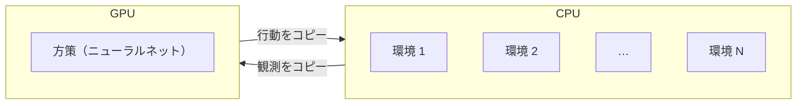
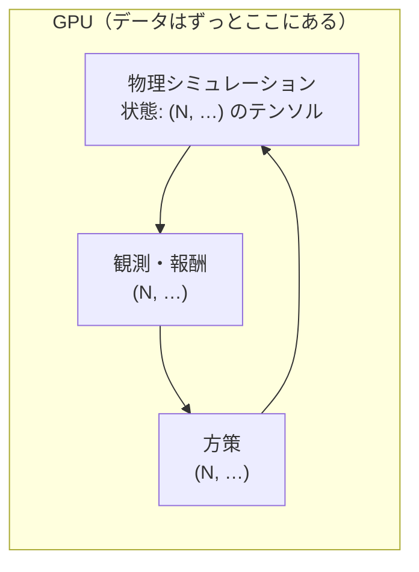
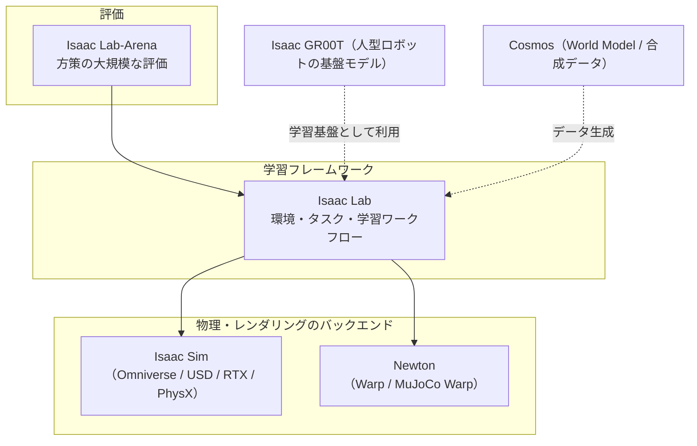

# はじめに

[第6章](./06_MuJoCo入門.md)では、MuJoCo で「掴める」環境を作りました。CPU だけで手軽に動き、物理の挙動もひととおり確かめられました。

しかし、Part 4 で扱う **強化学習** では、ロボットは数百万〜数十億回の試行錯誤を必要とします。1つの環境を実時間で動かしていたら、何年かかるかわかりません。そこで現在のロボット学習では、**GPU 上で数千〜数万の環境を同時に動かす** のが標準になっています。その代表的な基盤が、NVIDIA の **Isaac Sim** と **Isaac Lab** です。

本章のゴールは次の4つです。

- **GPU 並列シミュレーション** がなぜ速いのか、その考え方を理解する
- **Isaac Sim / Isaac Lab / Newton** など、NVIDIA のロボット学習スタックの全体像と役割分担を整理する
- Isaac Lab の **環境の書き方**（Direct / Manager-based）を、自分で書いた NumPy の並列環境と対応づけて読めるようになる
- ローカルに対応 GPU がない場合に、**クラウドで Isaac Lab を動かす** 方法を知る

:::note warn
**本章の実行環境について**
Isaac Sim は、RT コアを持つ RTX GPU（公式の最小要件は VRAM 16 GB）が必要です[^isaacsim-req]。本章の実践コードは、**GPU 並列シミュレーションの考え方を NumPy だけで体験する** もので、CPU で動きます。Isaac Lab のコマンドや構成は公式ドキュメントにもとづいて紹介していますが、筆者の環境では実行していません。

また、Isaac Lab は **3.0 への大きな移行期** にあります。執筆時点（2026年10月）の最新は **3.0 Early Access** で、正式版（GA）は 2026年10月末が目標とされています[^il-release]。コマンドや API は今後変わる可能性があるため、必ず公式ドキュメントで最新情報を確認してください。
:::

---

# 1. なぜ GPU で並列に動かすのか

## 1.1 強化学習は大量のデータを必要とする

強化学習（第9章）は、「試す → 結果（報酬）を見る → 方策を少し直す」を延々と繰り返す学習方法です。LLM の事前学習が大量のテキストを必要とするのと同じように、強化学習は大量の **試行（環境とのやり取り）** を必要とします。

たとえば、歩行ロボットの方策を学習するのに、合計で数十億ステップの経験が必要になることもあります。1つの環境を実時間で動かしていては、とても間に合いません。

## 1.2 従来の書き方：CPU で環境を1つずつ動かす

GPU 並列シミュレーションが登場する前は、次のような構成が一般的でした。



この構成には、2つのボトルネックがあります。

1. **環境ごとの処理がループになる**：Python のループで1環境ずつ物理を計算するので、環境数に比例して遅くなる
2. **CPU と GPU の間のデータコピー**：毎ステップ、観測を GPU に送り、行動を CPU に戻す必要がある

## 1.3 GPU 並列の書き方：すべてを1つの大きなテンソルにする

GPU 並列シミュレーションでは、**N 個の環境の状態を、形状 `(N, …)` の1つのテンソルにまとめ**、物理の計算も、観測・報酬の計算も、方策の推論も、すべて GPU 上のテンソル演算として一括で行います。



機械学習エンジニアなら、**「ミニバッチ」と同じ発想** だと考えるとわかりやすいでしょう。1サンプルずつ学習するより、バッチでまとめて計算したほうが GPU を効率よく使えます。ロボットのシミュレーションでも、環境を「バッチ」として扱うのです。

ソフトウェアエンジニア向けにたとえるなら、**1行ずつ `INSERT` するのをやめて、バルクインサートにする** ようなものです。1件あたりのオーバーヘッドがほぼ消えます。

この「シミュレーションから学習まで、データを GPU から出さない」構成は、NVIDIA の Isaac Gym（Isaac Lab の前身）が広めたもので、現在の Isaac Lab や、MuJoCo の GPU 版（MuJoCo Warp / MJX）、第8章の Genesis にも共通する考え方です。

実践パートでは、この効果を **NumPy だけで** 確かめます。CPU 1コアの環境でも、環境数が数百を超えると、環境を一括で計算するだけで、ループより **100 倍以上** 速くなります。

---

# 2. NVIDIA のロボット学習スタック

NVIDIA のロボット関連の製品は名前が多く、混乱しやすいので、まず役割を整理します。



| 名前 | 何をするものか | たとえ |
|---|---|---|
| **Omniverse / USD** | 3D シーンを記述・共有するための基盤。USD（Universal Scene Description）は Pixar 発の3Dシーンの記述形式 | 3D 版の「共通ファイル形式 + 共同編集基盤」 |
| **Isaac Sim** | Omniverse 上に作られたロボット用シミュレータ。写実的な **RTX レンダリング**、**PhysX** 物理エンジン、各種センサー、ROS 2 連携など | ロボット用の「ゲームエンジン」 |
| **Isaac Lab** | Isaac Sim などの上で動く **ロボット学習フレームワーク**。並列環境、タスク定義、強化学習・模倣学習のワークフローを提供 | 学習のための「アプリケーションフレームワーク」 |
| **Newton** | GPU で動く物理エンジン。NVIDIA Warp 上に作られ、MuJoCo Warp を統合している | 新しい「物理エンジン」 |
| **Isaac Lab-Arena** | Isaac Lab 上で、方策を大規模に評価するためのフレームワーク | 方策の「テストスイート」 |

Isaac Lab 自体は BSD-3 ライセンスのオープンソースで、強化学習・模倣学習・モーションプランニングといったワークフローを扱います[^il-docs]。NVIDIA の人型ロボット基盤モデル **Isaac GR00T** の学習基盤にもなっています[^il-nvidia]。

## 2.1 Newton：NVIDIA・Google DeepMind・Disney の共同プロジェクト

**Newton** は、GPU で動く、拡張可能で **微分可能な** 物理エンジンです。NVIDIA Warp の上に作られ、**MuJoCo Warp**（MuJoCo の GPU 版）を統合しています。NVIDIA、Google DeepMind、Disney Research が開発に参加し、Linux Foundation のもとでオープンソースとして運営されています[^newton]。

第6章で学んだ MuJoCo の考え方（MJCF、接触モデルなど）が、GPU 並列の世界でもそのまま活かせる、ということです。Isaac Lab のドキュメントでは、Newton で学習した方策を PhysX に移したり、その逆を行ったりして検証したこと、Newton で学習した歩行の方策を Unitree G1 の実機で動かしたことが報告されています[^newton]。

## 2.2 Isaac Lab 3.0：「1つのタスク、複数のバックエンド」

Isaac Lab 3.0 の最大の変更点は、**物理エンジン・レンダラー・可視化を、タスクのコードを書き換えずに切り替えられる** マルチバックエンドの設計です[^il-release]。

| 種類 | 選択肢（3.0 Early Access 時点） |
|---|---|
| 物理 | `isaacsim_physx`（Isaac Sim の PhysX）、`ovphysx`（Isaac Sim なしの PhysX）、`newton_mjwarp`（Newton / MuJoCo Warp） |
| レンダリング | `isaacsim_rtx`、`ovrtx`、`newton_renderer` |
| 可視化 | `newton_gl`、`newton_rtx`、`viser`、`rerun`、`kit` |

注目したいのは、**Isaac Sim をインストールしなくても動かせる（kit-less）** 構成が加わったことです。従来の Isaac Lab は Isaac Sim の上でしか動きませんでしたが、3.0 では Newton や OVPhysX を使えば、Isaac Sim なしで学習を回せます[^il-release][^il-docs]。

| 構成 | 向いている用途 |
|---|---|
| **Isaac Sim + PhysX** | 写実的なカメラ画像が必要なタスク、ROS 2 連携、既存の Isaac Sim のシーン資産を使う場合 |
| **Newton（MuJoCo Warp）** | 状態ベースの強化学習を高速に回したい場合、MuJoCo のモデルの考え方に慣れている場合 |

ただし、バックエンドの組み合わせによって対応しているタスク・センサー・機能が異なり、3.0 は活発に開発中であるため、**タスクごとに対応状況を確認する** 必要があります[^il-release][^il-newton-guide]。

:::note info
**Isaac Lab 2.x からの変化**
2.x 系では `./isaaclab.sh -p scripts/...` のようにスクリプトを実行していましたが、3.0 では **uv** によるセットアップと `isaaclab train` のような統一されたコマンドに移行しつつあります。また、Isaac Sim は 6.x 系、Python は 3.12 が前提になりました[^il-install]。インターネット上の情報は 2.x 系のものが多いので、バージョンに注意してください。
:::

---

# 3. Isaac Lab の環境の書き方

## 3.1 2つのワークフロー

Isaac Lab には、環境（タスク）を定義する方法が2つあります[^il-direct][^il-manager]。

| ワークフロー | 書き方 | 向いている場面 |
|---|---|---|
| **Direct**（`DirectRLEnv`） | 1つのクラスに、行動の適用・観測・報酬・終了判定・リセットを **メソッドとして直接書く** | 学習しやすい。複雑で分割しにくいロジック。Isaac Gym からの移行 |
| **Manager-based**（`ManagerBasedRLEnv`） | 観測・行動・報酬・イベントなどを、それぞれの **Manager に設定（config）として登録** する | 部品の再利用、チームでの分担開発。新規ユーザーにはこちらが推奨されている |

NVIDIA の学習コースでは、Manager-based は準備に手間がかかる代わりに再利用性が高く、Direct は1つのスクリプトにまとまっていて理解しやすい、と説明されています[^il-course]。

ソフトウェアエンジニア向けにたとえると、Direct は **1つのクラスにロジックを書くスタイル**、Manager-based は **DI コンテナに部品を登録して組み立てるスタイル** です。

## 3.2 Direct ワークフローの構成

Direct ワークフローの環境は、主に次のメソッドで構成されます[^il-direct]。

| メソッド | 役割 | 実践コードの対応箇所 |
|---|---|---|
| `_setup_scene` | ロボットや地面などを配置し、環境を複製する | `__init__` |
| `_pre_physics_step` / `_apply_action` | 方策の行動を受け取り、関節の目標やトルクに変換する | `step` の前半・`_apply_action` |
| `_get_observations` | 観測をテンソルで返す | `_get_observations` |
| `_get_rewards` | 報酬をテンソルで返す | `_get_rewards` |
| `_get_dones` | 「成功・失敗による終了」と「時間切れ」を返す | `_get_dones` |
| `_reset_idx(env_ids)` | **終わった環境だけ** をリセットする | `_reset_idx` |

重要な概念が2つあります。

**① decimation（間引き）**：物理エンジンは細かい時間刻み（例：1/120 秒）で計算しますが、方策は毎回それに付き合う必要はありません。`decimation = 2` なら、方策が1回行動を決めるごとに、物理を2ステップ進めます。第5章で学んだ「方策は遅く、制御は速く」の関係そのものです。

**② 環境ごとの自動リセット**：N 個の環境は、それぞれ異なるタイミングで終了します。そこで、終了した環境の ID だけを `_reset_idx` に渡して、**その場でリセット** します。全環境が終わるのを待つことはありません。

これらはすべて **(N, …) 形状のテンソル** で書かれます。たとえば Isaac Lab の Cartpole（倒立振子）の Direct 版では、既定で **4096 環境** を並列に動かす設定になっています[^il-direct]。

## 3.3 Manager-based ワークフローの構成

Manager-based ワークフローでは、環境を次の Manager の組み合わせで表します[^il-manager][^deepwiki-manager]。

| Manager | 役割 |
|---|---|
| Scene | ロボット・物体・センサーの配置 |
| Observation Manager | 観測を計算する関数（項）の集まり |
| Action Manager | 方策の出力を、関節の指令に変換する |
| Reward Manager | 報酬の項とその重み |
| Termination Manager | 終了条件 |
| Event Manager | リセット時やエピソード中に起こすイベント（**ドメインランダマイゼーション** など） |
| Command Manager | 「この速度で歩け」「この位置に手を伸ばせ」などの目標の生成 |

報酬を「項の重み付き和」として設定で書けるので、報酬設計の試行錯誤（第9章）がしやすくなります。また Event Manager で、摩擦係数や質量をランダムに変える **ドメインランダマイゼーション**（第18章）を簡単に組み込めます。

---

# 4. クラウドで Isaac Lab を動かす

## 4.1 必要な環境

Isaac Lab 3.0 で Isaac Sim を含む完全な構成を動かすには、次の環境が必要です[^il-install]。

| 項目 | 要件 |
|---|---|
| OS | Ubuntu 22.04 以降、または Windows 11 |
| Python | 3.12 |
| メモリ | 32 GB 以上 |
| GPU | VRAM 16 GB 以上（レンダリングにはさらに必要な場合あり） |
| Isaac Sim | 6.x 系（5.1 以前は非対応） |

さらに、Isaac Sim は **RT コアを持たない GPU（A100、H100 など）をサポートしていません**[^isaacsim-req]。データセンター向けの高性能 GPU であっても、RTX レンダリングを使う Isaac Sim は動かない点に注意が必要です。クラウドで GPU インスタンスを選ぶときは、**L40S や RTX PRO 6000 のような RT コアを持つ GPU** を選びます。

一方、Isaac Sim を使わない kit-less の Newton バックエンドの場合、必要な GPU の条件は異なる可能性があります。ただし公式に動作が保証されている構成ではないので、試す場合は、動作条件を各自で確認してください。

:::note info
**GTX 10xx 世代の GPU について**
GTX 1080（VRAM 8 GB、RT コアなし）は、Isaac Sim の要件（RT コア、VRAM 16 GB）を満たしません。また第0章で触れたとおり、最近の PyTorch の CUDA 12.8 以降のビルドは Pascal 世代に対応していません。Isaac Lab はクラウドで動かすのが現実的です。
:::

## 4.2 クラウドで動かす方法

公式に案内されている主な方法は次のとおりです。

| 方法 | 概要 |
|---|---|
| **NVIDIA Brev / Isaac Launchable** | NVIDIA のクラウド GPU サービス。Isaac Sim のドキュメントでは、L40S GPU のインスタンスで Isaac Sim のコンテナを起動し、ブラウザでストリーミング表示する手順が紹介されている[^brev] |
| **Isaac Automator** | AWS・Azure・GCP・Alibaba Cloud に、Isaac Sim / Isaac Lab 入りのリモートデスクトップ環境を自動構築するツール。インスタンスの停止・再開にも対応し、コストを抑えられる[^il-cloud] |
| **各クラウドの GPU VM に手動で構築** | Docker コンテナや uv で自分でセットアップする |

Isaac Automator は Docker の上で動き、`./deploy-azure` や `./deploy-aws` のようなコマンドで、クラウド上に環境を構築します。利用には NVIDIA NGC の API キーが必要です[^il-cloud]。比較的新しい GPU インスタンス（AWS の g7e、Azure の NCv6 など RTX PRO 6000 Blackwell 搭載のもの）にも対応が追加されています[^automator]。

:::note warn
**クラウドを使うときの注意**
- GPU インスタンスは高価です。**使い終わったら必ず停止・削除** しましょう（Isaac Automator には停止・削除のコマンドがあります）
- Isaac Sim のライブストリーミングのポートには認証や暗号化がありません。**ポートは自分の IP アドレスからのアクセスだけに制限** してください[^brev]
- 会社のクラウド環境を使う場合は、社内のクラウド利用ルールやコスト管理の方針に従ってください
:::

## 4.3 Isaac Lab 3.0 の最初のコマンド

Isaac Lab 3.0 Early Access のリリースノートでは、次の手順が紹介されています[^il-release]。

```bash
# リポジトリを取得（3.0 のブランチ）
git clone --branch release/3.0.0 https://github.com/isaac-sim/IsaacLab.git
cd IsaacLab

# Isaac Sim なし（kit-less）で、Newton 物理を使って Cartpole を学習
uv run isaaclab train --rl_library rsl_rl --task Isaac-Cartpole \
    physics=newton_mjwarp --viz newton_gl

# Isaac Sim を含む完全な構成（Isaac Sim の PhysX・RTX レンダリング）
uv run --extra isaacsim isaaclab train --rl_library rsl_rl --task Isaac-Cartpole \
    physics=isaacsim_physx --viz kit
```

- `--rl_library rsl_rl`：強化学習ライブラリとして **RSL-RL**（ETH Zurich 発の、PPO を中心とした軽量なライブラリ）を使う
- `--task Isaac-Cartpole`：登録済みのタスク名
- `physics=...`、`--viz ...`：2.2 節のバックエンドの選択

Isaac Lab には、Cartpole のような古典的な制御タスクのほか、Franka や UR10 のアーム、Allegro や Shadow Hand のような多指ハンド、ANYmal・Unitree Go2・Spot などの四脚ロボット、Unitree H1・G1 などの人型ロボットの環境が最初から含まれています[^il-docs]。

:::note warn
上記のコマンドは **Early Access 版のリリースノートの記載** です。筆者は実行して確認していません。正式版（GA）で変わる可能性があるため、実行前に公式のインストールガイドとクイックスタートを確認してください。
:::

---

# 5. 実践：GPU 並列シミュレーションの考え方を NumPy で体験する

GPU がなくても、**「環境をまとめて配列で計算する」** という考え方そのものは、NumPy で体験できます。NumPy の配列演算は、内部では C で書かれたループや SIMD 命令で一括処理されるため、Python のループよりはるかに速いからです。

## 5.1 作るもの

```text
ch07_isaac_lab/
├── vec_env.py      # N 環境を一括で扱う Reach 環境（Isaac Lab の DirectRLEnv と同じ構成）
└── benchmark.py    # ループ vs 一括のスループット比較、4096 環境での実行
```

タスクは、平面2関節アームの手先を、ランダムな目標位置に動かす **Reach** タスクです。第0章の2関節アームと同じ形状ですが、MuJoCo は使わず、**運動方程式を自分で書いて NumPy で一括に解きます**。第5章で紹介した運動方程式に、関節の粘性を加えた $M(\boldsymbol{q})\ddot{\boldsymbol{q}} + \boldsymbol{c}(\boldsymbol{q}, \dot{\boldsymbol{q}}) + D\dot{\boldsymbol{q}} = \boldsymbol{\tau}$ を、N 環境分まとめて計算します（水平面内の運動を想定しているので、重力は考慮しません）。

## 5.2 並列環境：`vec_env.py`

```python:vec_env.py
"""第7章: GPU 並列シミュレーションの考え方を NumPy で体験する

2関節アームの Reach タスクを、
  (a) 1環境ずつのクラスを N 個並べてループで回す（従来の書き方）
  (b) N 環境分の状態を (N, ...) の配列にまとめて一括で計算する（Isaac Lab の書き方）
の2通りで実装し、スループットを比べる。

(b) のメソッド構成は Isaac Lab の DirectRLEnv（_apply_action / _get_observations /
_get_rewards / _get_dones / _reset_idx）に合わせてある。NumPy を PyTorch の CUDA テンソルに
置き換えれば、そのまま GPU 上で動く形になる。
"""
import numpy as np

L1, L2 = 0.30, 0.25          # リンク長 [m]
M1, M2 = 1.0, 0.5            # リンク先端の質量 [kg]（質点モデル）
DAMP = 0.5                   # 関節の粘性
DT, DECIMATION = 0.002, 10   # 物理 500Hz、方策 50Hz（物理10ステップごとに行動を1回決める）
EPISODE_STEPS = 150          # 1エピソード = 3秒
TAU_MAX = 5.0


def dynamics(q, qd, tau):
    """平面2関節アームの運動方程式  M(q) q̈ + c(q, q̇) + D q̇ = τ  を一括で解く（形状 (N, 2)）"""
    c2, s2 = np.cos(q[:, 1]), np.sin(q[:, 1])
    m11 = (M1 + M2) * L1**2 + M2 * L2**2 + 2 * M2 * L1 * L2 * c2
    m12 = M2 * L2**2 + M2 * L1 * L2 * c2
    m22 = np.full_like(m11, M2 * L2**2)
    h = M2 * L1 * L2 * s2
    c = np.stack([-h * (2 * qd[:, 0] * qd[:, 1] + qd[:, 1] ** 2), h * qd[:, 0] ** 2], axis=1)
    rhs = tau - c - DAMP * qd
    det = m11 * m22 - m12**2                                  # 2x2 の逆行列を解析的に
    qdd = np.stack([(m22 * rhs[:, 0] - m12 * rhs[:, 1]) / det,
                    (-m12 * rhs[:, 0] + m11 * rhs[:, 1]) / det], axis=1)
    return qdd


def fk(q):
    """手先位置 (N, 2)"""
    return np.stack([L1 * np.cos(q[:, 0]) + L2 * np.cos(q[:, 0] + q[:, 1]),
                     L1 * np.sin(q[:, 0]) + L2 * np.sin(q[:, 0] + q[:, 1])], axis=1)


def jacobian(q):
    """手先のヤコビアン (N, 2, 2)（第4章）"""
    s1, c1 = np.sin(q[:, 0]), np.cos(q[:, 0])
    s12, c12 = np.sin(q[:, 0] + q[:, 1]), np.cos(q[:, 0] + q[:, 1])
    return np.stack([np.stack([-L1 * s1 - L2 * s12, -L2 * s12], axis=1),
                     np.stack([L1 * c1 + L2 * c12, L2 * c12], axis=1)], axis=1)


class VecReachEnv:
    """N 環境を一括で扱う Reach 環境（Isaac Lab の DirectRLEnv と同じ構成）"""

    def __init__(self, num_envs, seed=0):
        self.n = num_envs
        self.rng = np.random.default_rng(seed)
        self.q = np.zeros((num_envs, 2)); self.qd = np.zeros((num_envs, 2))
        self.target = np.zeros((num_envs, 2))
        self.step_count = np.zeros(num_envs, dtype=int)
        self.actions = np.zeros((num_envs, 2))
        self.successes = 0; self.episodes = 0
        self._reset_idx(np.arange(num_envs))

    # ---- 行動を受け取り、物理を DECIMATION ステップ進める ----
    def step(self, actions):
        self.actions = np.clip(actions, -1.0, 1.0)            # 方策の出力は [-1, 1] に正規化
        for _ in range(DECIMATION):
            self._apply_action()
            self.qd += dynamics(self.q, self.qd, self.tau) * DT   # 半陰的オイラー積分
            self.q += self.qd * DT
        self.step_count += 1
        obs = self._get_observations()
        rew = self._get_rewards()
        success, timeout = self._get_dones()
        done = success | timeout
        self.successes += int(success.sum()); self.episodes += int(done.sum())
        if done.any():                                        # 終わった環境だけをその場でリセット
            self._reset_idx(np.nonzero(done)[0])
        return obs, rew, done

    def _apply_action(self):
        self.tau = TAU_MAX * self.actions

    def _get_observations(self):
        return np.concatenate([np.cos(self.q), np.sin(self.q), self.qd,
                               self.target, self.target - fk(self.q)], axis=1)   # (N, 10)

    def _get_rewards(self):
        dist = np.linalg.norm(self.target - fk(self.q), axis=1)
        return -dist - 0.01 * np.square(self.actions).sum(axis=1)

    def _get_dones(self):
        dist = np.linalg.norm(self.target - fk(self.q), axis=1)
        speed = np.linalg.norm(self.qd, axis=1)
        return (dist < 0.01) & (speed < 0.2), self.step_count >= EPISODE_STEPS

    def _reset_idx(self, ids):
        """指定した環境だけ初期化する（関節角と目標位置をランダム化）"""
        k = len(ids)
        self.q[ids] = self.rng.uniform(-np.pi, np.pi, (k, 2))
        self.q[ids, 1] = self.rng.uniform(0.3, 2.5, k) * self.rng.choice([-1, 1], k)  # 特異姿勢を避ける
        self.qd[ids] = 0.0
        r = self.rng.uniform(0.15, 0.50, k); th = self.rng.uniform(-np.pi, np.pi, k)
        self.target[ids] = np.stack([r * np.cos(th), r * np.sin(th)], axis=1)
        self.step_count[ids] = 0


class SingleReachEnv:
    """比較用：1環境だけを扱うクラス（中身は VecReachEnv を N=1 で使う）"""

    def __init__(self, seed):
        self.env = VecReachEnv(1, seed)

    def step(self, action):
        return self.env.step(action[None, :])


def scripted_policy(obs):
    """学習の代わりの方策：第0章のヤコビ転置法 + ダンピング（一括で計算）"""
    q = np.arctan2(obs[:, 2:4], obs[:, 0:2])
    qd, err = obs[:, 4:6], obs[:, 8:10]
    tau = 100.0 * np.einsum("nij,ni->nj", jacobian(q), err) - 1.5 * qd   # τ = Kp Jᵀe − Kd q̇
    return tau / TAU_MAX
```

コードのポイントは次の3つです。

**① すべての状態が `(N, …)` の配列**：関節角 `self.q` は `(N, 2)`、目標 `self.target` も `(N, 2)` です。運動方程式の慣性行列も、N 個の 2×2 行列をまとめて計算し、逆行列も一括で解いています。`for` 文で環境をたどる箇所は1つもありません。

**② Isaac Lab と同じメソッド構成**：`_apply_action`、`_get_observations`、`_get_rewards`、`_get_dones`、`_reset_idx` は、3.2 節の表のとおり、Isaac Lab の `DirectRLEnv` に合わせた名前と役割です。`DECIMATION = 10` で、方策 50 Hz に対して物理を 500 Hz で回しています。NumPy の配列を PyTorch の CUDA テンソルに置き換えれば、同じ構造のまま GPU で動く形になります。

**③ 終わった環境だけをリセット**：`step` の最後で、`done` になった環境の ID だけを `_reset_idx` に渡しています。

方策には、学習の代わりに第0章の **ヤコビ転置法**（$\boldsymbol{\tau} = K_p J^\top \boldsymbol{e} - K_d \dot{\boldsymbol{q}}$）を使っています。ヤコビアンも `(N, 2, 2)` の配列で一括に計算し、`np.einsum` で N 個の行列とベクトルの積をまとめて計算しています。

## 5.3 スループットの比較：`benchmark.py`

```python:benchmark.py
"""第7章 (1): 「ループで N 環境」vs「一括で N 環境」のスループット比較"""
import time

import numpy as np

from vec_env import SingleReachEnv, VecReachEnv, scripted_policy


def steps_for(n):
    return max(50, 5000 // n)            # 環境数が少ないときは多めに回して計測誤差を減らす


def bench_loop(n):
    STEPS = steps_for(n)
    envs = [SingleReachEnv(seed=i) for i in range(n)]
    obs = [e.env._get_observations() for e in envs]
    t0 = time.perf_counter()
    for _ in range(STEPS):
        for i, e in enumerate(envs):                     # Python のループで1環境ずつ
            obs[i], _, _ = e.step(scripted_policy(obs[i])[0])
    return n * STEPS / (time.perf_counter() - t0)


def bench_vec(n):
    STEPS = steps_for(n)
    env = VecReachEnv(n)
    obs = env._get_observations()
    t0 = time.perf_counter()
    for _ in range(STEPS):
        obs, _, _ = env.step(scripted_policy(obs))       # N 環境を配列演算で一括
    return n * STEPS / (time.perf_counter() - t0)


if __name__ == "__main__":
    bench_loop(4); bench_vec(4)                          # ウォームアップ（初回の遅延を除く）
    print(f"{'環境数':>6s} {'ループ [env-step/s]':>20s} {'一括 [env-step/s]':>18s} {'倍率':>6s}")
    for n in [1, 16, 256, 4096]:
        loop = bench_loop(n) if n <= 256 else float("nan")   # 4096 はループだと遅すぎるので省略
        vec = bench_vec(n)
        ratio = f"{vec / loop:5.1f}x" if not np.isnan(loop) else "   -"
        loop_s = f"{loop:15,.0f}" if not np.isnan(loop) else f"{'（省略）':>14s}"
        print(f"{n:6d} {loop_s:>20s} {vec:18,.0f} {ratio:>6s}")

    print("\n=== 4096 環境で 10 秒分（500 方策ステップ）を回して、エピソードの統計を取る ===")
    env = VecReachEnv(4096, seed=1)
    obs = env._get_observations()
    t0 = time.perf_counter()
    for _ in range(500):
        obs, rew, done = env.step(scripted_policy(obs))
    sec = time.perf_counter() - t0
    print(f"実時間 {sec:.1f} 秒 / シミュレーション時間の合計 {4096 * 10 / 3600:.1f} 時間分"
          f"（実時間の {4096 * 10 / sec:,.0f} 倍）")
    print(f"終了したエピソード {env.episodes:,} 回 / 成功 {env.successes:,} 回"
          f"（成功率 {env.successes / env.episodes * 100:.1f}%）")
```

```bash
python benchmark.py
```

筆者の環境（CPU 1コア、GPU なし）での実行結果です。

```text
   環境数     ループ [env-step/s]    一括 [env-step/s]     倍率
     1                1,076              1,151   1.1x
    16                1,137             17,129  15.1x
   256                1,127            145,428 129.0x
  4096                 （省略）            436,693      -

=== 4096 環境で 10 秒分（500 方策ステップ）を回して、エピソードの統計を取る ===
実時間 5.1 秒 / シミュレーション時間の合計 11.4 時間分（実時間の 8,007 倍）
終了したエピソード 19,186 回 / 成功 16,790 回（成功率 87.5%）
```

### ① 一括計算は、環境数を増やすほど速くなる

- **ループ** では、環境数を増やしても、1秒あたりに処理できる環境ステップ数は約 1,100 で **変わりません**。環境を増やした分だけ、時間がかかるだけです
- **一括計算** では、環境数を増やすほどスループットが伸び、256 環境で約 **130 倍**、4096 環境では約 44 万環境ステップ/秒に達しました

1環境のときは、どちらもほぼ同じ速さです。一括計算が速いのは、**Python のループ1回あたりのオーバーヘッドを、多数の環境で分け合えるから** です。これは、GPU のミニバッチ学習で、バッチサイズを大きくするほど1サンプルあたりの計算が速くなるのと同じ理屈です。

### ② 5秒足らずで、11時間分の経験

4096 環境を 500 方策ステップ（シミュレーション時間で各10秒）回すと、合計 **11.4 時間分** のロボットの経験が、実時間 **約5秒** で得られました。実時間の **約 8,000 倍** の速さです。その間に約 1.9 万回のエピソードが終わり、ヤコビ転置法の方策は約 88% のエピソードで目標に到達しました。

これが CPU 1コアの NumPy での結果です。実際の GPU シミュレーションでは、数千のコアで並列に計算するため、さらに大きな規模で経験を集められます。**「数分〜数時間で、現実には何年もかかるような量の試行錯誤ができる」** ことが、強化学習でロボットの歩行や操作を学べるようになった大きな理由の1つです。

### ③ この実装の限界

一方で、本章の NumPy 版は、2関節の平面アームという **非常に単純な物理** だから成り立っています。実際のロボットでは、次のような処理が必要になります。

- 多数の関節と、木構造に沿った運動方程式の計算
- **接触の検出と、接触力の計算**（第6章）。物体どうしがどこで接触しているかは、環境ごとにまったく異なる
- カメラ画像のレンダリング

これらを GPU で効率よく一括処理するのは非常に難しく、だからこそ PhysX、Newton（MuJoCo Warp）、Genesis のような専用の GPU 物理エンジンが開発されています。カメラについても、Isaac Lab は多数の環境のカメラ画像をまとめて描画する **タイルレンダリング** の API を提供しています[^il-docs]。

## 5.4 演習

1. `benchmark.py` の環境数を 16384 や 65536 に増やすと、スループットはどこまで伸びるでしょうか。どこかで頭打ちになる理由を考えてみましょう（ヒント：メモリの帯域やキャッシュ）。
2. `scripted_policy` のゲイン $K_p$ と $K_d$ を変えて、成功率がどう変わるか調べてみましょう。4096 環境で一度に評価できるので、パラメータ探索が一瞬で終わることを体感できます。
3. `_reset_idx` で、関節の粘性 `DAMP` やリンクの質量を環境ごとにランダムに変えるように改造してみましょう（定数を `(N,)` の配列にします）。これが第18章の **ドメインランダマイゼーション** の最小版です。
4. PyTorch がインストールされている環境なら、`vec_env.py` の `np.` を `torch.` に置き換えて（`np.linalg.norm` → `torch.linalg.norm` など）、`device="cuda"` のテンソルで動かしてみましょう。GPU のある PC なら、環境数を増やしたときの伸び方の違いが見られるはずです。
5. （クラウドが使える場合）4.3 節の手順で Isaac Lab の Cartpole を学習し、Direct ワークフローの Cartpole のコードを読んで、3.2 節の表と本章の `vec_env.py` の対応を確かめてみましょう。

---

# 6. まとめ

- 強化学習は大量の試行を必要とするため、**GPU 上で数千〜数万の環境を同時に動かす** のが現在の標準。状態を `(N, …)` のテンソルにまとめ、物理から方策までデータを GPU から出さずに一括で計算する。ミニバッチやバルクインサートと同じ発想
- NVIDIA のスタックは、**Isaac Sim**（RTX レンダリング・PhysX のシミュレータ）、**Isaac Lab**（ロボット学習フレームワーク）、**Newton**（NVIDIA・Google DeepMind・Disney による GPU 物理エンジン。MuJoCo Warp を統合）、**Isaac Lab-Arena**（評価）などに分かれている
- **Isaac Lab 3.0** では、物理・レンダリング・可視化のバックエンドを切り替えられるようになり、**Isaac Sim なしでも動かせる** 構成が加わった。執筆時点では Early Access で、変化が続いている
- Isaac Lab の環境は、**Direct**（メソッドに直接書く）と **Manager-based**（設定で部品を組み立てる）の2つの書き方がある。decimation と、終わった環境だけの自動リセットが重要な概念
- Isaac Sim は **RT コアを持つ GPU（VRAM 16 GB 以上）** が必要で、A100 / H100 などは非対応。手元にない場合は、NVIDIA Brev や Isaac Automator で **クラウドの L40S / RTX PRO 6000 などのインスタンス** を使う
- NumPy の実験では、環境を一括で計算するだけで、環境数が数百を超えるとループの **100 倍以上** のスループットになり、CPU 1コアでも実時間の約 8,000 倍の速さで経験を集められた

## 次回予告

**第8章「Genesis」** では、もう1つの GPU ネイティブなシミュレータ **Genesis** を扱います。Python だけで書かれた軽量な構成、高速な並列シミュレーション、そして「生成的シミュレーション」という考え方を紹介し、第6章と同じ把持タスクを Genesis で動かします。

---

# 参考文献

[^isaacsim-req]: NVIDIA, "Isaac Sim Requirements". https://docs.isaacsim.omniverse.nvidia.com/latest/installation/requirements.html
[^il-release]: isaac-sim/IsaacLab, "Releases"（v3.0.0-EA リリースノート）. https://github.com/isaac-sim/IsaacLab/releases/
[^il-docs]: Isaac Lab Documentation, "Welcome to Isaac Lab!". https://isaac-sim.github.io/IsaacLab/develop/index.html
[^il-nvidia]: NVIDIA Developer, "Isaac Lab". https://developer.nvidia.com/isaac/lab
[^newton]: Isaac Lab Documentation, "Newton Physics Integration". https://isaac-sim.github.io/IsaacLab/main/source/experimental-features/newton-physics-integration/index.html
[^il-newton-guide]: Physical AI Lab, "Isaac Lab 3 and Newton 1 Guide: Choosing PhysX or MuJoCo-Warp", 2026-08-07. https://physicalailab.io/en/isaac-lab3-newton1-backend-guide/
[^il-install]: Isaac Lab Documentation, "Installation". https://isaac-sim.github.io/IsaacLab/develop/source/setup/installation/index.html
[^il-direct]: Isaac Lab Documentation, "Creating a Direct Workflow RL Environment". https://isaac-sim.github.io/IsaacLab/main/source/tutorials/03_envs/create_direct_rl_env.html
[^il-manager]: Isaac Lab Documentation, "Creating a Manager-Based Base Environment". https://isaac-sim.github.io/IsaacLab/main/source/tutorials/03_envs/create_manager_base_env.html
[^il-course]: NVIDIA, "Getting Started With Isaac Lab — Manager Configuration". https://docs.nvidia.com/learning/physical-ai/getting-started-with-isaac-lab/latest/train-your-second-robot-with-isaac-lab/03-implementing-mdp-with-managers.html
[^deepwiki-manager]: DeepWiki, "Manager-Based Environments". https://deepwiki.com/fan-ziqi/IsaacLab/3.1-manager-based-environments
[^brev]: Isaac Sim Documentation, "NVIDIA Brev Deployment". https://docs.isaacsim.omniverse.nvidia.com/latest/installation/install_advanced_cloud_setup_brev.html
[^il-cloud]: Isaac Lab Documentation, "Cloud Deployment". https://isaac-sim.github.io/IsaacLab/main/source/setup/installation/cloud_installation.html
[^automator]: isaac-sim/IsaacAutomator, GitHub. https://github.com/isaac-sim/IsaacAutomator
