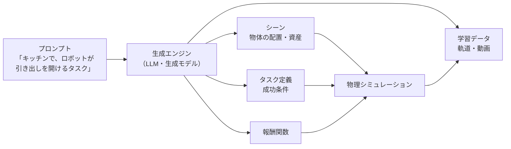

# はじめに

[第7章](./07_IsaacSim_IsaacLab.md)では、NVIDIA の Isaac Sim / Isaac Lab を取り上げ、GPU 上で数千の環境を同時に動かす考え方を学びました。ただし Isaac Sim は RT コア付きの RTX GPU を必要とし、手元の PC で気軽に試すのは難しいツールでした。

本章では、もう1つの GPU ネイティブなシミュレータ **Genesis**（現在の名称は **Genesis World**）を扱います。Genesis は `pip install` で手軽に導入でき、**CPU でも、NVIDIA・AMD・Apple Silicon の GPU でも動く** のが大きな特徴です。

本章のゴールは次の4つです。

- Genesis の成り立ちと構成（物理エンジン・レンダラー・コンパイラ）を理解する
- 「**生成的シミュレーション**」という考え方と、その現状を知る
- Genesis の基本的な使い方（初期化 → シーン → エンティティ → build → step）を身につける
- **実在のロボット（Franka Emika Panda）で箱を掴む** タスクを、**16 環境を並列に** 動かして実行し、第6章の把持の物理が成り立つか確かめる

:::note info
**前提**
- `pip install genesis-world` と、PyTorch（[公式の手順](https://pytorch.org/get-started/locally/)に従ってインストール）が必要です
- Python は **3.10〜3.13** が必要です（Genesis World 1.4 系は Python 3.14 に対応していません）。最新の Python が入っている場合は、`uv venv --python 3.12` などで、この章専用の環境を作ってください
- 本章のコードは CPU でも動きます。GPU がある場合は `gs.cpu` を `gs.gpu` に変えるだけで GPU で動きます
- 執筆時点の Genesis World のバージョンは 1.4 系です[^pypi][^pepy]
:::

---

# 1. Genesis とは

## 1.1 成り立ち

Genesis は、2024年12月に発表されたオープンソースの物理シミュレーションプラットフォームです。カーネギーメロン大学の研究者が中心となり、20を超える大学・研究機関が約2年をかけて共同開発しました[^aiwiki][^robotsatlas]。

現在は **Genesis World** に名称が変わり、開発は **Genesis AI** という企業の支援のもとで進められています[^gh]。Genesis AI は、自社の汎用ロボット「Eno」と、それを動かす基盤モデル「GENE」も開発しています[^genesisai]。ライセンスは Apache 2.0 です[^gh]。

## 1.2 4つの層

Genesis World は、次の4つの層で構成されています[^gh][^intro]。

| 層 | 内容 |
|---|---|
| **シミュレーションのインターフェース** | ユーザーが使う API。URDF・MJCF・OBJ・GLB・USD などの読み込み、センサー、コントローラー、並列環境、ビューア |
| **物理** | 剛体に加えて、**FEM**（有限要素法、柔らかい物体）、**MPM**（物質点法、砂や雪）、**SPH / PBD**（液体・布）などのソルバーを、**1つのシーン・1つの状態** で統合 |
| **レンダリング** | 自社開発のロボット向けレンダラー **Nyx**、レイトレーサー **Luisa**、ラスタライザ **Pyrender** の3種類 |
| **コンパイラ** | **Quadrants**。Python で書かれたカーネルを、CUDA・AMD ROCm・Apple Metal・Vulkan・x86・ARM64 向けにコンパイルする。自動微分も担う |

MuJoCo や Isaac Sim の物理エンジンは C++ で書かれていますが、Genesis は **エンジン自体が Python で書かれ**、それを Quadrants が各種ハードウェア向けにコンパイルします。そのため、ソルバーの中身を読んだり、手を入れたりしやすいのが特徴です[^intro]。

## 1.3 他のシミュレータとの比較

第6・7章のシミュレータと比べると、次のようになります。

| | MuJoCo | Isaac Sim / Isaac Lab | Genesis World |
|---|---|---|---|
| 開発 | Google DeepMind | NVIDIA | Genesis AI（元は大学の共同プロジェクト） |
| 導入 | `pip install mujoco` | Isaac Sim 6.x + uv など。RTX GPU が必要 | `pip install genesis-world` + PyTorch |
| 動く環境 | CPU（GPU 版は MJX / MuJoCo Warp） | NVIDIA の RTX GPU（Newton なら Isaac Sim 不要） | CPU、NVIDIA / AMD / Apple の GPU |
| 物理 | 剛体中心（柔軟物も一部対応） | PhysX / Newton | 剛体 + FEM・MPM・SPH・PBD を統合 |
| 得意なこと | 高精度な接触、研究で広く使われている | 写実的なレンダリング、ROS 2 連携、大規模学習 | 多様な物理現象、手軽さ、ハードウェアを選ばない |

Genesis は、ロボットのモデルを **MJCF や URDF でそのまま読み込めます**。本章の実践でも、MuJoCo Menagerie と同じ Franka Emika Panda の MJCF を使います。

## 1.4 速度の主張と、その受け止め方

Genesis は発表当初から、その速さを大きく打ち出してきました。公式ドキュメントでは、Isaac Gym / Sim / Lab や MuJoCo MJX などの既存の GPU シミュレータと比べて、**最大 10〜80 倍のスループット** を、精度を犠牲にせずに実現していると説明しています[^intro]。発表時には、RTX 4090 1枚で、Franka を使った操作のシーンを毎秒 4,300 万フレーム（実時間の約 43 万倍）でシミュレーションできるとも発表されました[^aiwiki]。

一方で、これらの数値は **Genesis 自身が、剛体ソルバーに有利な条件で測ったもの** だと指摘されており、第三者による再現の結果にもばらつきがあります[^aiwiki][^review]。発表後の検証をきっかけに、プロジェクト側もベンチマークの条件をより厳密に示すようになりました[^aiwiki]。

ベンチマークの数値は、**シーンの複雑さ、接触の数、環境の数、ハードウェア** によって大きく変わります。シミュレータを選ぶときは、**自分のタスクに近い条件で、自分で測る** のが確実です。本章の実践でも、実際に測ってみます。

---

# 2. 生成的シミュレーション

## 2.1 考え方

Genesis が当初から掲げているもう1つの柱が、**生成的シミュレーション（Generative Simulation）** です。これは、**自然言語の指示から、シミュレーションのシーン・タスク・報酬・ロボットの動きなどを自動で生成する** という構想です[^docs-ja]。



ロボット学習の大きなボトルネックは、**環境やタスクを人間が1つずつ作る手間** と、**データを集めるコスト** です。これを言語モデルや生成モデルで自動化できれば、学習に使える環境とデータの量を桁違いに増やせます。第2章の Code as Policies が「LLM にロボットの動きのコードを書かせる」ものだったのに対し、生成的シミュレーションは「LLM に **訓練する環境そのもの** を作らせる」ものだと言えます。

## 2.2 現状

ただし、2024年12月の発表時に公開されたのは物理エンジンとシミュレーションの基盤で、生成エンジンは段階的に公開する予定とされていました[^aiwiki][^docs-ja]。本章では、公開されている物理エンジンとシミュレーションの基盤を使います。

この「言語や生成モデルで、学習用の環境やデータを作る」という流れは、Genesis に限らず、フィジカルAI全体の重要なテーマです。第13章の World Model と第14章の合成データで、NVIDIA Cosmos などの例とあわせて詳しく扱います。

---

# 3. Genesis の基本的な使い方

## 3.1 5つのステップ

Genesis のプログラムは、次の5つのステップで構成されます[^hello]。

```python
import genesis as gs

gs.init(backend=gs.cpu)                         # 1. 初期化（バックエンドを選ぶ）
scene = gs.Scene()                              # 2. シーンを作る
plane = scene.add_entity(gs.morphs.Plane())     # 3. エンティティを追加する
franka = scene.add_entity(gs.morphs.MJCF(file="xml/franka_emika_panda/panda.xml"))
scene.build()                                   # 4. build（ここでカーネルがコンパイルされる）
for i in range(1000):
    scene.step()                                # 5. 時間を進める
```

| ステップ | ポイント |
|---|---|
| `gs.init` | `gs.cpu` はどこでも動く。GPU で並列に動かす場合は `gs.cuda`、`gs.amdgpu`、`gs.metal`、または自動で選ぶ `gs.gpu` を使う[^hello] |
| `gs.Scene` | シミュレーションの設定（時間刻み `dt`、重力など）とビューアの設定を持つ。既定では画面を開かない |
| `add_entity` | **morph**（形状と初期姿勢の記述）を渡して、物体やロボットを追加する。戻り値のエンティティを通じて操作する |
| `scene.build` | シーンの構成をもとに、物理計算のカーネルをコンパイルする。`n_envs` を指定すると並列環境になる |
| `scene.step` | 時間を1ステップ進める |

MuJoCo では `MjModel` と `MjData` を ID で操作しましたが、Genesis は **オブジェクト指向** で、`franka.get_dofs_position()` のようにエンティティのメソッドを直接呼びます。戻り値は **PyTorch のテンソル** です。

## 3.2 姿勢の約束事

morph の姿勢は、`euler`（度、SciPy の外因性 x-y-z の順）か `quat`（**w-x-y-z の順**）で指定します[^docs-ja-hello]。クォータニオンの順番は MuJoCo と同じです。第3章の「座標系の約束事を確認する」習慣が、ここでも役に立ちます。

## 3.3 並列環境

`scene.build(n_envs=16)` のように環境の数を指定すると、同じシーンが 16 個複製されます。以降の API は、**先頭に環境の次元が付いたテンソル** を受け取り、返します。

```python
scene.build(n_envs=16)
franka.get_dofs_position()          # 形状 (16, 9)：16 環境 × 9 自由度
cube.set_pos(positions)             # positions の形状は (16, 3)
franka.inverse_kinematics(link=hand, pos=targets)   # targets (16, 3) → 関節角 (16, 9)
```

第7章で NumPy で書いた `(N, …)` の配列による並列化を、Genesis が物理エンジンごと提供してくれる、ということです。逆運動学（第4章）も、全環境分を一括で解けます。

## 3.4 ロボットの制御

関節の制御には、次の API を使います。

| API | 内容 | 対応する章 |
|---|---|---|
| `set_dofs_kp` / `set_dofs_kv` | 関節ごとの PD ゲイン（$K_p$ / $K_d$） | 第5章 |
| `set_dofs_force_range` | 関節ごとの力・トルクの上限 | 第5・6章 |
| `control_dofs_position` | 目標の関節角を与える（内部で PD 制御） | 第5章 |
| `control_dofs_force` | 力・トルクを直接与える | 第5・6章 |
| `inverse_kinematics` | リンクの目標位置・姿勢から関節角を求める | 第4章 |

これまでの章で学んだ道具が、そのまま API として用意されています。

---

# 4. 実践：Genesis で Franka に箱を掴ませる

## 4.1 ファイル構成

```text
ch08_genesis/
├── hello_genesis.py      # 最小のプログラム（Franka と箱を置いて、重力で落とす）
├── grasp_parallel.py     # 16 環境で、箱の位置と把持力を変えて掴む
└── benchmark.py          # 環境数を変えてスループットを測る
```

:::note warn
**筆者の検証環境について**
本章のコードは、**GPU のない Linux サーバー（CPU 1コア）** で実行しています。この環境には OpenGL / EGL がなく、Genesis の `scene.build()` が画面外描画の準備に失敗したため、**検証のときだけ、描画の初期化を無効にするラッパーを通して実行** しました（カメラを使わないので、物理の結果には影響しません）。通常の PC や、OpenGL / EGL が使える環境では、この対応は不要です。
画面表示のない Linux で同じエラーが出た場合は、OpenGL / EGL のライブラリ（`libgl1`、`libegl1` など）を入れてください。
:::

## 4.2 最小のプログラム：`hello_genesis.py`

```python:hello_genesis.py
"""第8章 (1): Genesis の最小プログラム ― 初期化 → シーン → エンティティ → build → step"""
import time

import genesis as gs

gs.init(backend=gs.cpu, logging_level="warning")   # GPU があれば gs.gpu

scene = gs.Scene(
    sim_options=gs.options.SimOptions(dt=0.01),
    show_viewer=False,                              # 画面に表示する場合は True
)
plane = scene.add_entity(gs.morphs.Plane())
box = scene.add_entity(gs.morphs.Box(pos=(0.0, -0.6, 0.3), size=(0.04, 0.04, 0.04)))
franka = scene.add_entity(gs.morphs.MJCF(file="xml/franka_emika_panda/panda.xml"))

t0 = time.perf_counter()
scene.build()                                       # ここでカーネルがコンパイルされる
print(f"build（コンパイル）: {time.perf_counter() - t0:.1f} 秒")

t0 = time.perf_counter()
for i in range(100):
    scene.step()
print(f"100 ステップ: {time.perf_counter() - t0:.2f} 秒")
print("箱の位置（落下後）:", box.get_pos())
print("Franka の自由度:", franka.n_dofs, "/ 関節角（重力で垂れ下がる）:", franka.get_dofs_position()[:7])
```

```bash
python hello_genesis.py
```

```text
build（コンパイル）: 16.0 秒
100 ステップ: 0.97 秒
箱の位置（落下後）: tensor([ 1.9862e-09, -6.0000e-01,  1.9892e-02])
Franka の自由度: 9 / 関節角（重力で垂れ下がる）: tensor([ 0.0821,  1.7698, -0.0164, -0.0811,  0.0035,  0.2278,  0.0646])
```

高さ 0.3 m から落とした一辺 4 cm の箱は、中心の高さ約 0.02 m、つまり **床の上にちょうど乗った位置** で止まっています。Franka は関節に何も指令を与えていないので、重力で腕が垂れ下がっています（第5章で学んだとおり、関節を支えるには重力に逆らうトルクが必要です）。

`build` に 16 秒かかっているのは、**物理計算のカーネルをコンパイルしている** ためです。筆者の環境では、初回の実行には数分かかりましたが、2回目以降はコンパイル結果のキャッシュが使われて短くなりました。シーンの構成（エンティティの種類や環境の数）を変えると、再びコンパイルが走ることがあります。

## 4.3 16 環境で箱を掴む：`grasp_parallel.py`

第6章では、XYZ ステージに付けた2本指グリッパーで箱を掴みました。今度は、**7自由度のアームを持つ Franka Emika Panda** で掴みます。手先の位置から関節角を求めるために、第4章の **逆運動学** が必要になります。

さらに、16 環境を並列に動かし、次の2つを環境ごとに変えます。

- **箱の位置**：4種類（基準位置から ±8 cm の範囲でランダムにずらす）
- **把持力**（指1本あたり）：4種類（0.1 N、0.3 N、0.4 N、2.0 N）

```python:grasp_parallel.py
"""第8章 (2): Franka で箱を掴む ― 16 環境を並列に動かし、箱の位置と把持力を環境ごとに変える

第6章の把持の物理（2μF ≥ m(g+a)）を、実在のロボットモデル（Franka Emika Panda）と
Genesis の並列環境で確かめる。
"""
import time

import numpy as np
import torch

import genesis as gs

N_ENVS = 16
GRIP_FORCES = [0.1, 0.3, 0.4, 2.0]      # 指1本あたりの把持力 [N]（4種類 × 箱の位置 4種類）

gs.init(backend=gs.cpu, logging_level="warning", seed=0)   # GPU があれば gs.gpu
scene = gs.Scene(
    sim_options=gs.options.SimOptions(dt=0.01),
    rigid_options=gs.options.RigidOptions(box_box_detection=True),
    show_viewer=False,
)
scene.add_entity(gs.morphs.Plane())
cube = scene.add_entity(gs.morphs.Box(size=(0.04, 0.04, 0.04), pos=(0.65, 0.0, 0.02)))
franka = scene.add_entity(gs.morphs.MJCF(file="xml/franka_emika_panda/panda.xml"))

t0 = time.perf_counter()
scene.build(n_envs=N_ENVS, env_spacing=(1.0, 1.0))        # 同じシーンを 16 個複製
print(f"build: {time.perf_counter() - t0:.1f} 秒（{N_ENVS} 環境）")

arm = np.arange(7)                          # 腕の関節（7自由度）
fingers = np.arange(7, 9)                   # 指（2自由度）
hand = franka.get_link("hand")

# 第5章の PD ゲイン（Genesis のチュートリアルの値）と、力の上限
franka.set_dofs_kp(np.array([4500, 4500, 3500, 3500, 2000, 2000, 2000, 100, 100]))
franka.set_dofs_kv(np.array([450, 450, 350, 350, 200, 200, 200, 10, 10]))
franka.set_dofs_force_range(np.array([-87, -87, -87, -87, -12, -12, -12, -100, -100]),
                            np.array([87, 87, 87, 87, 12, 12, 12, 100, 100]))

# ---- 環境ごとに、箱の位置と把持力を変える ----
rng = np.random.default_rng(0)
offsets = rng.uniform(-0.08, 0.08, size=(4, 2))            # 箱の位置のずらし方 4種類
cube_xy = np.array([[0.6 + offsets[i % 4, 0], offsets[i % 4, 1]] for i in range(N_ENVS)])
cube.set_pos(torch.tensor(np.c_[cube_xy, np.full(N_ENVS, 0.02)], dtype=torch.float32))
grip = torch.tensor([GRIP_FORCES[i // 4] for i in range(N_ENVS)], dtype=torch.float32)

home = torch.tensor([0, -0.3, 0, -2.2, 0, 2.0, 0.79, 0.04, 0.04], dtype=torch.float32).repeat(N_ENVS, 1)
franka.set_qpos(home)
franka.control_dofs_position(home)

down = torch.tensor([0.0, 1.0, 0.0, 0.0]).repeat(N_ENVS, 1)   # 手先を真下に向ける姿勢（wxyz）


def ik(z):
    """全環境の手先目標 (N, 3) に対して、一括で IK を解く（第4章）"""
    pos = torch.tensor(np.c_[cube_xy, np.full(N_ENVS, z)], dtype=torch.float32)
    return franka.inverse_kinematics(link=hand, pos=pos, quat=down)


def move(q_goal, seconds, finger=None):
    """第5章の5次多項式で、関節空間をなめらかに補間しながら移動する"""
    q_start = franka.get_dofs_position()[:, arm].clone()
    n = int(seconds / 0.01)
    for k in range(n):
        s = min(1.0, (k + 1) / (0.8 * n))
        s = 10 * s**3 - 15 * s**4 + 6 * s**5
        franka.control_dofs_position(q_start + s * (q_goal[:, arm] - q_start), arm)
        if finger is not None:
            finger()
        scene.step()


t0 = time.perf_counter()
move(ik(0.25), 1.5)                                                      # 1. 箱の上へ
franka.control_dofs_position(torch.full((N_ENVS, 2), 0.04), fingers)
move(ik(0.135), 1.0)                                                     # 2. 下ろす
close = lambda: franka.control_dofs_force(-grip[:, None].repeat(1, 2), fingers)
move(ik(0.135), 0.5, close)                                              # 3. 力で指を閉じる
move(ik(0.30), 1.5, close)                                               # 4. 持ち上げる
sec = time.perf_counter() - t0

z = cube.get_pos()[:, 2].numpy()
print(f"シミュレーション 4.5 秒 × {N_ENVS} 環境 = {4.5 * N_ENVS:.0f} 秒分を、実時間 {sec:.1f} 秒で計算\n")
mu = min(cube.geoms[0].get_friction(), franka.get_link("left_finger").geoms[0].get_friction())
m, g = 0.04**3 * 1000, 9.81                                     # 箱の質量（既定の密度 1000 kg/m³）
a = 10 / np.sqrt(3) * (0.30 - 0.135) / (0.8 * 1.5) ** 2        # 持ち上げ時の最大加速度（5次多項式）
need = m * (g + a)
print(f"箱の質量 {m * 1000:.0f} g、摩擦係数 μ={mu:.2f}、持ち上げの最大加速度 {a:.2f} m/s²"
      f" → 必要な摩擦力 m(g+a) = {need:.3f} N\n")
z_ref = z[-4:].mean()                                          # 最も強く握った場合の箱の高さ
print(f"{'把持力F(1本)':>12s} {'2μF':>8s} {'理論':>6s} {'箱の高さ（4環境）':>26s} {'平均の滑り':>8s} {'成功':>5s}")
for j, F in enumerate(GRIP_FORCES):
    zs = z[4 * j: 4 * j + 4]
    theory = "持てる" if 2 * mu * F >= need else "滑る"
    slip = (z_ref - zs[zs > 0.05]).mean() * 100 if (zs > 0.05).any() else float("nan")
    slip_s = f"{slip:5.1f} cm" if not np.isnan(slip) else "  落下"
    print(f"{F:10.2f} N {2 * mu * F:6.2f} N {theory:>6s}   {np.array2string(zs, precision=3):>24s}"
          f" {slip_s:>8s} {int((zs > 0.15).sum())}/4")
```

動作の流れは、第6章とほぼ同じです。

1. **箱の上へ**：箱の真上 25 cm に手先を向ける関節角を、IK で全環境分まとめて求め、5次多項式でなめらかに移動する
2. **下ろす**：手先の高さを 13.5 cm まで下げる（指が箱の側面に来る）
3. **指を閉じる**：`control_dofs_force` で、環境ごとに決めた把持力を指にかける
4. **持ち上げる**：把持力をかけたまま、手先を 30 cm まで上げる

手先の姿勢 `quat=[0, 1, 0, 0]` は、$(w, x, y, z)$ の順で「x 軸まわりに 180° 回転」、つまり **手先を真下に向ける** 姿勢です（第3章の 5.2 節の式で、$\theta = 180°$、軸 $= (1, 0, 0)$ とすると $(\cos 90°, \sin 90°, 0, 0) = (0, 1, 0, 0)$）。

```bash
python grasp_parallel.py
```

```text
build: 19.5 秒（16 環境）
シミュレーション 4.5 秒 × 16 環境 = 72 秒分を、実時間 3.9 秒で計算

箱の質量 64 g、摩擦係数 μ=1.00、持ち上げの最大加速度 0.66 m/s² → 必要な摩擦力 m(g+a) = 0.670 N

    把持力F(1本)      2μF     理論                  箱の高さ（4環境）    平均の滑り    成功
      0.10 N   0.20 N     滑る      [0.02 0.02 0.02 0.02]       落下 0/4
      0.30 N   0.60 N     滑る   [0.161 0.02  0.155 0.159]   2.7 cm 3/4
      0.40 N   0.80 N    持てる   [0.181 0.181 0.181 0.181]   0.4 cm 4/4
      2.00 N   4.00 N    持てる   [0.185 0.184 0.186 0.185]  -0.0 cm 4/4
```

### ① 16 環境を一度に計算

4.5 秒間のタスクを 16 環境分、合計 72 秒分の動きを、CPU 1コアで約 4 秒で計算できました。IK も、関節の制御も、すべて `(16, …)` のテンソルで一括に処理しています。把持力 2.0 N の4環境では、**箱の位置がそれぞれ異なるにもかかわらず、すべて箱を持ち上げられました**。このことから、一括で解いた IK が各環境で正しく機能していることがわかります。

### ② 把持の物理は、ここでもおおむね成り立つ

第6章と同じ $2\mu F \ge m(g + a)$ の条件で考えます。箱の質量は 64 g（Genesis の既定の密度 1000 kg/m³ × 一辺 4 cm）、摩擦係数は既定値の 1.0、持ち上げの最大加速度は約 0.66 m/s² なので、必要な摩擦力は約 0.67 N です。

| 把持力（1本） | 2μF | 理論 | 結果 |
|---|---|---|---|
| 0.1 N | 0.2 N | 滑る | **4環境とも落下** |
| 0.3 N | 0.6 N | 滑る（境界の近く） | **1環境は落下、3環境は 2.7 cm ずり落ちながら保持** |
| 0.4 N | 0.8 N | 持てる | 4環境とも成功（ずり落ち 0.4 cm） |
| 2.0 N | 4.0 N | 持てる | 4環境とも成功 |

把持力が十分小さいときと十分大きいときは、理論どおりの結果になりました。

### ③ 境界の近くでは、シミュレータの接触モデルの違いが現れる

注目したいのは **0.3 N** のケースです。理論上は $2\mu F = 0.6$ N が箱の重さ $mg = 0.63$ N にすら届かないので、すべて滑り落ちるはずです。しかし実際には、4環境中3環境で、箱は **2.7 cm ほどずり落ちながらも、指の間に残りました**。なお、この境界付近の結果は、実行環境やバージョンによって変わります。別の環境での再検証では、4環境中2環境が指の間に残り、2環境が落下しました。0.1 N、0.4 N、2.0 N の結果は、再検証でも変わりませんでした。

第6章の MuJoCo の実験では、7つの条件すべてで理論と結果が一致していました。理論との差が出た理由として、次のようなことが考えられます。

- 指と箱の間には **複数の接触点** があり、それぞれの法線力の分布や、ねじり方向の摩擦の扱いが、単純な $2\mu F$ のモデルとは異なる
- 接触の **柔らかさ（めり込みの許容）** や、摩擦円錐の近似の方法が、シミュレータごとに違う
- 箱がずり落ちて指の中での位置が変わると、接触の状態そのものが変わる

ここで大事なのは、**「どちらのシミュレータが正しいか」ではない** という点です。理論の式は単純化したモデルであり、シミュレータの接触モデルも、それぞれの近似にもとづいています。そして実世界の接触は、どちらとも違います。**成否の境界の近くでは、シミュレータの選び方によって結果が変わりうる** ということを知っておくのが重要です。

把持力 0.4 N でも 0.4 cm のずり落ちがあるように、実用では **境界からある程度の余裕（安全率）を持たせて把持力を決める** のが基本です。この「シミュレーションと実世界のずれ」をどう扱うかは、第18章の Sim2Real の中心的なテーマです。

## 4.4 スループットを測る：`benchmark.py`

最後に、環境の数を変えて、1秒あたりに何環境ステップを計算できるかを測ります。GPU がある環境では自動的に GPU を使います。

```python:benchmark.py
"""第8章 (3): 環境数を変えて、Genesis のスループット（環境ステップ/秒）を測る

  python benchmark.py 64          # 64 環境
"""
import sys
import time

import torch

import genesis as gs

n_envs = int(sys.argv[1]) if len(sys.argv) > 1 else 16
backend = gs.gpu if torch.cuda.is_available() else gs.cpu
gs.init(backend=backend, logging_level="warning", seed=0)

scene = gs.Scene(sim_options=gs.options.SimOptions(dt=0.01), show_viewer=False)
scene.add_entity(gs.morphs.Plane())
franka = scene.add_entity(gs.morphs.MJCF(file="xml/franka_emika_panda/panda.xml"))
scene.build(n_envs=n_envs)

home = torch.tensor([0, -0.3, 0, -2.2, 0, 2.0, 0.79, 0.04, 0.04])
franka.set_dofs_kp(torch.tensor([4500, 4500, 3500, 3500, 2000, 2000, 2000, 100, 100]))
franka.set_dofs_kv(torch.tensor([450, 450, 350, 350, 200, 200, 200, 10, 10]))
franka.set_qpos(home.repeat(n_envs, 1))


def run(steps):
    for k in range(steps):
        # 全環境に、少しずつ異なる関節目標を与える（N, 9）
        target = home + 0.3 * torch.sin(torch.arange(n_envs)[:, None] * 0.1 + k * 0.05)
        franka.control_dofs_position(target)
        scene.step()


run(20)                                    # ウォームアップ（初回のカーネル実行を除く）
t0 = time.perf_counter()
STEPS = 200
run(STEPS)
sec = time.perf_counter() - t0
print(f"backend={backend.name if hasattr(backend, 'name') else backend}  n_envs={n_envs:5d}  "
      f"{STEPS * n_envs / sec:10,.0f} env-step/s  （実時間の {STEPS * n_envs * 0.01 / sec:,.1f} 倍）")
```

```bash
for n in 1 16 64 256; do python benchmark.py $n; done
```

筆者の環境（CPU 1コア）での結果です。

```text
backend=cpu  n_envs=    1         701 env-step/s  （実時間の 7.0 倍）
backend=cpu  n_envs=   16       4,526 env-step/s  （実時間の 45.3 倍）
backend=cpu  n_envs=   64       2,273 env-step/s  （実時間の 22.7 倍）
backend=cpu  n_envs=  256       2,009 env-step/s  （実時間の 20.1 倍）
```

| 環境数 | スループット | 1環境のときとの比 |
|---|---|---|
| 1 | 約 700 env-step/s | 基準 |
| 16 | 約 4,500 env-step/s | 約 6.5 倍 |
| 64 | 約 2,300 env-step/s | 約 3.2 倍 |
| 256 | 約 2,000 env-step/s | 約 2.9 倍 |

**16 環境でスループットが最大になり、それ以上に増やすと逆に下がりました**（同じ条件で再実行しても、16 環境で約 3,900、64 環境で約 2,100 と、同じ傾向でした）。

第7章の NumPy の実験では、環境を増やすほどスループットが伸びました。違いが出た理由は、シミュレーションの中身にあります。第7章のアームは、接触のない2関節の平面アームで、1環境あたりの計算はごくわずかでした。一方、本章の Franka は、9自由度に加えて、メッシュによる衝突判定・自己衝突・床との接触があり、1環境あたりの計算量とメモリがはるかに大きくなります。CPU 1コアでは、環境が増えるとキャッシュに収まりきらなくなり、効率が落ちたと考えられます。

**Genesis の真価は GPU で発揮されます**。GPU では数千のコアで環境を並列に処理できるため、環境の数を数千〜数万まで増やしても、スループットが伸びやすくなります。1.4 節で触れたように、ベンチマークの数値はハードウェアとシーンによって大きく変わります。GPU のある PC やクラウドで同じ `benchmark.py` を実行して、環境数とスループットの関係を自分で確かめてみてください（演習1）。

## 4.5 演習

1. GPU のある環境で `benchmark.py` を実行し、環境数を 1、64、1024、4096 と増やしたときのスループットを測ってみましょう。CPU の結果と比べて、どこまで伸びるでしょうか。
2. `grasp_parallel.py` で、持ち上げの時間を 1.5 秒から 0.5 秒に短くすると、成否の境界はどう動くでしょうか。第6章の結果と比べてみましょう。
3. `grasp_parallel.py` の箱を `gs.morphs.Box(..., )` から `gs.morphs.Sphere(radius=0.02)` に変えて、球を掴んでみましょう。接触点の数が変わると、必要な把持力はどう変わるでしょうか。
4. 第6章の `grasp.py` と同じ条件（ステップ指令で一気に持ち上げる）を Genesis で再現し、箱が飛んでいくかどうか確かめてみましょう。
5. （発展）Genesis の FEM や MPM のソルバーを使って、柔らかい物体や砂を Franka で扱うシーンを作ってみましょう。公式リポジトリの `examples` に多数のサンプルがあります[^gh]。

---

# 5. まとめ

- **Genesis World** は、2024年12月に 20 以上の研究機関の共同プロジェクトとして発表され、現在は Genesis AI の支援のもとで開発されているオープンソースのシミュレータ。**Python で書かれた物理エンジン** を、**Quadrants** コンパイラが CUDA・ROCm・Metal・CPU などに向けてコンパイルする
- 剛体に加えて、**FEM・MPM・SPH・PBD** などのソルバーを1つのシーンに統合しているのが大きな特徴。ロボットは MJCF や URDF でそのまま読み込める
- 公式は既存の GPU シミュレータより最大 10〜80 倍速いと主張しているが、数値はシーンとハードウェアに大きく依存するため、**自分のタスクで測る** ことが大切
- **生成的シミュレーション** は、言語や生成モデルで環境・タスク・データを自動生成する構想。第13・14章の World Model・合成データにつながる
- 実践では、**16 環境を並列に** 動かして Franka で箱を掴み、IK を一括で解きながら、把持力と成否の関係を確かめた。十分小さい・大きい把持力では理論どおりだったが、**境界の近くでは理論やシミュレータ間で結果が異なる** ことがわかった
- CPU 1コアでは、接触を含む Franka のシーンでは、16 環境前後で並列化の効果が頭打ちになった。大規模な並列化には GPU が必要

これで Part 3「シミュレーション」は終わりです。MuJoCo（第6章）、Isaac Sim / Isaac Lab（第7章）、Genesis（第8章）と、性格の異なる3つのシミュレータを見てきました。

## 次回予告

**第9章「強化学習（RL）」** から Part 4「ロボット学習」に入ります。いよいよ、第0章から人間が数式で書いてきた `think()` を、**学習によって獲得** します。マルコフ決定過程（MDP）、PPO と SAC、そして最も難しい **報酬設計** を学び、第7章の並列環境を使って、Reach タスクを強化学習で解きます。

---

# 参考文献

[^pypi]: PyPI, "genesis-world". https://pypi.org/project/genesis-world/
[^pepy]: pepy.tech, "genesis-world"（バージョンの履歴）. https://www.pepy.tech/projects/genesis-world
[^aiwiki]: AI Wiki, "Genesis (simulator)", 2026-09-25 更新. https://aiwiki.ai/wiki/genesis_simulator
[^robotsatlas]: Robots Atlas, "Genesis — universal Embodied AI simulation platform". https://robotsatlas.com/robotics-software/genesis-physics-simulator
[^gh]: Genesis-Embodied-AI, "genesis-world", GitHub. https://github.com/Genesis-Embodied-AI/genesis-world
[^genesisai]: Genesis AI. https://www.genesis.ai/
[^intro]: Genesis World Documentation, "Introduction". https://genesis-world.readthedocs.io/en/latest/user_guide/overview/what_is_genesis.html
[^review]: F. Okafor, "Genesis World Review: Pricing, Pros and Cons". https://www.francisokafor.com/tools/genesis-world
[^docs-ja]: Genesis 日本語ドキュメント（有志による翻訳、0.2.0 時点）. https://genesis-world.readthedocs.io/ja/latest/
[^hello]: Genesis World Documentation, "Hello, Genesis World". https://genesis-world.readthedocs.io/en/latest/user_guide/getting_started/hello_genesis.html
[^docs-ja-hello]: Genesis 日本語ドキュメント, 「Genesisの使い方」. https://genesis-world.readthedocs.io/ja/latest/user_guide/getting_started/hello_genesis.html
